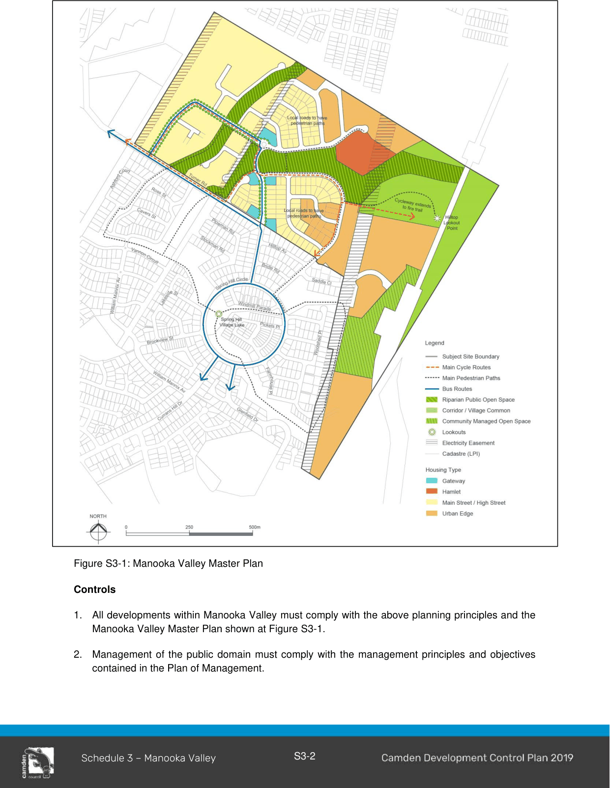

### S3.1 Introduction

Manooka Valley is located between Spring Hill Village urban area at Currans Hill, Gregory Hills and the adjoining RU2 Rural Landscape zoned land to the north (see Figure S3-1 and 3-2).

#### S3.1.1 Manooka Valley Planning Principles

1\. Manooka Valley will provide a physical and visual transition between rural/scenic protection areas and Currans Hill. The residential zone will be characterised by a range of lot sizes. Lot size and building character within residential precincts will reflect their relationship to adjacent amenities and the provision of housing diversity. Other lots will provide a low key and visually sensitive transition to surrounding rural and scenic protection land.

2\. The visual impact of development on Manooka Valley’s landscape setting will be minimised. A high level of scenic quality will be achieved by protecting significant watercourses, significant trees, ridgetops and steep slopes from any adverse effects of development. The design of roads, landscaping, open spaces, water cycle management systems, houses and other elements of the urban landscape, will positively respond to these aims. The public open space design and water cycle management system will be environmentally sensitive, will contribute to the maintenance of downstream water quality and will recognise the importance of revegetated riparian corridors in the locality.

3\. A variety of publicly accessible open space areas, suitable for a range of passive recreation opportunities will be available to residents. Pedestrians and cyclists will have convenient access throughout the precinct and connections to surrounding precincts.

4\. A significant area of endangered Cumberland Plain Woodland has been set aside for restoration and revegetation. A Village Common will be created within an attractive and functional creek line. An integrated stormwater management system will help make Manooka Valley an attractive, environmentally sustainable neighbourhood.

5\. The detailed design of the public domain in Manooka Valley, and its seamless integration with the private domain of each dwelling, is critical to achieving this vision.  For this reason, control of the neighbourhood’s streets and open spaces is rigorous.  It has been planned and designed to respond to the natural features of the site, and to integrate innovative integrated water cycle management techniques.  The combination of a thoughtful public domain design and its integration with the private domain of each dwelling will make Manooka Valley a great place to live.

#### Related Studies

Plan of Management prepared by Conacher Travers, (Ref: 3167, April 2003)

> [Picture on page 4: a picture, saved as a picture (images/schedule-03-manooka-valley-page-4-1.gif, 150 dpi).]

Figure S3-1: Manooka Valley Master Plan

#### Controls

1\. All developments within Manooka Valley must comply with the above planning principles and the Manooka Valley Master Plan shown at Figure S3-1.

2\. Management of the public domain must comply with the management principles and objectives contained in the Plan of Management.

