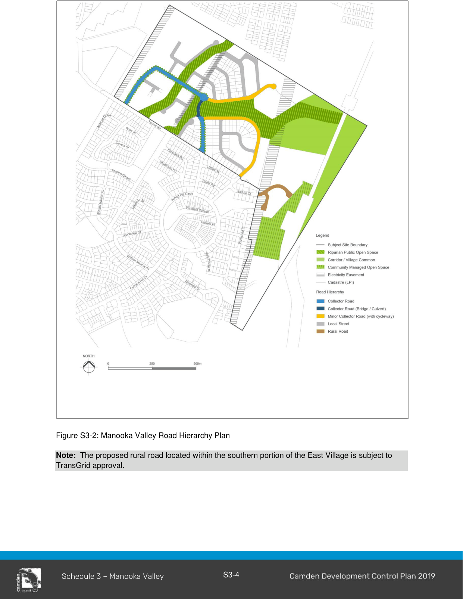
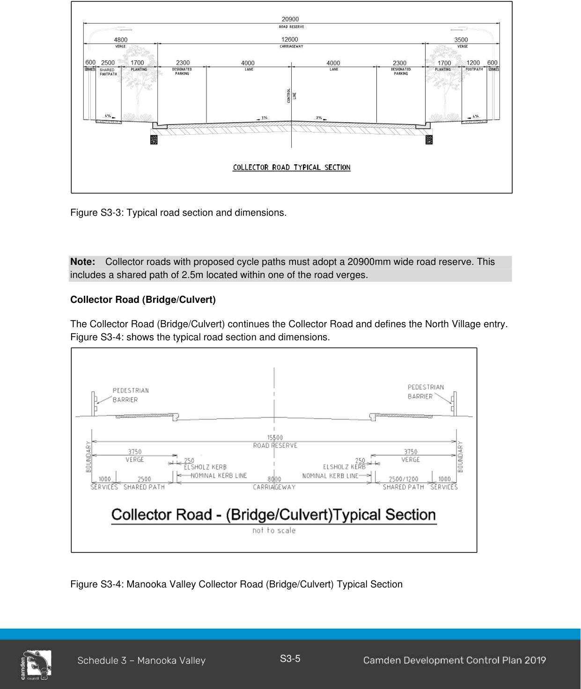
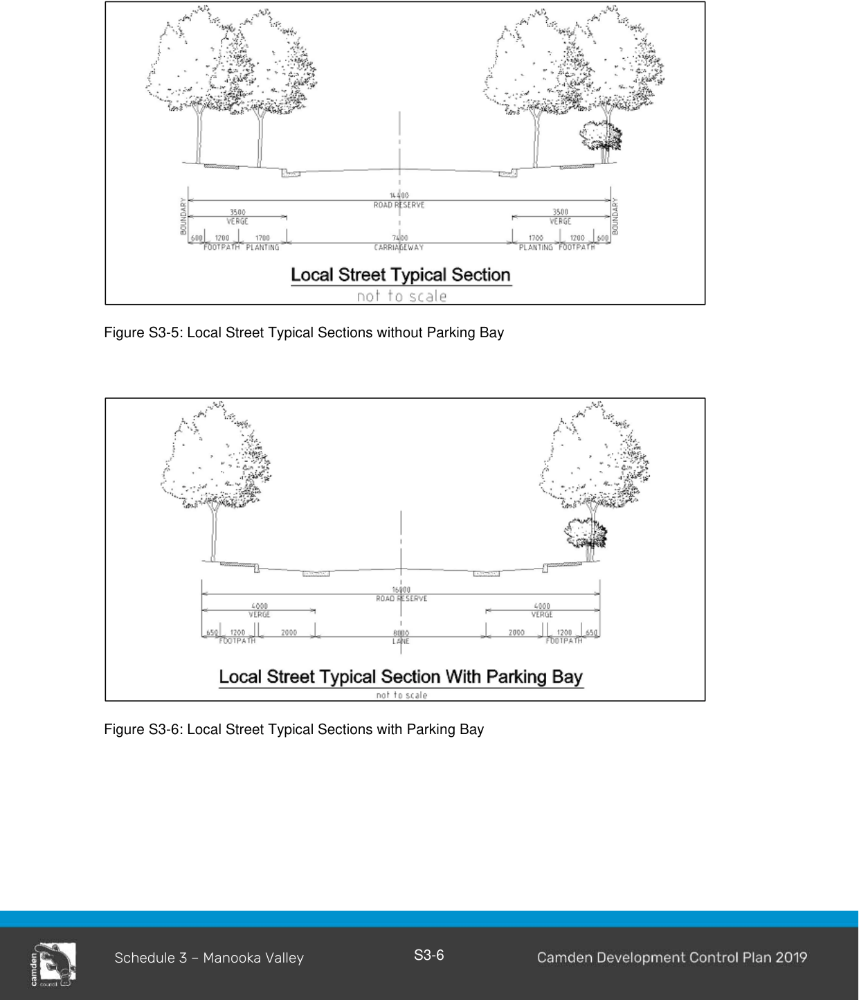
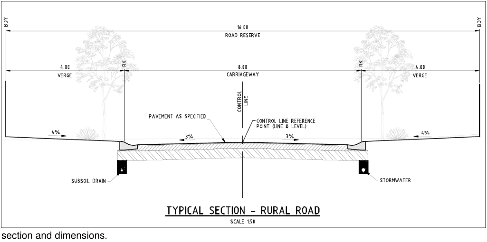

### S3.2 Subdivision Planning and Design

#### S3.2.1 Street Network and Design

#### Controls

1\. The street network and design in Manooka Valley must be undertaken in accordance with Figure S3-2 Manooka Valley Road Hierarchy Plan and the street cross-sections contained in this section at Figures S3-3 to S3-7. There are five types of streets throughout Manooka Valley. Table S3-1 indicates the minimum width of the road reserve of each road type.

#### Table S3-1: Road Type and Width

| Road Type | Minimum Road Reserve Width |
|---|---|
| Collector Road | 19.6m |
| Collector Road (Bridge/Culvert) | 15.5m |
| Minor Collector Road | 16.0m |
| Local Street | 14.0m |
| Rural Road | 16.0m |

> [Picture on page 6: a picture, saved as a picture (images/schedule-03-manooka-valley-page-6-1.gif, 150 dpi).]

Figure S3-2: Manooka Valley Road Hierarchy Plan

Note:  The proposed rural road located within the southern portion of the East Village is subject to TransGrid approval.

#### Collector Road

The Collector Road is the main road of the Village and the entry to Manooka Valley from Turner Road.  The road will be lined with an avenue of trees with a broad canopy that overhangs the road.

> [Picture on page 7: a picture, saved as a picture (images/schedule-03-manooka-valley-page-7-4.gif, 150 dpi).]

Figure S3-3: Typical road section and dimensions.

Note: Collector roads with proposed cycle paths must adopt a 20900mm wide road reserve. This includes a shared path of 2.5m located within one of the road verges.

#### Collector Road (Bridge/Culvert)

The Collector Road (Bridge/Culvert) continues the Collector Road and defines the North Village entry. Figure S3-4: shows the typical road section and dimensions.

Figure S3-4: Manooka Valley Collector Road (Bridge/Culvert) Typical Section

#### Local Street (with or without parking bays)

The local street provides safe access to residents and pedestrians.  On street parking must be provided along the carriageway.  Figures S3-5 and S3-6 shows the typical road section and dimensions.

> [Picture on page 8: a picture, saved as a picture (images/schedule-03-manooka-valley-page-8-5.gif, 150 dpi).]

Figure S3-5: Local Street Typical Sections without Parking Bay

Figure S3-6: Local Street Typical Sections with Parking Bay

#### Rural roads

Rural roads are located within the Eastern Village and provide safe access to residents of the Urban Edge lots. On street parking must be provided along the carriageway. Figure S3-7 shows typical road

> [Picture on page 9: a picture, saved as a picture (images/schedule-03-manooka-valley-page-9-4.gif, 150 dpi).]

section and dimensions.

Figure S3-7: Manooka Valley Rural Road Typical Section

#### S3.2.2 Pedestrian and Cycle Network

#### Controls

1\. The layout of the main pedestrian paths and cycleway routes are shown in Figure S3-1 Manooka Valley Master Plan.

2\. Pedestrian paths are to be provided for pedestrian movement through the open spaces in Manooka Valley and connected into the wider Currans Hill area.

3\. Bridges, boardwalks and other landscape devices are to be used to limit pedestrian access into areas of high vegetation sensitivity, and to provide views of special interest points and the broader landscape.

4\. Dedicated cycle routes should be provided within the road reserve and must be off road.

#### S3.2.3 Public Transport Network

#### Controls

1\. The layout of bus route is shown in Figure S3-1 Manooka Valley Master Plan.

2\. Bus route must be extended into Manooka Valley along the Collector Road, in order to increase the number of dwellings within a reasonable walking distance to public transport.

#### S3.2.4 Parks and Open Space

#### Controls

1\. Requirements for bushland restoration are provided in the Plan of Management prepared by Conacher Travers (2003). All development consents must implement the recommendations of the Conacher Travers Plan of Management.

2\. A path system must be constructed to provide links across and through the area, connect with the bushland regeneration areas, and the Currans Hill open space system. Emergency and service vehicle access will be controlled.

#### S3.2.5 Housing Type

#### Objectives

a. To create a socially and environmentally sustainable environment that balances residential demands with preservation of the sites assets; and

b. To provide a range of housing choice.

#### Controls

1\. Development applications must be supported by a Master Plan showing the different types of housing within the subdivision. These housing types must include:

a. Gateway sites on the main boulevard bus route are to be developed as distinctive ‘icons’ that define the principal entry points into Manooka Valley. Two-storey attached, or two-storey single/multiple dwelling medium density housing is permissible.

b. One and two storey detached Main/High Street housing of a more traditional character is to be located on local streets within the North, South and West Villages.

c. In addition, the perimeter of Manooka Valley will be a carefully planned transition zone between urban and rural developments. Large Urban Edge lots and housing clusters will minimise the impact of low density development on the area’s landscape.

