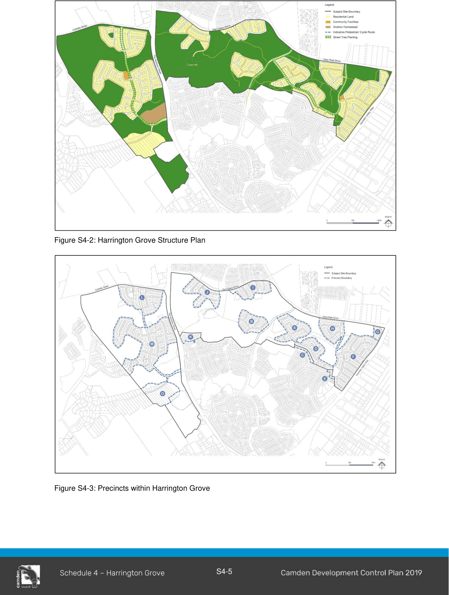

#### S4.1.2 Structure Plan

The Harrington Grove Indicative Structure Plan has been prepared as a strategic plan to demonstrate the vision for the future development of the subject land (Figure S4-2).  The Indicative Structure Plan was prepared in conjunction with the preparation of the Local Environmental Study and reflects the background studies and Government Agency negotiations.

The Indicative Structure Plan establishes a framework for the urban form and defines the critical components to satisfy the road pattern, land uses, conservation, drainage, transport and social

infrastructure requirements.  More detailed planning and design is required through the preparation of Precinct Plans prior to Development Applications being considered by Council.

The Indicative Structure Plan illustrates the road network and the proposed intersection locations along The Northern Road, Cobbitty Road and Camden Valley Way. This includes connections to existing roads within Harrington Park.  The Indicative Structure Plan also illustrates a general road layout for the residential zoned land.

The Indicative Structure Plan also shows the land use activity across the subject land and the land within public ownership. This includes the area to the north and west of the Orielton Homestead, the land incorporating the southern face of Crear Hill (including Crear Hill) and the regional pedestrian and cycle share path traversing the subject land.

#### Precinct Areas

The Indicative Structure Plan has been divided into 15 Precincts.  For the purpose of clarity, precincts have been grouped into the following Precinct Areas (Figure S4-3).

1\. Development Precincts

• R1 General Residential

• C4 Environmental Living

• R5 Large Lot Residential

2\. Environmentally Sensitive Precincts

3\. Heritage Homestead Precincts

4\. Recreation Precincts

> [Picture on page 8: a picture, saved as a picture (images/schedule-04-harrington-grove-page-8-1.gif, 150 dpi).]

Figure S4-2: Harrington Grove Structure Plan

Figure S4-3: Precincts within Harrington Grove

