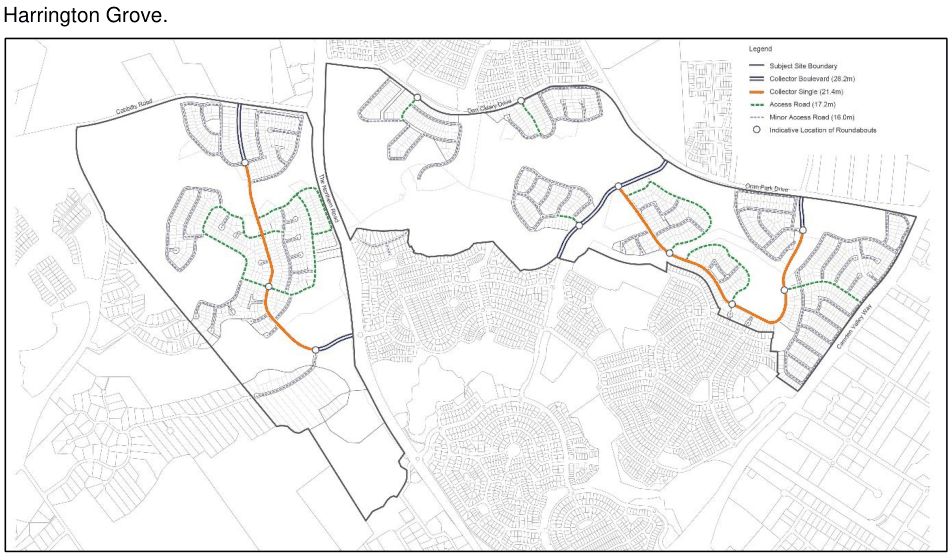
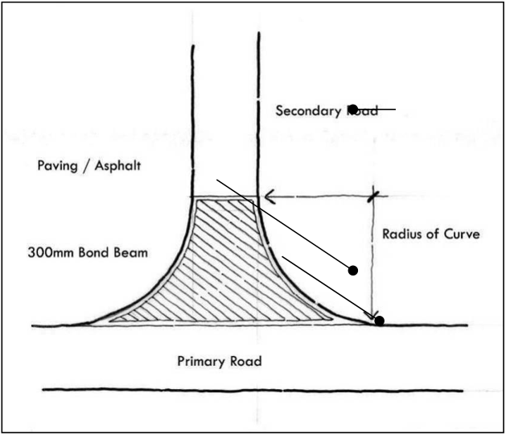

### S4.2 Subdivision Planning and Design

#### S4.2.1 Street Network and Design

#### Background

This subsection establishes the road hierarchy (Figure S4-4) for and minimum street cross-sections for Harrington Grove.

> [Picture on page 9: a picture, saved as a picture (images/schedule-04-harrington-grove-page-9-6.gif, 150 dpi).]

Figure S4-4: Harrington Grove Indicative Road Hierarchy Plan

#### Minor Access Road or Minor Access Place (Cul-de-sac)

These roads provide access to residential lots and are to be designed to take account of the natural contours of the site.

Vehicle and bicycle use is shared within the carriageway. The carriageway width provides for two lanes of traffic and parking.

#### Table S4-1 Minor Access Road or Minor Access Place (Cul-de-sac)

| Road Type | Carriageway | Footway Width | Footpath Width | Road Reserve (Minimum) | Design Considerations |
|---|---|---|---|---|---|
| Minor Access Road or Minor Access Place | 6m | 10m total (i.e. 5.0-5.0m or 6.0-4.0m) | 1.2m (Refer to Figure 4-6 for location of path) | 16m | • No cycle lane. • Site responsive road alignments. • Designed to accommodate traffic flows up to 1,000 vpd. |

#### Road Design

1\. Roads are to be designed in accordance with Council’s Engineering Design Specifications.

2\. Pavement design are to be in accordance with ‘Ausroads Publication – Pavement Design of Road Pavements’ and ‘Ausroads Pavement Research Group Publication, Report No. 21 - A Guide to the Design of New Pavements for Light Traffic’

3\. Roundabouts are to be provided generally in accordance with the Harrington Grove Indicative Structure Plan.  Roundabout are to have a minimal internal radius of 8m, with a minimum pavement width of 3.5m

4\. Intersection treatments are required to clearly identify the road hierarchy and to create more defined intersections.

5\. Precinct Plans are to define the locations of road intersection thresholds. These are to be constructed of coloured asphalt or paved.

6\. The colour of the threshold paving/concrete is to be similar to the road pavement.

7\. Traffic islands and slow points are to be constructed of concrete or paving.  Extended speed humps (i.e. Plateaus) are not to be provided for traffic calming.

8\. Road pavement must be asphalt.  Coloured asphalt, concrete or paving bricks should be used to define cycle lanes, car parking spaces or at intersections.

9\. The road layout is to be generally in accordance with the Harrington Grove Road Hierarchy Plan (Figure S4-4)

10\. The location of street lights, street tree planting, street furniture, traffic control devices and bus bays are to be identified in Part B.

11\. Roads are to be designed to take account of the topography and minimise earthworks.

12\. A turning area at the end of proposed cul-de-sac must be provided generally in accordance with Appendix B “Turning Heads”.

13\. “T” configuration turning heads are to be designed in accordance with Appendix B “Turning Heads”.

14\. For road works within areas identified as a salinity hazard, the following is to occur as a minimum:

a. Roads should be perpendicular to the contours as much as possible.

b. Minimum disturbance of subsoil.

c. Engineering designs incorporating considerations of salinity impacts are required.

d. Subsoil drainage is to be installed along both sides of all roads.

#### Road Geometry

1\. On-street and off-road cycleways are to be provided in accordance with Councils Engineering Design Specifications.

2\. All residential roads (e.g. minor collector roads, access road/places, minor access road/places, and share ways) are to be designed and sign posted at a minimum of 50kph (i.e. traffic management must be considered at the subdivision application, with either road layout or speed reducing devices to produce a traffic environment which reduces traffic speed).

3\. Verge widths are to respect the character of the Development Precinct and provide sufficient space for service infrastructure.

4\. Where roads are adjacent to public reserves or conservation areas the verge widths are to be a minimum of 1.5 metre, subject to public utilities, bollards and fencing being adequately provided within the road reserve, unless prescribed by an approved Conservation Management Plan, Bushfire Management Plan or Landscape Master Plan.

#### Road Principles

a. The road network for is a safe, permeable road system providing an appropriate level of road access and connectivity both within Harrington Grove and externally to the surrounding district, including the neighbourhood shopping centre at Harrington Park (via Harrington Parkway and Fairwater Drive).

b. The interconnected road network facilitates safe and efficient pedestrian movement throughout Harrington Grove, linking residents to all proposed land uses and residences, including the Local Community and Recreation Centre, public parks and Community Woodland.

c. The road system provides a road interface with the surrounding Community Woodland/public reserve and has been designed to be sympathetic with the natural contours of the precinct

#### Controls

1\. Roundabouts are to be provided in the locations shown on the Road Hierarchy Plan (Figure S4-4).

2\. Intersection treatments are to clearly identify the road hierarchy and create defined intersections through the utilisation of thresholds.

3\. Thresholds at intersections (Figure S4-5) are to be provided in the locations identified on the Road Hierarchy Plan (Figure S4-4). These are to be constructed of coloured or stamped concrete or asphalt (individual pavers, cobblestones etc. are not acceptable for trafficable roads)

4\. Kerb profile and materials may be varied depending on road drainage requirements.

5\. Medians, traffic islands and slow points are to be landscaped.

> [Picture on page 12: a picture, saved as a picture (images/schedule-04-harrington-grove-page-12-9.gif, 150 dpi).]

Figure S4-5: Indicative Threshold Treatment
