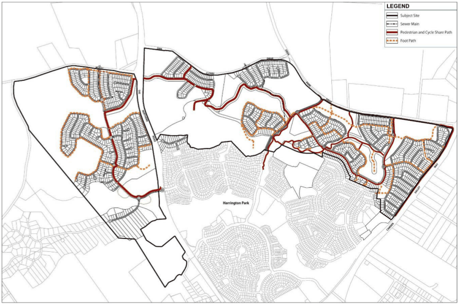

#### S4.2.2 Pedestrian and Cycle Network

#### Controls

1\. Development applications are to provide for the detailed design and location of footpaths and cycleways generally in accordance with the layout provided in Figure S4-6.

2\. The construction material, alignment and use of the pedestrian & cycle share path are to be determined by an approved conservation management plan for the conservation area and landscape master plan for the subject land.

3\. Pedestrian and cycle share path crossings of The Northern Road are only to occur at the Cobbitty Road west intersection for safety reasons.

4\. The pedestrian & cycle share path is to be a minimum width of 2.5m metres.  The width and construction standards should cater for the user types and volumes anticipated as determined by an approved conservation management plan and landscape master plan for the subject land.

5\. Lookouts are to be generally provided in locations in accordance with an approved conservation management plan and/or landscape master plan.

6\. The construction material and associated public facilities at each lookout are to be in accordance with an approved conservation management plan and landscape master plan for the subject land.

7\. The pedestrian & cycle share path must be contained within a 50 metre wide corridor (i.e. 25 metres either side of the path).

8\. The pedestrian and cycle pathway network is to:

a. provide safe and convenient linkages between open space systems, community facilities, schools and shops, and

b. respond to the topography and achieve appropriate grades for safe and comfortable use where possible.

c. Pedestrian and cycle share paths are to be provided in accordance with AustRoads Part 14 and locations are shown in Figure S4-6. These locations are indicative and subject to further detailed survey work and discussions with Council.

> [Picture on page 13: a picture, saved as a picture (images/schedule-04-harrington-grove-page-13-18.gif, 150 dpi).]

Figure S4-6: Harrington Grove Indicative Pedestrian and Cycle Network

