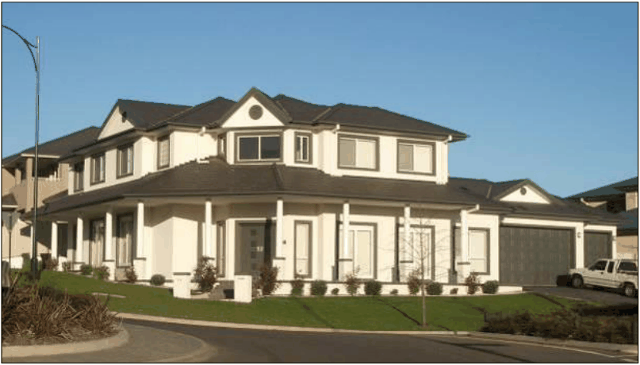
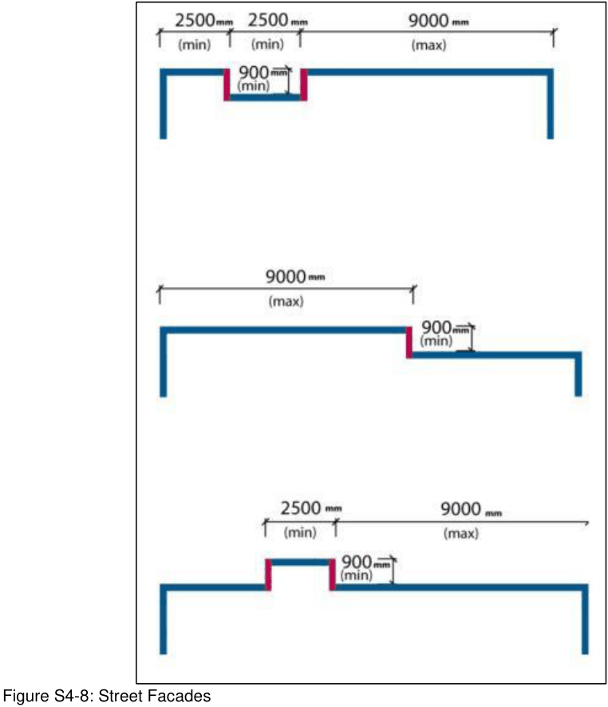
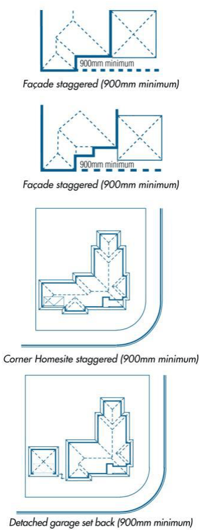
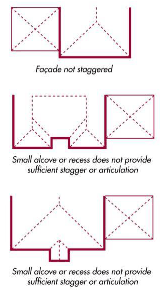
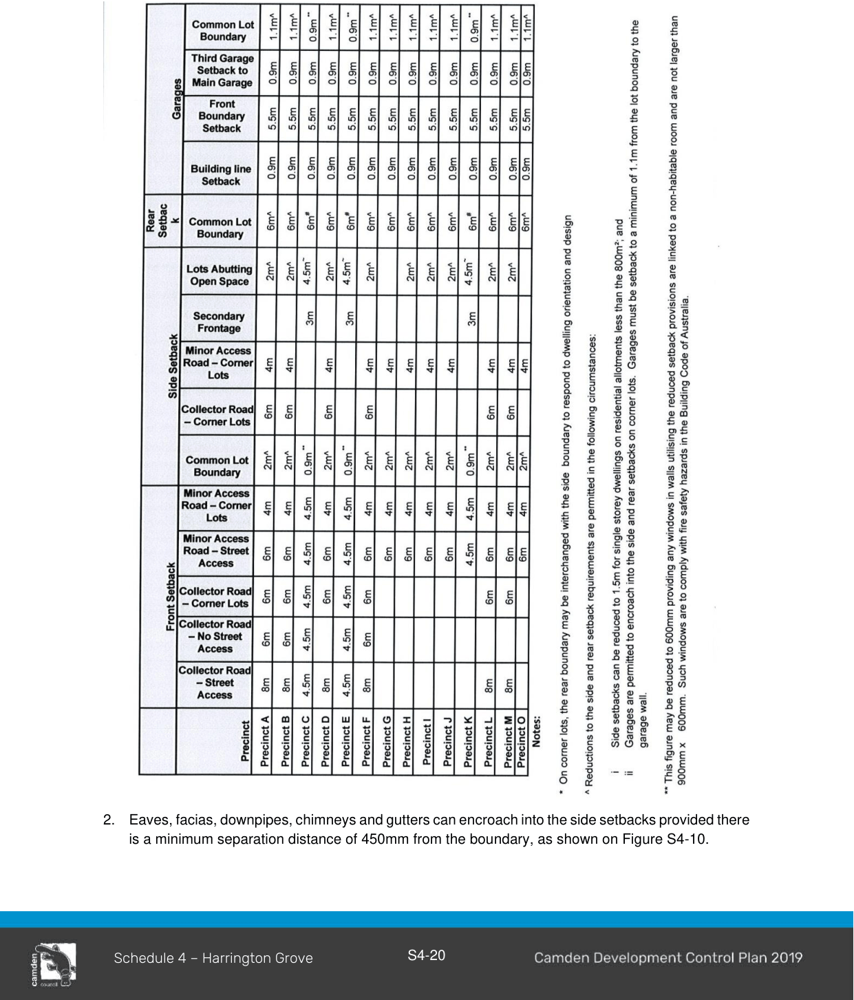
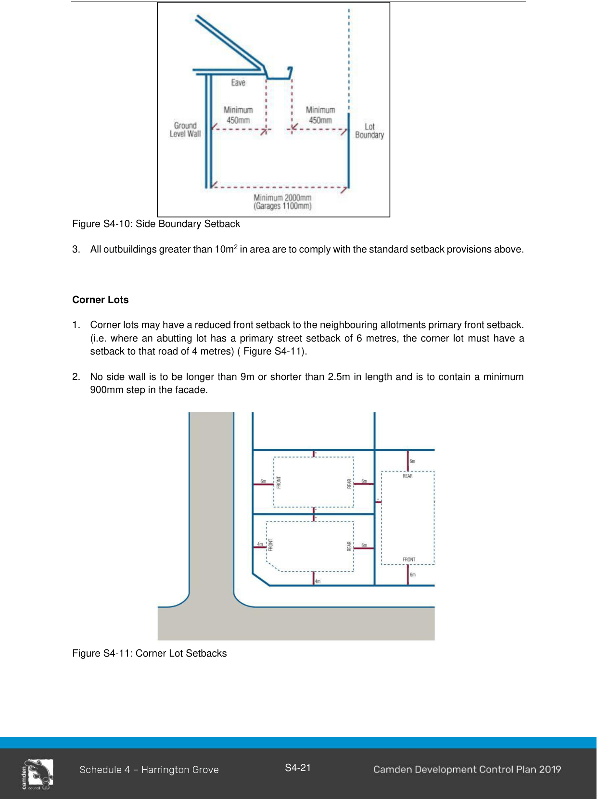

#### S4.4.2 Building and Site Design

#### Form and Character

Residential development within Harrington Grove comprises a variety of styles, densities and form, which creates neighbourhood villages of a high standard.

1\. Whilst encouraging variety in housing design these Building Controls promote characteristics of good design such as:

a. facades that are attractive and provide interest.

b. facades that are “welcoming” and do not dominate the streetscape.

c. rooflines that are aesthetically pleasing and incorporate adequate eaves.

d. reduced visual impact from garage doors.

e. make best use of the site area and orientation of the lot.

f. energy consumption reductions in housing through passive solar design.

g. good landscape design to maximise energy efficiency of dwellings.

h. high levels of amenity (daylight, outlook, privacy) from within the house and the private open space.

i. safe neighbourhoods through informal surveillance of the street.

#### Siting of Dwellings

1\. The orientation, siting and layout of dwellings is to consider the following:

a. location and design of houses are to relate to the site topography.

b. houses to be orientated to the front street.

c. visual and acoustic privacy is to be maintained between the dwellings and adjacent residential properties.

d. the benefits of passive solar design and natural ventilation.

e. effective landscaping and careful site design is to assist in acoustic and visual privacy and enhance shaded areas.

f. minimise the effects of overshadowing, and visual and acoustic intrusion.

g. the provision of sunlight in living spaces within buildings and in open spaces around buildings to improve energy efficiency.

#### Corner Lots

1\. Dwellings on corner lots are to consider the following:

a. Dwellings on corner lots are to address both street frontages (Figure S4-7).

b. Dwellings on corner lots should encroach closer to the road reserve to frame the corner      and improve the visual quality of the streetscape.

Figure S4-7: Street Frontage for Corner Lots

> [Picture on page 20: a picture, saved as a picture (images/schedule-04-harrington-grove-page-20-19.gif, 150 dpi).]

#### Street Facades

1\. Garages are not to protrude in front of houses and/or dominate the streetscape. The front of the house is to have an attractive facade that displays sufficient articulation (Figure S4-8). To achieve this, the following provisions apply.

2\. Triple garages are to have at least one garage set back a minimum distance of 900mm behind the other garages.

3\. Part of the front facade (excluding the garage) must be set back a minimum of 900mm from the rest of the facade (excluding the garage) (Figure S4-9). This results in a staggered or articulated facade. Recessed or protruding entry alcoves, central to the front building facade and containing the front door, do not, alone, satisfy this requirement.

4\. On corner homesites, no straight section of the side wall facing a street is to be longer than 9m or shorter than 2.5m. Walls longer than 9m are to have a ‘step’ of at least 900mm between the

> [Picture on page 21: a picture, saved as a picture (images/schedule-04-harrington-grove-page-21-13.gif, 150 dpi).]

sections.

Figure S4-8: Street Facades

5\. Garages are permitted forward of the front building facade providing (Figure S4-9):

a. garage doors do not front the street,

b. the facade of the garage fronting the street resembles a dwelling facade which includes windows and similar architectural elements, and

c. the garage is integrated with the dwelling.

#### Facades – Acceptable

> [Picture on page 22: a picture, saved as a picture (images/schedule-04-harrington-grove-page-22-7.gif, 150 dpi).]

#### Facades – Not Acceptable

> [Picture on page 22: a picture, saved as a picture (images/schedule-04-harrington-grove-page-22-9.gif, 150 dpi).]

Figure S4-9: Facades which are/are not permitted

#### Setbacks for Dwellings and Structures (General)

1\. Setbacks within these precincts are to be in accordance with Table S4-2.

#### Table S4-2 Precinct Setbacks

> [Picture on page 23: a picture, saved as a picture (images/schedule-04-harrington-grove-page-23-4.gif, 150 dpi).]

2\. Eaves, facias, downpipes, chimneys and gutters can encroach into the side setbacks provided there is a minimum separation distance of 450mm from the boundary, as shown on Figure S4-10.

> [Picture on page 24: a picture, saved as a picture (images/schedule-04-harrington-grove-page-24-1.gif, 150 dpi).]

Figure S4-10: Side Boundary Setback

3\. All outbuildings greater than 10m2 in area are to comply with the standard setback provisions above.

#### Corner Lots

1\. Corner lots may have a reduced front setback to the neighbouring allotments primary front setback. (i.e. where an abutting lot has a primary street setback of 6 metres, the corner lot must have a setback to that road of 4 metres) ( Figure S4-11).

2\. No side wall is to be longer than 9m or shorter than 2.5m in length and is to contain a minimum 900mm step in the facade.

Figure S4-11: Corner Lot Setbacks

#### Garages

1\. Garages are to be setback a minimum of 5.5m from any street frontage.

2\. Garages are to be setback a minimum of 1.1m from any other boundary.

3\. Garages are to be setback by a minimum of 900mm from the primary building facade closest to the road.

4\. Triple garages are to have at least one garage setback a minimum distance of 900mm behind the other garages.

#### Site Coverage and Floor Area

1\. The area of the dwelling (including ancillary buildings) is to occupy no more than 50% of the lot area (excluding access legs of battle-axe allotments).

Note:  Open verandahs and covered outdoor entertaining areas with perimeter walling no higher than 1m are excluded, as are garden sheds that comply with the SEPP
