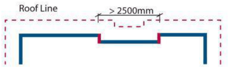

#### S4.4.4 Roof Form

#### Roof Pitch and Line

1\. The roof pitch is to be a minimum of 22.50 and a maximum of 450.

2\. Skillion roofs are permitted with a minimum slope of 22.50.

3\. The roof line is to be articulated to follow the modulation of the dwelling facade where the step within the facade exceeds 2.5m in length and fronts a road or public reserve (i.e. corner lot and street front) (Figure S4-12).

4\. Eaves no smaller than 450mm are to be incorporated into the building design and are required on all front and side facades of dwellings.

5\. Notwithstanding controls 1-4, dwellings in Harrington Grove with low pitched roofs and lacking eaves on front/side facades are permitted if it can be demonstrated that:

a. a BASIX Certificate has been provided to Council which demonstrates the proposed dwelling will comply with thermal and energy requirements,

b. the proposed dwelling design demonstrate architectural merit through a modern and contemporary design, and

c. the proposed variation will not result in any negative impacts on the future character of the streetscape or locality.

Note: Variations to the minimum roof pitch requirement can be considered where architectural merit and innovation in the building design is demonstrated.

> [Picture on page 27: a picture, saved as a picture (images/schedule-04-harrington-grove-page-27-1.gif, 150 dpi).]

Figure S4-12: Roof Articulation

#### Lofts

1\. Lofts are intended to provide flexibility in the design and location of floor space within a dwelling but are not intended to be an additional storey.

2\. Lofts are to be contained entirely within the roof pitch.

3\. Lofts will not be counted as a storey.

4\. Lofts may be used as habitable areas but are not included in floorspace calculations.

5\. Dormer windows and tilt up windows that are flush with the roof are permitted.
