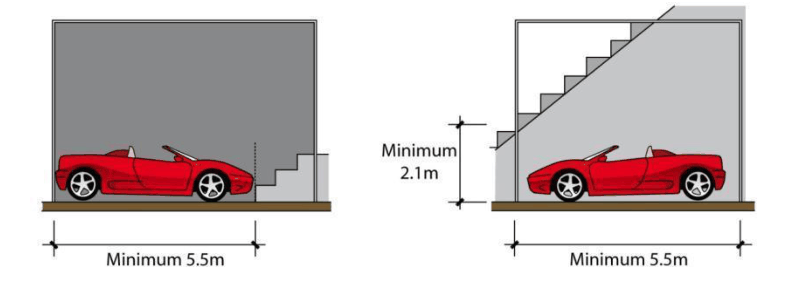
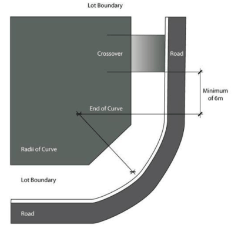

#### S4.4.5 Garages and Driveways

#### Garage Design

1\. Garages are to have a minimum internal dimension of 3m wide x 5.5m length for a single garage or 5.5m width x 5.5m length for a double garage. All dimensions are to be clear of any fixed internal structures, such as staircases (Figure S4-13).

2\. A garage or carport is permitted at the rear or side of the dwelling, though not permitted to be constructed in the front setback of the allotment. All garages are to be positioned behind the setback line, and a minimum of 5.5m from the lot boundary fronting a road.

3\. A third garage is permitted in accordance with Control 4 \within Street Façades of this Schedule.

4\. A detached garage is permitted.

5\. The carport/garage must be constructed of materials that match or complement the primary dwelling in respect of material, pitch of roof, design, colour and external appearance.

6\. Garage doors are to be tilt-up, panel or sectional. Roller doors are not permitted to the front of the garage.

7\. The width of the garage doors when viewed from the street must not exceed 50% of the width of the dwelling’s front elevation.

> [Picture on page 28: a picture, saved as a picture (images/schedule-04-harrington-grove-page-28-1.gif, 150 dpi).]

Figure S4-13: Carparking Clearance from Fixed Structures

#### Driveways (Access Design)

1\. Driveways must be constructed from the garage to the road kerb prior to occupation of the dwelling and be a minimum of 5.5m in length from the lot boundary to the garage.

2\. Driveways to corner lots are to be a minimum of 6 metres from the end point of the curve adjacent to the intersection of the primary and secondary lot boundaries (as shown on Figure S4-14).

> [Picture on page 28: a picture, saved as a picture (images/schedule-04-harrington-grove-page-28-8.gif, 150 dpi).]

Figure S4-14: Carparking Clearance from Fixed Structures

3\. The footpath cross-over needs to be constructed from the kerb to the boundary.

4\. The driveway must not be less than 3m and no greater than 5.5m in width from the kerbside to the boundary of the lot and a consistent width for its length between the kerb and the lot boundary.

5\. The driveway must be constructed to its full width using either a stencilled or stamped concrete, clay pavers or exposed aggregate. No portion of the driveway is to be uncoloured concrete.

6\. Driveways are to be sufficiently setback from side boundaries to allow effective screen planting along the boundary, provided vehicular and pedestrian safety is maintained.

7\. Driveways are to have an average overall grade of 1:6 (refer to Council’s detailed requirements for grades and vertical curves) and be a minimum of 500mm clear of all drainage structures on the

kerb and gutter and side fencing. They are not to interfere with the existing public utility infrastructure unless prior approval is obtained from the relevant authority.
