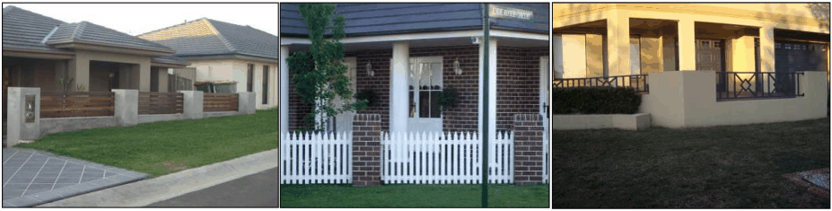
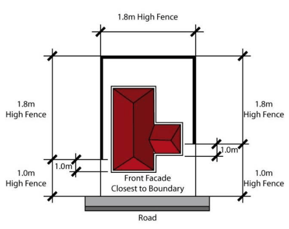
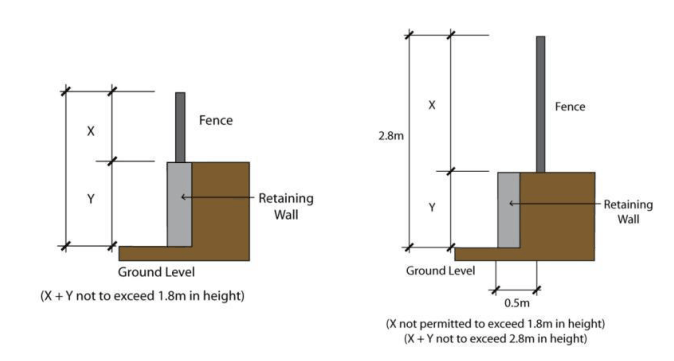
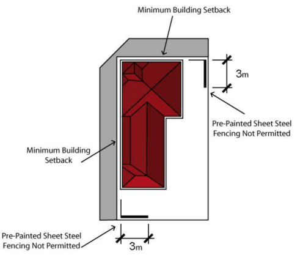
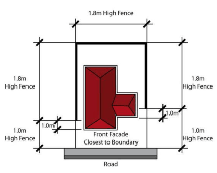

#### S4.4.7 Fencing

#### Front Fencing

1\. Fencing along the front boundary is limited to a maximum height of 1m from finished ground level. Notwithstanding piers with a maximum dimension of 500mm x 500mm are permitted to a maximum height of 1200mm.

2\. Fencing is to be constructed of face brick, rendered brick or rendered blockwork piers with visually permeable infill panels of landscaping, decorative steel, wrought iron or timber pickets (Figure S4- 15). Panels are to be at least 70% visually permeable.

3\. Where front fencing is located on top of a retaining wall, the total height of the front fence and retaining wall (measured from finished ground level on the verge side) is not to exceed 1m in height.

4\. Fences constructed entirely of timber pickets, palings or materials of similar appearance are not permitted.

5\. Bold contrasting primary coloured fencing is to be avoided so as not to detract from the natural setting of the development.

> [Picture on page 30: a picture, saved as a picture (images/schedule-04-harrington-grove-page-30-7.gif, 150 dpi).]

Front fencing with infill panels Face brick piers with pickets        Rendered brick with decorative

Steel

Figure S4-15: Examples of Allowable Fences

#### Fencing Along Common Lot Boundaries

1\. Fencing on side boundaries is limited to:

a. 1m in height from the front boundary to 1m behind the front building facade closest to the side boundary, and

b. 1.8m in height from 1m behind the front building facade closest to the side boundary to the rear boundary (Figure S4-16).

Note:  The side fence erected with the first constructed dwelling, will take precedence, unless otherwise agreed by both affected landowners that these arrangements are impracticable.

c. Fencing on rear boundaries is limited to 1.8m in height.

> [Picture on page 31: a picture, saved as a picture (images/schedule-04-harrington-grove-page-31-1.gif, 150 dpi).]

Figure S4-16: Common Boundary Fencing

2\. Fencing along the side and rear common lot boundaries is to be constructed:

a. of pre-painted sheet steel fencing or masonry materials where a fence height limit of 1.8m is permitted, and

b. in accordance with the front fencing requirements where a fence height limit of 1m is permitted (refer to control 1 in this subsection).

#### Fencing Along a Road Reserve

1\. Fencing abutting a road reserve is to be constructed of:

a. face brick, rendered brick or rendered blockwork, or

b. face brick, rendered brick or rendered blockwork piers with infill panels of landscaping, decorative steel, wrought iron, decorative timber or brushwood, or

c. brushwood.

> [Picture on page 32: a picture, saved as a picture (images/schedule-04-harrington-grove-page-32-1.gif, 150 dpi).]

Figure S4-17: Lot Fencing Abutting a Road Reserve on a Retaining Wall

2\. Where 1.8m corner lot fencing abutting a road reserve is constructed on top of a retaining wall, the total height of the front fence and retaining wall (measured from ground level on the verge

side) is not to exceed 1.8m in height. Notwithstanding fencing is permitted to a height of 1.8m above a retaining wall provided the fence is setback a minimum of 500mm from the facia of the retaining wall (Refer Figure S4-18).

3\. Fencing on common lot boundaries for corner lots is limited to a height of 1.8m.

4\. Pre-painted sheet steel fencing alongside and rear common lot boundaries on corner lots is not to extend past a point measured to be 2.9m behind the minimum building setback for the corner lot (Refer to Figure S4-19 and Table S4-2 for setback requirements for corner lots). Fencing forward of this point is to be constructed of face brick, rendered brick or rendered blockwork with or without visually permeable infill panels of landscaping, decorative steel, wrought iron, brushwood, or decorative timber.

> [Picture on page 32: a picture, saved as a picture (images/schedule-04-harrington-grove-page-32-15.gif, 150 dpi).]

Figure S4-18: Pre-painted Sheet Steel Fencing on Common Lot Boundaries

#### Return Fencing to the Dwelling

1\. Return fencing to the dwelling is:

a. limited to a maximum height of 1.8m, and

b. is to be setback a minimum of 1m behind the building facade fronting the street and closest to the lot boundary.

2\. Fencing between the dwelling and the side boundary is to be constructed from the same or similar materials as the dwelling.

3\. Gates located between the dwelling and the side boundary are to be constructed of decorative steel, wrought iron, brushwood or decorative timber.

4\. Gates painted with bold primary colours are not permitted.

5\. Fencing between the dwelling and side boundary may be constructed from pre-painted sheet steel where the distance is less than 3m to the boundary, and a minimum of 1.0m behind the building line. (Maximum height of 1.8m). (Refer Figure S4-19).

> [Picture on page 33: a picture, saved as a picture (images/schedule-04-harrington-grove-page-33-14.gif, 150 dpi).]

Figure S4-19: Return Fencing
