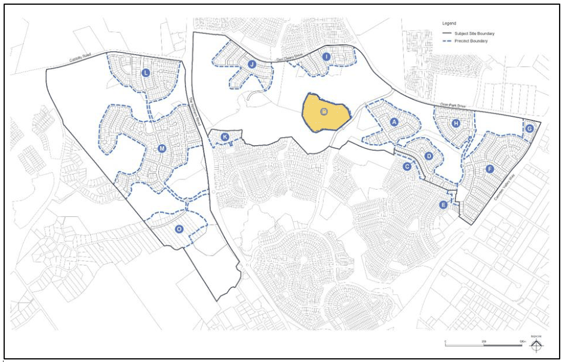
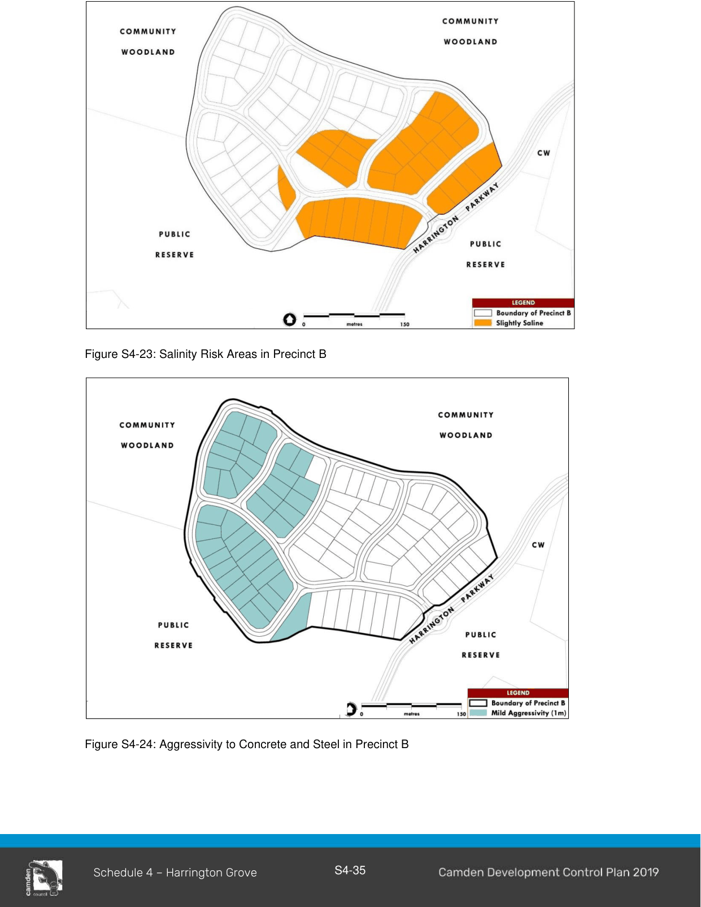

#### S4.4.11 Precinct B

> [Picture on page 37: a picture, saved as a picture (images/schedule-04-harrington-grove-page-37-2.gif, 150 dpi).]

#### Dual Frontage Residential Lots Fronting Harrington Parkway

1\. Dwellings that front both Harrington Parkway and an opposing street (front and rear) are to address both frontages.

2\. No direct vehicular access to Harrington Parkway is permitted.

3\. Garages are to be setback a minimum of 20 metres from the lot boundary fronting Harrington Parkway.

4\. Boundary fencing along the street frontage where vehicular access is permitted is limited to a maximum height of 1.8 metres. A minimum length of 10 metres of this fencing is to be 70% permeable.

#### Salinity and Aggressivity

Refer to Environmental Elements in Section 2 of this Schedule for salinity and aggressivity controls and Figure S4-23 and 4-24.

> [Picture on page 38: a picture, saved as a picture (images/schedule-04-harrington-grove-page-38-1.gif, 150 dpi).]

Figure S4-23: Salinity Risk Areas in Precinct B

Figure S4-24: Aggressivity to Concrete and Steel in Precinct B

