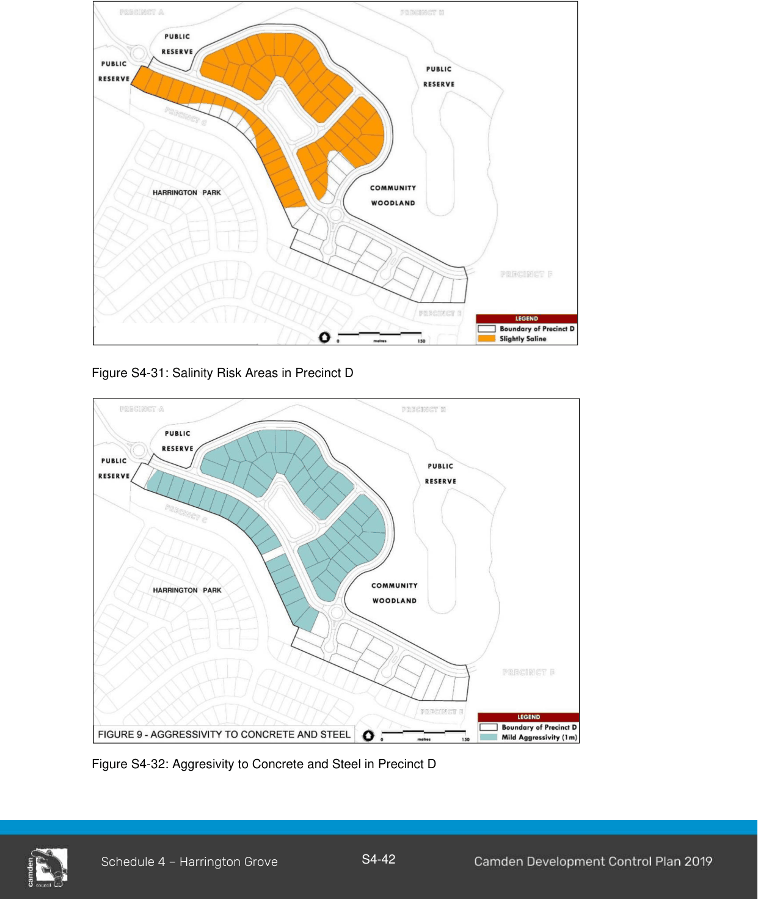

#### S4.4.13 Precinct D

#### Salinity and Aggressivity

Refer to Environmental Elements in Section 2 of this Schedule for salinity and aggressivity controls and Figure S4-31 and 4-32.

> [Picture on page 45: a picture, saved as a picture (images/schedule-04-harrington-grove-page-45-4.gif, 150 dpi).]

Figure S4-31: Salinity Risk Areas in Precinct D

Figure S4-32: Aggresivity to Concrete and Steel in Precinct D

