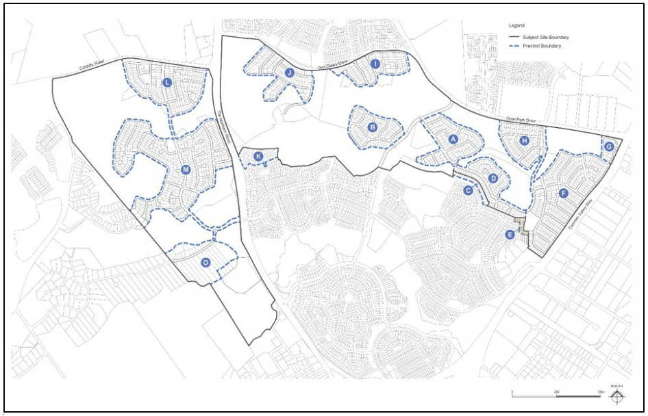
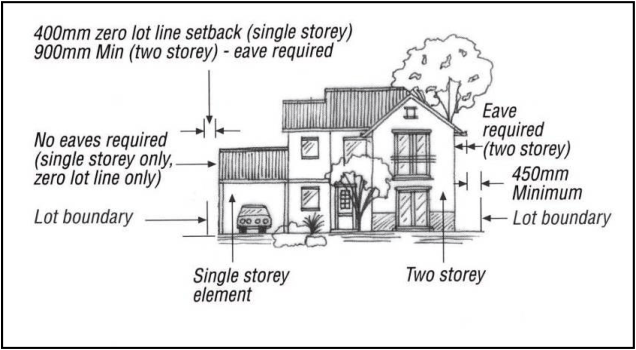
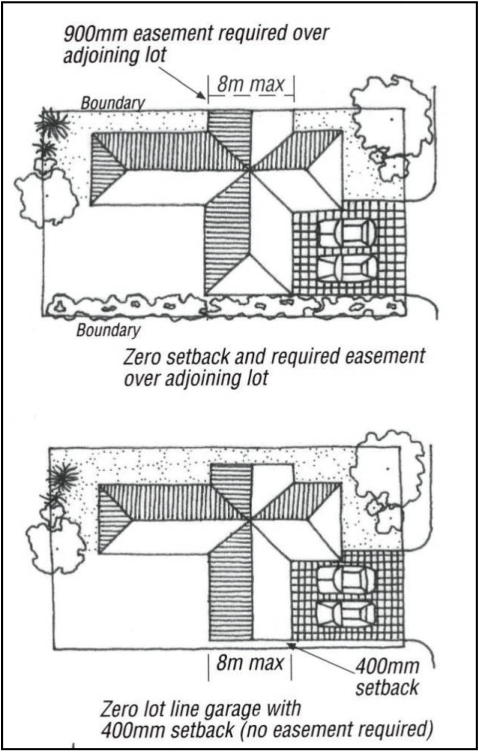
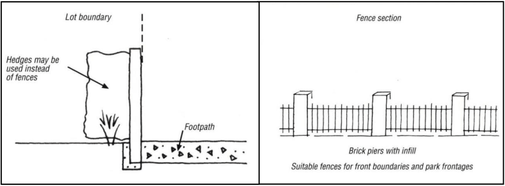

#### S4.4.14 Precinct E

> [Picture on page 46: a picture, saved as a picture (images/schedule-04-harrington-grove-page-46-2.gif, 150 dpi).]

#### Setbacks to Open Space Areas

1\. Setbacks to lot boundaries abutting open space are to be a minimum of 4.5m.

2\. Verandahs and balconies can extend into the setback to open space by up to 1m provided these areas are not enclosed (excluding handrails and balustrades).

3\. Eaves overhangs can extend into the setback to open space up to 1m.

#### Zero Lot Line Guidelines and Controls

The zero lot line guidelines and controls only apply to a single storey dwelling or to a single storey element of a two storey dwelling (e.g. Garage).  To ensure efficient use of a residential lot, part of the dwelling may be built as a ‘zero lot line’ (Refer Figures S4-33 and S4-34).

1\. The use of zero lot lines provides flexibility to maximise private courtyard spaces and take advantage of the opportunities for improved solar design. Buildings with zero lot lines are to comply with the following provisions:

a. Ensuring there is no unreasonable adverse impact on the privacy, amenity or solar access of an adjoining allotment, side or rear walls without windows may be built on the boundary.

b. The maximum length of wall built on the side boundary is limited to 8m and is to be a continuous length without any windows. Garages and carports are appropriate for zero lot line situations.

c. An easement may be required on the neighbouring land for maintenance and support, except

where a 400mm setback is adopted. Downpipes and drainage lines are not permitted within this setback area.

> [Picture on page 47: a picture, saved as a picture (images/schedule-04-harrington-grove-page-47-3.gif, 150 dpi).]

Figure S4-33: Zero Lot Lines in Elevation

> [Picture on page 47: a picture, saved as a picture (images/schedule-04-harrington-grove-page-47-5.gif, 150 dpi).]

Figure S4-34: Zero Lot Lines in Plan View

#### Private Open Space

Private outdoor open space is an important component of any dwelling.  The climate in Sydney allows outdoor living areas to be utilised for most of the year. Therefore, it is important that these spaces are functional and relate to the size and activity areas of the dwelling.

1\. Private open space areas should be securely enclosed (fences and gates) and abut living and kitchen areas of the dwelling. Private open space areas are not intended to be walled with a roof, but a portion may be covered with a pergola or weatherproof canopy providing that the energy efficiency of the home is not affected.

2\. A principal private open space area is to be provided within the private open space area. The principal private open space is to provide a highly usable private living area which adjoins the internal living areas of the dwelling.

3\. A minimum of 80m2 of private open space is to be provided for each dwelling.

4\. Any area to be included in the above calculation must have a minimum dimension of 2.5m.

5\. Any area in front of the front building alignment will not be considered in the above calculation.

6\. A principal private open space area no less than 25m2 with a minimum dimension of 5m x 5m is to be provided.

7\. The principal private open space area is to be directly accessible from internal living area.

#### Front Fencing Abutting a Road

> [Picture on page 48: a picture, saved as a picture (images/schedule-04-harrington-grove-page-48-19.gif, 150 dpi).]

Figure S4-35: Lot Boundary Fencing

1\. The height of front fencing is limited to a maximum of 900mm and is to be at least 70% visually permeable.

2\. Front fencing is to be constructed of rendered brick or blockwork columns with visually permeable infill panels of landscaping, decorative steel, wrought iron or timber pickets (Figure S4-35).

3\. Front fencing is to be consistent in colour with the dwelling and neighbouring houses and fences.

#### Side Fencing Abutting a Reserve or Park

1\. The height of side fencing is limited to a maximum 1.8m.

2\. Side boundary fencing abutting a park or reserve can be constructed the entire length from the rear boundary to the front lot boundary line.

3\. Fencing on side boundaries facing a reserve or park is to be constructed of:

a. faced/rendered brick or rendered blockwork columns with infill panels of landscaping (hedges), decorative steel, wrought iron, timber pickets, rendered/faced brickwork or rendered blockwork (Figure S4-35), or

b. dressed timber.

#### Side and Rear Fencing Between House Lots

1\. The height of side and rear fencing is limited to a maximum of:

a. 900mm where the fence is in front of the front facade of the home, or

b. 1800mm where the fence is 900mm behind the front facade of the house.

Note:  Side and rear fencing is to be constructed of Colorbond® pre-painted sheet steel in the colour of Riversand® or a similar product and colour.
