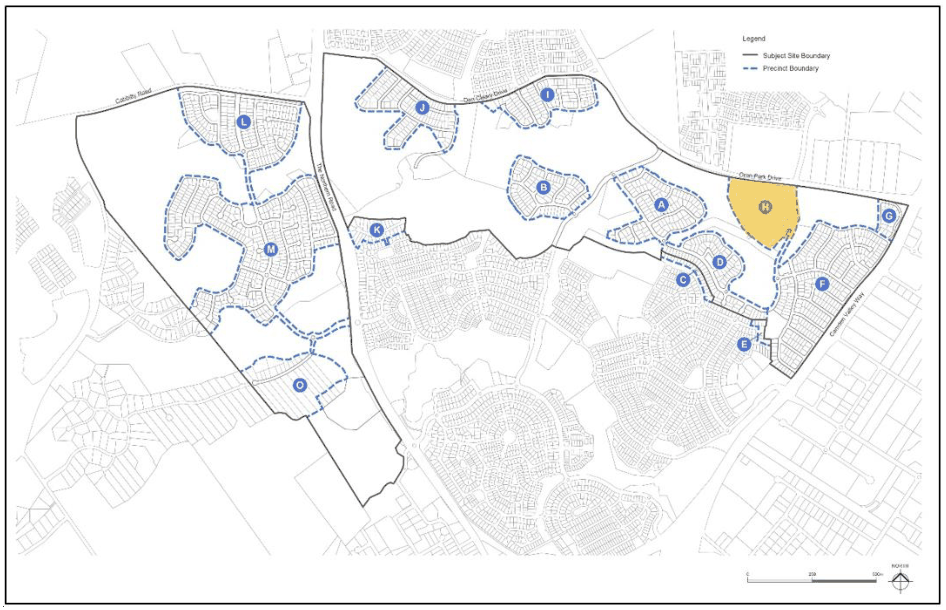
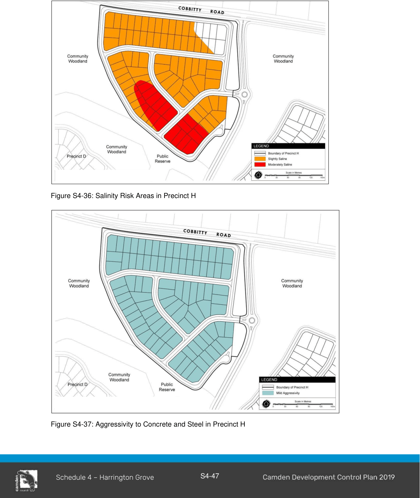

#### S4.4.15 Precinct H

> [Picture on page 49: a picture, saved as a picture (images/schedule-04-harrington-grove-page-49-17.gif, 150 dpi).]

#### Salinity and Aggressivity

Refer to Environmental Elements in Section 2 of this Schedule for salinity and aggressivity controls and Figure S4-36 and 4-37.

> [Picture on page 50: a picture, saved as a picture (images/schedule-04-harrington-grove-page-50-4.gif, 150 dpi).]

Figure S4-36: Salinity Risk Areas in Precinct H

Figure S4-37: Aggressivity to Concrete and Steel in Precinct H

