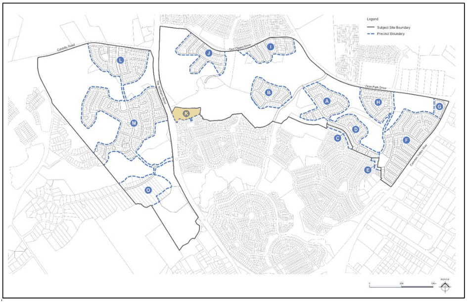
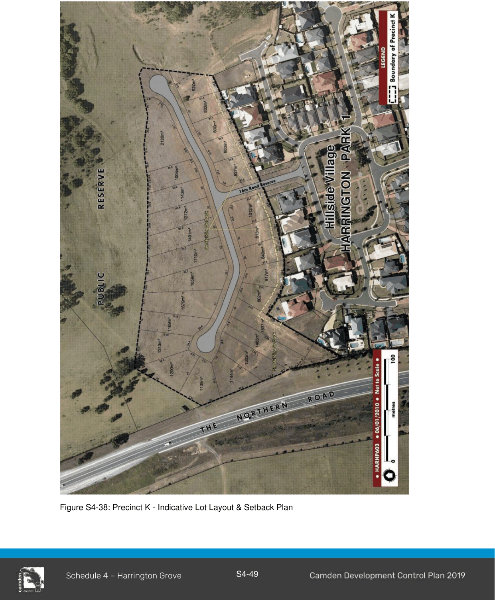
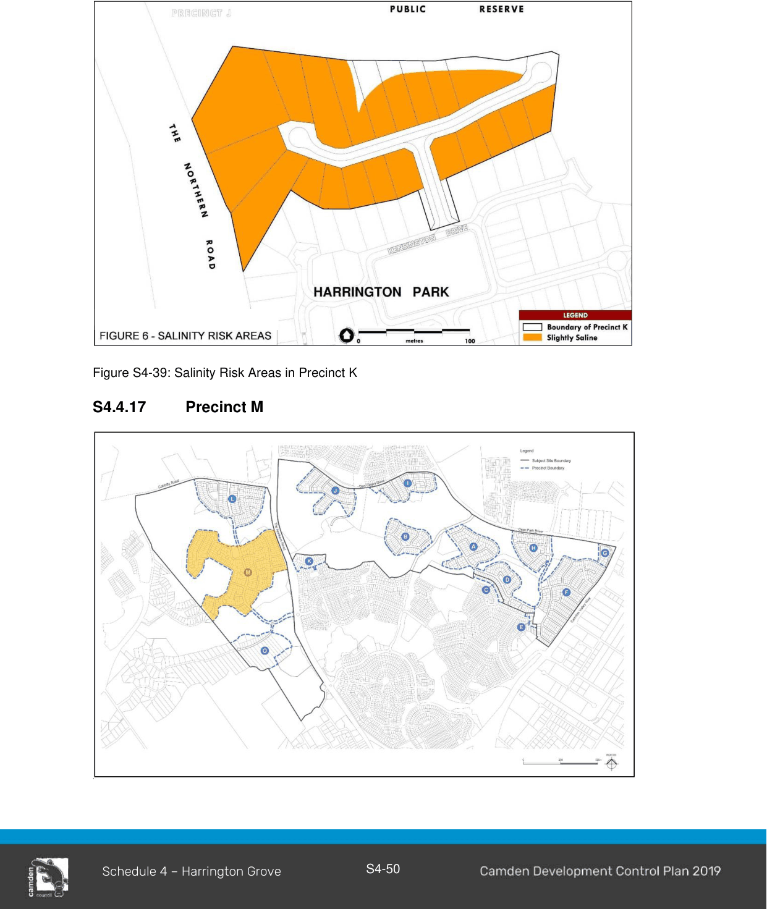

#### S4.4.16 Precinct K

> [Picture on page 51: a picture, saved as a picture (images/schedule-04-harrington-grove-page-51-2.gif, 150 dpi).]

#### Private Open Space

Private outdoor open space is an important component of any dwelling.  The climate in Sydney allows outdoor living areas to be utilised for most of the year. Therefore, it is important that these spaces are functional and relate to the size and activity areas of the dwelling.

1\. Private open space areas should be securely enclosed (fences and gates) and abut living and kitchen areas of the dwelling. Private open space areas are not intended to be walled with a roof, but a portion may be covered with a pergola or weatherproof canopy providing that the energy efficiency of the home is not affected.

2\. A principal private open space area is to be provided within the private open space area. The principal private open space is to provide a highly usable private living area which adjoins the internal living areas of the dwelling.

3\. A minimum of 80m2 of private open space is to be provided for each dwelling.

4\. Any area to be included in the above calculation must have a minimum dimension of 2.5m.

5\. Any area in front of the front building alignment will not be considered in the above calculation.

6\. A principal private open space area no less than 25m2 with a minimum dimension of 5m x 5m is to be provided.

7\. The principal private open space area is to be directly accessible from internal living area.

#### Lot Specific Setbacks

Refer to Figure S4-38 below.

> [Picture on page 52: a picture, saved as a picture (images/schedule-04-harrington-grove-page-52-3.gif, 150 dpi).]

Figure S4-38: Precinct K - Indicative Lot Layout & Setback Plan

#### Salinity and Aggressivity

Refer to Environmental Elements in Section 2 of this Schedule for salinity and aggressivity controls and 4-39.

> [Picture on page 53: a picture, saved as a picture (images/schedule-04-harrington-grove-page-53-4.gif, 150 dpi).]

Figure S4-39: Salinity Risk Areas in Precinct K
