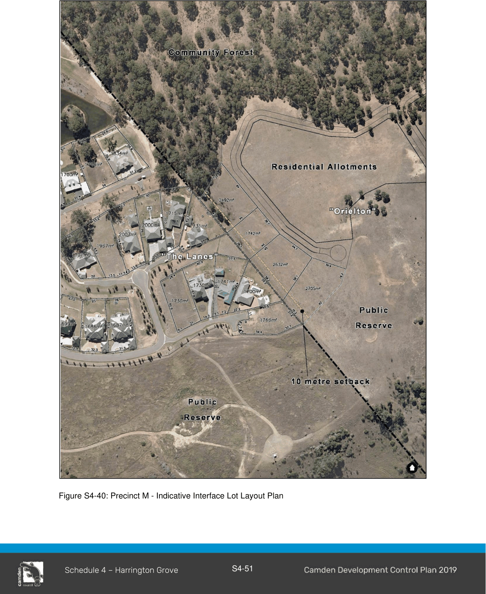

#### S4.4.17 Precinct M

The rear setback to “The Lanes” residential area is 10m as outlined in Figure S4-40.

> [Picture on page 54: a picture, saved as a picture (images/schedule-04-harrington-grove-page-54-2.gif, 150 dpi).]

Figure S4-40: Precinct M - Indicative Interface Lot Layout Plan

Note:  The controls listed below are specific to Harrington Grove Precincts (excluding C, E and K). They must be read in conjunction with the controls in Part 2 and Part 4 of this DCP. In the event of any inconsistency, the controls included in this subsection will take precedence.

#### Table S4-3: Summary of residential accommodation controls

| SETBACKS (Refer to Table S4-2) |  |  |
|---|---|---|
| Front setback (min) – Precincts |  | 6m |
| Front setback (min) – Collector road with street |  | 8m |
| access |  |  |
| Secondary street setback (min) |  | 4-6m |
| Side setback (min) |  | 2m |
| Rear setback (min) |  | 6m |
| Garage setback (min) |  | 0.9m behind principal building line and 5.5m from front boundary; third garage to be set back an additional 0.9m. |
| Architectural element | front setback | 1.5m |
| encroachment (max) |  |  |
| HEIGHT |  |  |

As per LEP 2010 and Part 4 of this DCP

| PRIVATE OPEN SPACE, LANDSCAPING AND | SITE COVERAGE |
|---|---|
| Site coverage (max) | 50% |
| Landscaped area (min) | 35% |
| Landscaped area (min) within the front setback | 60% |
| Private open space (min) | 80m2 for 3br dwelling; 100m2 for 4br dwelling |
| Principal private open space (PPOS) (min) | 24m2 with a minimum dimension 4m |
| Gradient of PPOS (max) | 1:15 Direct sunlight must reach at least 50% of |
| Solar access to PPOS (min) | the PPOS of both the subject dwelling and of any adjoining dwelling for not less than 3 hours between 9:00am and 3:00pm on 21 June. |

|  | Dwellings must be orientated to maximise solar access to living rooms having regard to future and existing site constraints. At least one window to a living area of dwellings on neighbouring properties must receive a minimum of 3 hours of direct sunlight between 9am and 3pm on 21 June. |
|---|---|
| GARAGE DESIGN |  |
| Garage door width (max) | 50% of front elevation width |

Note:  The controls listed below are specific to Harrington Grove Precincts C, E and K. They must be read in conjunction with the controls in section Part 2 and Part 4 of this DCP. In the event of any inconsistency, the controls included in this subsection will take precedence.

Table S4-4: Summary of residential accommodation controls – Precincts C, E and K

| SETBACKS (Refer to Table S4-2) |  |
|---|---|
| Front setback | Between 4.5m and 6.5m |
| Secondary street setback (min) | 3m |
| Side setback (min) | 0.9m |
| Rear setback (min) | 6m |
| Open space setback (min) | 4.5m |
| Garage setback (min) | 0.9m behind principal building line and 5.5m from front boundary; third garage to be set back an additional 0.9m. |
| Architectural element front setback encroachment (max) | 1m |
| HEIGHT |  |
| As per LEP 2010 and Part 4 of this DCP |  |
| PRIVATE OPEN SPACE, LANDSCAPING AND SITE COVERAGE |  |
| Site coverage (max) | 50% |
| Front yard paved surfaces (max) | 40% |

| Private open space (min) | 80m2 |
|---|---|
| Principal private open space (PPOS) (min) | 24m2 with a minimum dimension 4m |
| Gradient of PPOS (max) | 1:15 |
| Solar access to PPOS (min) | Direct sunlight must reach at least 50% of the PPOS of both the subject dwelling and of any adjoining dwelling for not less than 3 hours between 9:00am and 3:00pm on 21 June. Dwellings must be orientated to maximise solar access to living rooms having regard to future and existing site constraints. At least one window to a living area of dwellings on neighbouring properties must receive a minimum of 3 hours of direct sunlight between 9am and 3pm on 21 June. |
| GARAGE DESIGN |  |
| Garage door width (max) | 50% of front elevation width |

#### - End of Schedule –

