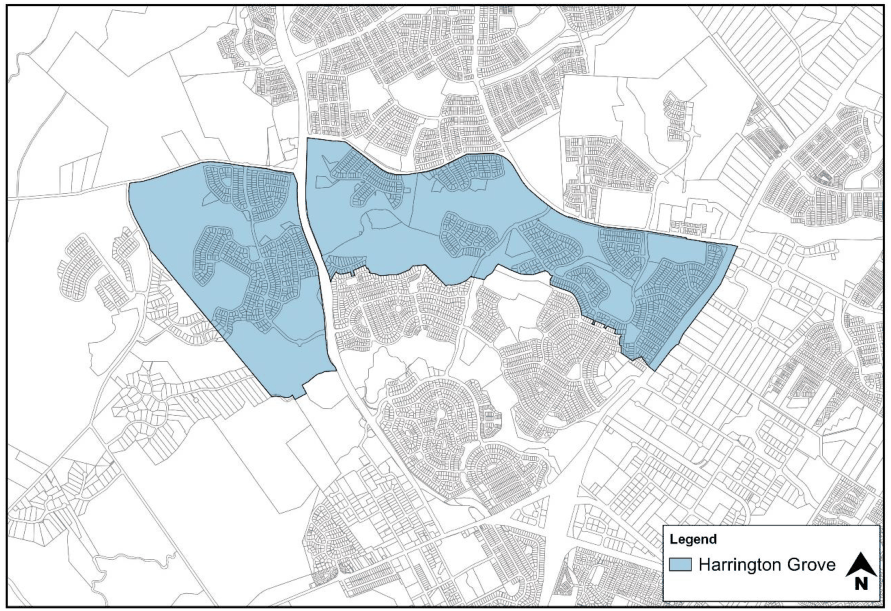

# Camden Development Control Plan 2019 - Schedule 4 Harrington Grove

> This chapter is split into 30 section file(s), one per numbered heading, in the order they appear in the PDF.

Source PDF: [Schedule-4-Harrington-Grove.pdf](Schedule-4-Harrington-Grove.pdf)

### Contents

| HARRINGTON GROVE | S4-1 |
|---|---|
| S4.1 Introduction | S4-1 |
| S4.1.1 Harrington Grove Planning Principles | S4-1 |
| S4.1.2 Structure Plan | S4-3 |
| S4.2 Subdivision Planning and Design | S4-6 |
| S4.2.1 Street Network and Design | S4-6 |
| S4.2.2 Pedestrian and Cycle Network | S4-9 |
| S4.2.3 Street Trees and Landscaping | S4-11 |
| S4.2.4 Bulk Earthworks | S4-11 |
| S4.2.5 Sloping Land and Retaining Walls | S4-11 |
| S4.2.6 Estate Fencing | S4-12 |
| S4.2.7 Bushfire Management | S4-12 |
| S4.2.8 Specific Development Precincts | S4-13 |
| S4.2.9 Environmental Elements | S4-14 |
| S4.3 Centre Development Controls | S4-15 |
| S4.4 Site Specific Residential Controls | S4-16 |
| S4.4.1 Harrington Grove General Residential Building Controls Applying to all Precincts S4-16 |  |
| S4.4.2 Building and Site Design | S4-16 |
| S4.4.3 Materials | S4-22 |
| S4.4.4 Roof Form | S4-23 |
| S4.4.5 Garages and Driveways | S4-24 |
| S4.4.6 Landscaping and Private Open Space | S4-26 |
| S4.4.7 Fencing | S4-26 |
| S4.4.8 Outbuildings | S4-30 |
| S4.4.9 Bushfire Management | S4-30 |
| S4.4.10 Precinct A | S4-31 |
| S4.4.11 Precinct B | S4-34 |
| S4.4.12 Precinct C | S4-36 |
| S4.4.13 Precinct D | S4-41 |
| S4.4.14 Precinct E | S4-43 |
| S4.4.15 Precinct H | S4-46 |
| S4.4.16 Precinct K | S4-48 |
| S4.4.17 Precinct M | S4-50 |

### Table of Figures

| Figure S4-1: Harrington Grove Site and Location Plan | S4-1 |
|---|---|
| Figure S4-2: Harrington Grove Structure Plan | S4-5 |
| Figure S4-3: Precincts within Harrington Grove | S4-5 |
| Figure S4-4: Harrington Grove Indicative Road Hierarchy Plan | S4-6 |
| Figure S4-5: Indicative Threshold Treatment | S4-9 |
| Figure S4-6: Harrington Grove Indicative Pedestrian and Cycle Network | S4-10 |
| Figure S4-7: Street Frontage for Corner Lots | S4-17 |
| Figure S4-8: Street Facades | S4-18 |
| Figure S4-9: Facades which are/are not permitted | S4-19 |
| Figure S4-10: Side Boundary Setback | S4-21 |
| Figure S4-11: Corner Lot Setbacks | S4-21 |
| Figure S4-12: Roof Articulation | S4-24 |
| Figure S4-13: Carparking Clearance from Fixed Structures | S4-25 |
| Figure S4-14: Carparking Clearance from Fixed Structures | S4-25 |
| Figure S4-15: Examples of Allowable Fences | S4-27 |

| Figure S4-16: Common Boundary Fencing | S4-28 |
|---|---|
| Figure S4-17: Lot Fencing Abutting a Road Reserve on a Retaining Wall | S4-29 |
| Figure S4-18: Pre-painted Sheet Steel Fencing on Common Lot Boundaries | S4-29 |
| Figure S4-19: Return Fencing | S4-30 |
| Figure S4-20: Single Storey Lots in Precinct A | S4-32 |
| Figure S4-21: Salinity Risk Areas in Precinct A | S4-33 |
| Figure S4-22: Aggressivity to Concrete and Steel in Precinct A | S4-33 |
| Figure S4-23: Salinity Risk Areas in Precinct B | S4-35 |
| Figure S4-24: Aggressivity to Concrete and Steel in Precinct B | S4-35 |
| Figure S4-25: Zero Lot Lines in Elevation | S4-37 |
| Figure S4-26: Zero Lot Lines in Plan View | S4-37 |
| Figure S4-27: Lots subject to special design requirements | S4-38 |
| Figure S4-28: Lot Boundary Fencing | S4-39 |
| Figure S4-29: Salinity Risk Areas in Precinct C | S4-40 |
| Figure S4-30: Aggressivity to Concrete and Steel in Precinct C | S4-41 |
| Figure S4-31: Salinity Risk Areas in Precinct D | S4-42 |
| Figure S4-32: Aggresivity to Concrete and Steel in Precinct D | S4-42 |
| Figure S4-33: Zero Lot Lines in Elevation | S4-44 |
| Figure S4-34: Zero Lot Lines in Plan View | S4-44 |
| Figure S4-35: Lot Boundary Fencing | S4-45 |
| Figure S4-36: Salinity Risk Areas in Precinct H | S4-47 |
| Figure S4-37: Aggressivity to Concrete and Steel in Precinct H | S4-47 |
| Figure S4-38: Precinct K - Indicative Lot Layout & Setback Plan | S4-49 |
| Figure S4-39: Salinity Risk Areas in Precinct K | S4-50 |
| Figure S4-40: Precinct M - Indicative Interface Lot Layout Plan | S4-51 |

### List of Tables

Table S4-1 Minor Access Road or Minor Access Place (Cul-de-sac) ............................................................... S4-7 Table S4-2 Precinct Setbacks ......................................................................................................................... S4-20 Table S4-3: Summary of residential accommodation controls ........................................................................ S4-52 Table S4-4: Summary of residential accommodation controls – Precincts C, E and K ................................... S4-53

### HARRINGTON GROVE S4.1 Introduction

Harrington Grove is located to the north of the existing Harrington Park Estate and is adjacent to the rural living allotments to the east of Macquarie Grove Road (Figure S4-1). The site is bound by Camden Valley Way to the east, Cobbitty Road to the north and Macquarie Grove Road to the west.  The Northern Road bisects Harrington Grove into two areas.

> [Picture on page 4: a picture, saved as a picture (images/schedule-04-harrington-grove-page-4-7.gif, 150 dpi).]

Figure S4-1: Harrington Grove Site and Location Plan

<!-- sections -->
## Sections

1. [S4.1.1 Harrington Grove Planning Principles](01-s4-1-1-harrington-grove-planning-principles.md)
2. [S4.1.2 Structure Plan](02-s4-1-2-structure-plan.md)
3. [S4.2.1 Street Network and Design](03-s4-2-1-street-network-and-design.md)
4. [S4.2.2 Pedestrian and Cycle Network](04-s4-2-2-pedestrian-and-cycle-network.md)
5. [S4.2.3 Street Trees and Landscaping](05-s4-2-3-street-trees-and-landscaping.md)
6. [S4.2.4 Bulk Earthworks](06-s4-2-4-bulk-earthworks.md)
7. [S4.2.5 Sloping Land and Retaining Walls](07-s4-2-5-sloping-land-and-retaining-walls.md)
8. [S4.2.6 Estate Fencing](08-s4-2-6-estate-fencing.md)
9. [S4.2.7 Bushfire Management](09-s4-2-7-bushfire-management.md)
10. [S4.2.8 Specific Development Precincts](10-s4-2-8-specific-development-precincts.md)
11. [S4.2.9 Environmental Elements](11-s4-2-9-environmental-elements.md)
12. [S4.3 Centre Development Controls](12-s4-3-centre-development-controls.md)
13. [S4.4 Site Specific Residential Controls](13-s4-4-site-specific-residential-controls.md)
14. [S4.4.1 Harrington Grove General Residential Building Controls Applying to all Precincts](14-s4-4-1-harrington-grove-general-residential.md)
15. [S4.4.2 Building and Site Design](15-s4-4-2-building-and-site-design.md)
16. [S4.4.3 Materials](16-s4-4-3-materials.md)
17. [S4.4.4 Roof Form](17-s4-4-4-roof-form.md)
18. [S4.4.5 Garages and Driveways](18-s4-4-5-garages-and-driveways.md)
19. [S4.4.6 Landscaping and Private Open Space](19-s4-4-6-landscaping-and-private-open-space.md)
20. [S4.4.7 Fencing](20-s4-4-7-fencing.md)
21. [S4.4.8 Outbuildings](21-s4-4-8-outbuildings.md)
22. [S4.4.9 Bushfire Management](22-s4-4-9-bushfire-management.md)
23. [S4.4.10 Precinct A](23-s4-4-10-precinct-a.md)
24. [S4.4.11 Precinct B](24-s4-4-11-precinct-b.md)
25. [S4.4.12 Precinct C](25-s4-4-12-precinct-c.md)
26. [S4.4.13 Precinct D](26-s4-4-13-precinct-d.md)
27. [S4.4.14 Precinct E](27-s4-4-14-precinct-e.md)
28. [S4.4.15 Precinct H](28-s4-4-15-precinct-h.md)
29. [S4.4.16 Precinct K](29-s4-4-16-precinct-k.md)
30. [S4.4.17 Precinct M](30-s4-4-17-precinct-m.md)
