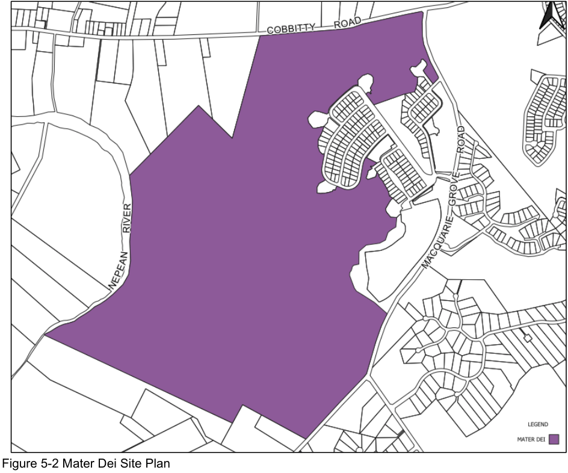
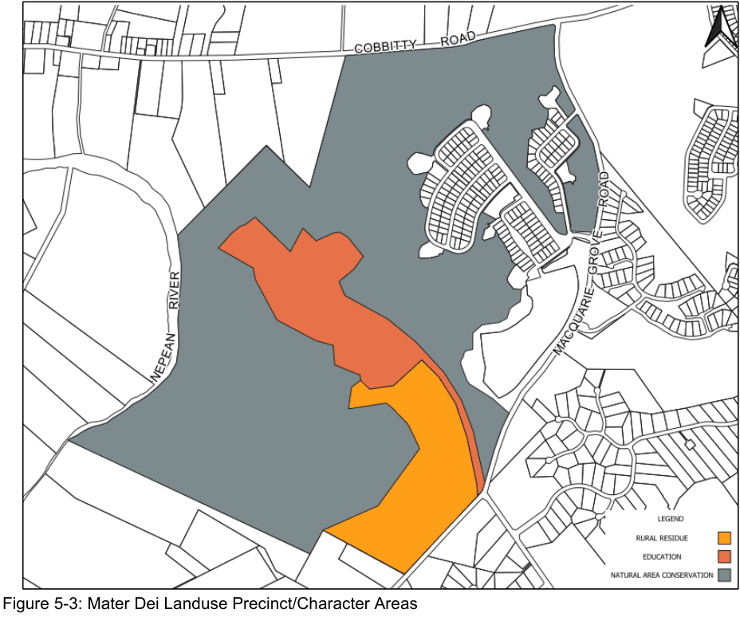
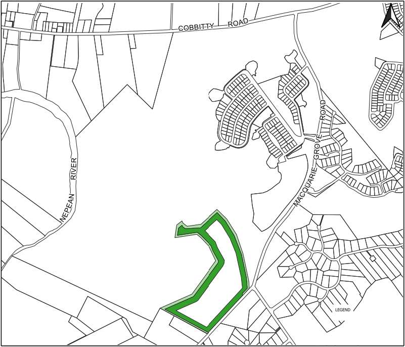
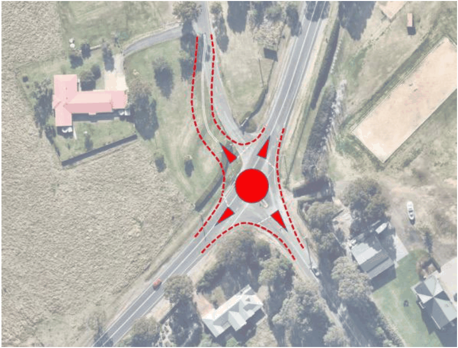

### S5.2 Subdivision Planning and Design

#### S5.2.1 Kirkham Rise

#### Introduction

The public domain of Kirkham Rise has been completed. If there are any residual issues, please refer to the repealed Camden DCP 2011.

#### S5.2.2 Mater Dei

#### Introduction

The Mater Dei site is an expansive diverse character parcel of land which includes the residue land holding surrounding the Kirkham Rise and Wivenhoe Retirement Village. It has an extensive frontage to Cobbitty Road, Macquarie Grove Road and Nepean River, with access generally opposite Kirkham Lane. It is depicted in Figure 5-2 below.

> [Picture on page 4: a picture, saved as a picture (images/schedule-05-mater-dei-and-kirkham-rise-page-4-12.gif, 150 dpi).]

Figure 5-2 Mater Dei Site Plan

#### Relationship to Other Plans

Detailed planning for the Mater Dei site has been informed by a range of specialist consultant reports over the years including most relevantly:

• Wivenhoe Conservation Management Plan (1997 revised 2008) prepared by Design 5

Architects.

• Wivenhoe Residential Development, Indigenous Heritage Conservation Strategy (4 April

2008\) prepared by Kelleher Nightingale Consulting PTY LTD

• Landscape Conservation Plan (2000) prepared by Design 5 Architects.

• Heritage Impact Statement (September 2023) prepared by Design 5 Architects.

• Biodiversity Overview (including Conservation Initiatives) Report (6 October 2023) prepared

by Travers Bushfire and Ecology.

• Aboriginal Due Diligence Assessment (12 September 2023) prepared by Travers Bushfire

and Ecology.

• Bushfire Protection Assessment (September 2023) prepared by Travers Bushfire and

Ecology.

• Airport Safeguarding Assessment – Aviation Services (28 September 2023) prepared by

Rehbein Airport Consulting.

• Preliminary Transport Assessment (23 June 2023) prepared by The Transport Planning

Partnership.

• Addendum to Traffic and Transport Assessment (20 January 2022) prepared by The

Transport Planning Partnership.

#### Site Precincts and Planning and Design Provisions

The Mater Dei site comprises a number of landuse precincts which generally exhibit distinguishing character qualities.

The subject precincts are distinguished as follows:

• Education;

• Natural Areas Conservation; and

• Rural Residue

Planning provisions in respect of the education precinct are detailed below; whilst provisions in respect of natural areas conservation and the rural residue holding are detailed at S5.3.1 and S5.4.2 respectively.

Planning and design provisions in respect of Bushfire Hazard Management/Asset Protection zones and Access are documented in this section.

They are represented in Figure 5-3 below, with objectives and controls detailed following.

> [Picture on page 6: a picture, saved as a picture (images/schedule-05-mater-dei-and-kirkham-rise-page-6-1.gif, 150 dpi).]

Figure 5-3: Mater Dei Landuse Precinct/Character Areas

#### Education

Objectives

a. To facilitate a range of education opportunities for people with disability in a unique

environment.

b. To ensure the natural and built environment sensitivities of the precinct and nearby lands are

respected and protected.

c. To ensure development is in accordance with the Wivenhoe Heritage Conservation

Management Plan 2008.

Controls

1\. Ensure appropriate setbacks, buffers and landscaping (including Asset Protection zones)

that do not adversely impact on the built heritage, landscape setting or natural environment

qualities of the precinct.

2\. Provide appropriate and sufficient access, manoeuvring and parking that is durable,

maintainable and respects the environmental sensitivities of the site.

3\. Ensure that clear, safe pedestrian movement paths are provided.

4\. Require spatial, acoustic and access compatibility of all educational activities and

environments.

5\. Ensure compliance with all constraint management strategies, including the Wivenhoe

Heritage Conservation Management Plan 2008, Chapter B3 of this DCP in respect of each

heritage items and curtilage area.

#### Bushfire Hazard Management/Asset Protection Zones

Bushfire hazard assessment and management is most recently addressed in Travers Bushfire and Ecology 2021.

The site is importantly established to “have the capacity for future development to conform with the planning principles detailed in Planning for Bushfire Protection 2019” and in particular the imposition and management of relevant Asset Protection Zones.

Objectives

a. To prevent loss of life and property due to bushfires by providing for development compatible

with bushfire hazard.

b. To encourage sound management of bushfire-prone areas.

c. To ensure appropriate access to the site during an emergency. Controls

1\. Asset Protection Zones (APZ) must be established as a means of managing vegetation

related hazards.

2\. APZs must be established and maintained in accordance with Planning for Bushfire

Protection, 2019; with indicative APZs depicted in Figure 5.5 following.

3\. A separate emergency access must be established to facilitate evacuation from the education

precinct during an emergency.

> [Picture on page 7: a picture, saved as a picture (images/schedule-05-mater-dei-and-kirkham-rise-page-7-19.gif, 150 dpi).]

Figure 5-4: Indicative Asset Protection Zone of varying width (depicted in green)

#### Access

Objectives

a. To ensure safe convenient access to the Mater Dei precinct.

b. To minimise conflict between the disparate users of the Mater Dei access.

c. To integrate access with changes to the immediate road network occasioned by surrounding

growth.

d. To ensure appropriate secondary/emergency access.

e. To retain the visual tree lines quality of the current driveway. Controls

1\. All future development applications must be accompanied by a traffic impact assessment.

2\. Any intersection upgrade must include the integration of the Mater Dei access (see indicative

design in Figure 5.5).

3\. Any access/driveway alterations must have regard to the Conservation Management Plan

compiled by Design 5 Architects 1997 (revised 2008), Landscape Conservation Plan

compiled by the same author and dated 2000 and the Heritage Impact Statement 2021, again

compiled by Design 5 Architects.

> [Picture on page 8: a picture, saved as a picture (images/schedule-05-mater-dei-and-kirkham-rise-page-8-17.gif, 150 dpi).]

Figure 5-5: Conceptual Kirkham Lane/Macquarie Grove Road Intersection Design

