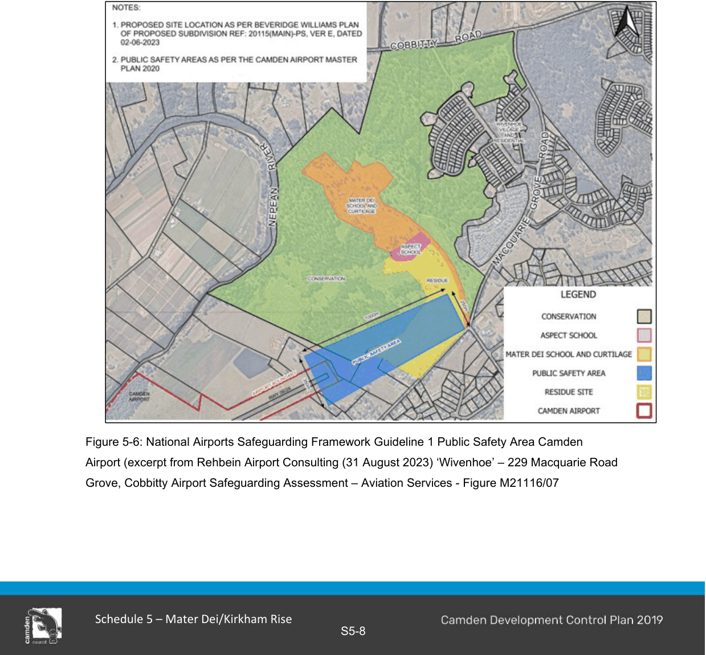

### S5.3 Heritage, Conservation and Airport Operations

#### Introduction

Key distinguishing qualities of the Mater Dei site which have future development and management implications include:

• Heritage Conservation

• Airspace Operations

• Natural Areas Conservation Objectives and controls in respect of each are detailed as follows:

#### Heritage Conservation

The Wivenhoe group including the grand villa (house) and gardens, outbuildings, stables, servant quarters, farmhouse and coach house are listed as an important local item of environmental heritage.

A comprehensive Conservation Management Plan was compiled by Design 5 Architects in 1997 and revised in 2008 and more recently reviewed in association with a Planning Proposal. A Landscape Conservation Plan was also prepared by Design 5 Architects in 2000. Further, Design 5 Architects prepared a Heritage Impact Statement (September 2023) to support a Planning Proposal for the future separation of uses on the site.

Objectives

a. To preserve significance of the place and its setting.

b. To ensure an appropriate visual and physical curtilage is provided around the heritage place to protect it and facilitate its enjoyment and understanding.

Controls

1\. In accordance with the Heritage Impact Statement compiled by Design 5 Architects (September 2023): The RU2 Rural Landscape zone (and any future subdivision) must include the avenue of trees and fencing each side of the driveway.

2\. The tree lined driveway known as Mater Dei Road, along with open grasslands along the sides of the driveway must be conserved.

3\. The site must be managed in accordance with the Conservation Management Plan compiled by Design Five Architects (1997 and revised 2008) and the Landscape Conservation Plan also compiled by Design 5 Architects (2000).

#### Airspace Operations

The site is located adjacent to the Camden Airport and is subject to the influence of its operational parameters.

A comprehensive report compiled by Rehbein Airport Consulting dated 31 August 2023 details preliminary considerations for further development of the site that are impacted by Camden Airport operations and form an important reference source.

Objectives

a. To ensure the operational integrity of the Camden Airport is not compromised and relevant safety levels achieved.

b. To ensure appropriate development envelopes are not compromised.

c. To ensure appropriate acoustic amenity in respect of new development. Controls

1\. Development must have specific regard to the Airport Safeguarding Assessment undertaken by Rehbein Airport Consulting (31 August 2023),and include reference to the map contained at Appendix H – Public Safety Area Camden Airport and reproduced below as Figure 5-6.

> [Picture on page 10: a picture, saved as a picture (images/schedule-05-mater-dei-and-kirkham-rise-page-10-10.gif, 150 dpi).]

Figure 5-6: National Airports Safeguarding Framework Guideline 1 Public Safety Area Camden Airport (excerpt from Rehbein Airport Consulting (31 August 2023) ‘Wivenhoe’ – 229 Macquarie Road Grove, Cobbitty Airport Safeguarding Assessment – Aviation Services - Figure M21116/07

#### Natural Areas Conservation

The retained and rehabilitated natural areas are critical to the Mater Dei setting and local and broader biodiversity outcomes.

Objectives

a. To conserve the ecological values of the site and ecological links to surrounding areas.

b. To facilitate limited access and educational/interpretative actions/activities.

c. To ensure conservation is in accordance with the Wivenhoe Conservation Management Plan 1997 and revised 2008.

Controls

1\. All conservation initiatives must generally reflect the details contained in the prevailing biodiversity stewardship and biodiversity legislation.

2\. A Conservation Management Plan must inform environmental protection works and the establishment of environmental facilities.

3\. Development on land that adjoins C2 Conservation Land is to ensure that there are no adverse impacts to the native vegetation and ecological values of the C2 zone, including adverse weed dispersion.

4\. Conservation areas located in the former vineyard site to southwest of the Wivenhoe Villa are to maintain the open grassed setting to ensure views and vistas are retained to and from the Wivenhoe Villa.

