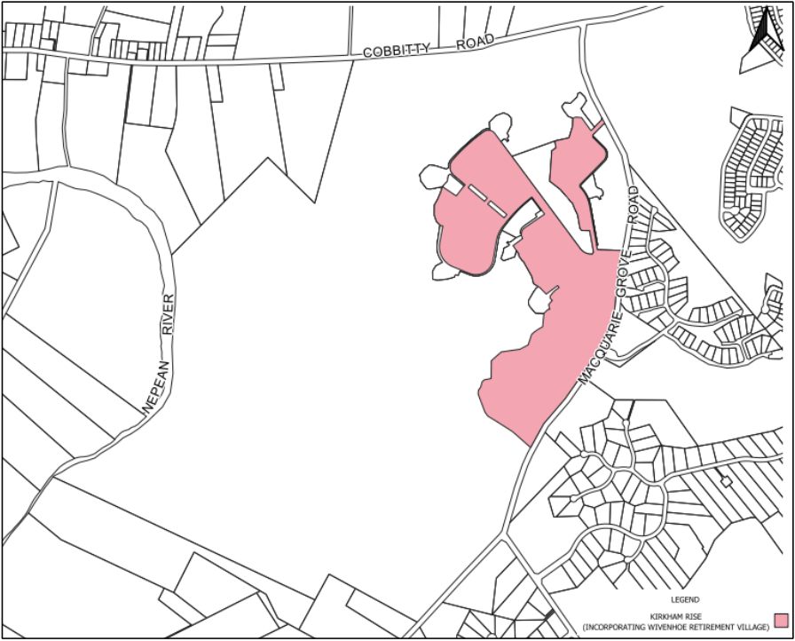

### S5.4 Site Specific Controls

> [Picture on page 12: a picture, saved as a picture (images/schedule-05-mater-dei-and-kirkham-rise-page-12-2.gif, 150 dpi).]

Figure 5-7 Kirkham Rise (incorporating Wivenhoe Retirement Village) Site Plan

#### S5.4.1  Kirkham Rise (and Wivenhoe Retirement Village)

It should be noted that the controls listed below are specific to Kirkham Rise (and the Wivenhoe Retirement Village). They must be read in conjunction with the controls in Part 4 of this DCP. In the event of any inconsistency, the controls below prevail.

#### Appearance

1\. Homes should be designed to be of ‘contemporary, eco character’.

2\. Use of architectural features such as awnings, porticos and verandahs are required to ensure street presentation of the homes is in keeping with the vision for Mater Dei.

#### Roof Eves

1\. 600mm at a minimum on eastern and western facades.

#### Corner Lots

1\. Should be designed to present to both street frontage and public areas.

2\. Front facade feature should continue around to 40% of the secondary frontage.

#### Parkland Lots

1\. Should be designed to appropriately address the parkland area.

2\. Architectural features are to be replicated to secondary frontages with front a parkland.

3\. Blank walls to the parkland are not permitted.

#### Roofing

1\. Roof designs must be a minimum pitch of 200.

2\. Skillion roofs can have a minimum pitch of 50.

3\. Highly reflective roofing material are not permitted.

#### Colours and Materials

1\. Colours should be low in contrast and sympathetic to the natural environment. Rendered masonry, stone, timber, steel and painted/rendered brickwork should be the predominant external materials.

#### Fencing

1\. Open fencing is preferred wherever possible.

2\. Front fencing is not allowed.

3\. Brush mat fencing is prohibited.

4\. Rear and side boundary fences once behind the building line can be a maximum height of 1.8m but on bush front lots must return with open post and rail or post and wire for the rear 6m of the lot.

#### Maximum Driveway Width

1\. 4.0m wide at the property verge but can be splayed within the property boundary to allow for adequate vehicle manoeuvrability.

#### Rainwater Tanks

1\. Each dwelling must have a tank of at least 5,000ltr.

2\. If the home contains a swimming pool, the water tank must be connected to the pool to assist in topping up the pool.

3\. Water tanks in the APZ cannot be constructed of plastic.

#### Kirkham Rise Guidelines

1\. Kirkham Rise Design Guidelines volume 1, November 2010 and as amended, should be referenced for further detailed design requirements

#### Table 5-1: Summary of residential accommodation controls – Kirkham Rise

| SETBACKS |  |
|---|---|
| Front setback (min) | 4.5m; average of 5.5m |
| Secondary street setback (min) | 4.5m |
| Side setback ground floor (min) | 1.5m |
| Side setback second floor (min) | 4.5m |
| Rear setback ground floor (min) | 6m |
| Rear setback second floor (min) | 10m |
| Garage setback (min) | 1m behind principal building line and 5.5m from front boundary; third garage to be set back 2m behind principal building line. |
| Architectural element front setback encroachment (max) | 1m |
| Rear lane setback (min) | 1m. Notwithstanding this, the rear lane setback can be reduced to 0.5m only if it can be adequately demonstrated to Council’s satisfaction, that the development can facilitate waste collection in a safe and orderly manner. |
| Public reserve setback (min) | 3m |
| HEIGHT |  |
| As per LEP 2010 and Part 4 of this DCP |  |

| PRIVATE OPEN SPACE, LANDSCAPING AND SITE COVERAGE |  |
|---|---|
| Site coverage (max) – lots less than 450m2 | Single storey development - 60% Two storey development – 50% ground floor, 35% upper floor |
| Site coverage (max) – lots 450m2 or greater | Single storey development - 50% Double storey development – 30% |
| Front yard paved surfaces (max) | 40% |
| Landscaped area (min) | 30% |
| Landscaped area (min) within the front setback | 40% |
| Principal private open space (PPOS) (min) | 24m2 with a minimum dimension 4m |
| Gradient of PPOS (max) | 1:10 |
| Solar access to PPOS (min) | Direct sunlight must reach at least 50% of the PPOS of both the subject dwelling and of any adjoining dwelling for not less than 3 hours between 9:00am and 3:00pm on 21 June. Dwellings must be orientated to maximise solar access to living rooms having regard to future and existing site constraints. At least one window to a living area of dwellings on neighbouring properties must receive a minimum of 3 hours of direct sunlight between 9am and 3pm on 21 June. |
| GARAGE DESIGN |  |
| Garage door width (max) – lots 7-15m wide | 60% of front elevation width |
| Garage door width (max) – lots greater than 15m wide | 50% of front elevation width |

#### S5.4.2  Mater Dei Rural Residue

The rural residue precinct on the Mater Dei site (depicted in Figure 5.3) is strategically located and should be developed and managed in accordance with the following planning provisions.

Objectives

a. To maintain the rural landscape character and general visual amenity of the area.

b. To ensure the compatibility of non-agricultural land uses with the rural, environmental and conservation values of the land.

c. Not to adversely impact the operational parameters of the Camden Airport.

d. To ensure development complies with the Wivenhoe Conservation Management Plan dated 1997 and revised 2008.

Controls

1\. The prevailing topography must not be significantly altered.

2\. Adverse impacts on view corridors and vistas must be minimised.

3\. New buildings and structures must minimise any visual impact.

4\. Fencing must be generally of a rural character utilising post and rail or wire.

5\. Screen landscaping must be minimised.

6\. Heritage conservation values are maintained.

#### - End of Schedule –

