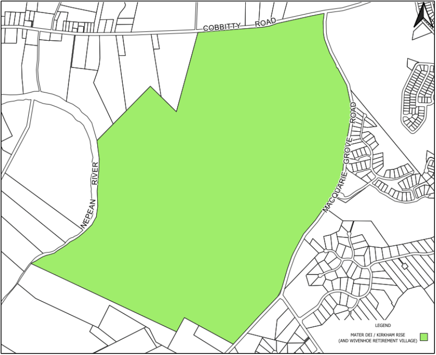

# Camden Development Control Plan 2019 - Schedule 5 Mater Dei and Kirkham Rise

> This chapter is split into 3 section file(s), one per numbered heading, in the order they appear in the PDF.

Source PDF: [Final-Adopted-Schedule-5-Mater-Dei-Kirkham-Rise-DCP-30-July-v2.pdf](Final-Adopted-Schedule-5-Mater-Dei-Kirkham-Rise-DCP-30-July-v2.pdf)

### Schedule 5

Mater Dei and

### Kirkham Rise

> [Picture on page 1: a picture, saved as a picture (images/schedule-05-mater-dei-and-kirkham-rise-page-1-4.gif, 150 dpi).]

### Contents

| MATER DEI/KIRKHAM RISE | S5-1 |
|---|---|
| S5.1 Introduction | S5-1 |
| S5.2 Subdivision Planning and Design | S5-2 |
| S5.2.1 Kirkham Rise | S5-2 |
| S5.2.2 Mater Dei | S5-2 |
| S5.3 Heritage, Conservation and Airport Operations | S5-7 |
| S5.4 Site Specific Controls | S5-10 |
| S5.4.1 Kirkham Rise (and Wivenhoe Retirement Village) | S5-10 |
| S5.4.2 Mater Dei Rural Residue | S5-14 |

| Table of Figures |  |
|---|---|
| Figure 5-1: Mater Dei/Kirkham Rise Location Plan | S5-1 |
| Figure 5-2 Mater Dei Site Plan | S5-2 |
| Figure 5-3: Mater Dei Landuse Precinct/Character Areas | S5-4 |
| Figure 5-4: Indicative Asset Protection Zones (depicted in green) | S5-5 |
| Figure 5-5: Conceptual Kirkham Lane/Macquarie Grove Road Intersection Design | S5-6 |
| Figure 5-6 National Airport Safeguarding Framework Guideline 1 Public Safety Area Camden Airport | S5-8 |
| Figure 5-7 Kirkham Rise (incorporating Wivenhoe Retirement Village) Site Plan | S5-10 |

### List of Tables

Table 5-1: Summary of residential accommodation controls – Kirkham Rise ................................................. S5-12

### MATER DEI/KIRKHAM RISE S5.1 Introduction

The Mater Dei/Kirkham Rise (and Wivenhoe Retirement Village) site interfaces with Harrington Grove and the Kirkham low density residential lands to the west of Macquarie Grove Road (Refer to Figure 5- 1). The Mater Dei site is occupied by the heritage listed building called Wivenhoe, two functioning schools and collection of associated buildings spaces and infrastructure and expansive restored woodland areas and open rural landscapes. The site is bound to the east by Macquarie Grove Road, to the north by Cobbitty Road, to the west by the Nepean River and adjoins privately owned rural lands to the south.

The Kirkham Rise site (incorporating the Wivenhoe Retirement Village) is a low-density residential development accessed off Macquarie Grove Road. It was formerly part of the Mater Dei property holding and is reflected in Figure 5.6.

Note: Wivenhoe referred to in isolation is a reference to the Wivenhoe Villa (heritage item) on the Mater Dei Site. This schedule refers to the residue Mater Dei site and the Kirkham Rise site (which

incorporates the Wivenhoe Retirement Village)

> [Picture on page 3: a picture, saved as a picture (images/schedule-05-mater-dei-and-kirkham-rise-page-3-16.gif, 150 dpi).]

Figure 5-1: Mater Dei/Kirkham Rise (incorporating Wivenhoe Retirement Village) Location Plan

<!-- sections -->
## Sections

1. [S5.2 Subdivision Planning and Design](01-s5-2-subdivision-planning-and-design.md)
2. [S5.3 Heritage, Conservation and Airport Operations](02-s5-3-heritage-conservation-and-airport.md)
3. [S5.4 Site Specific Controls](03-s5-4-site-specific-controls.md)
