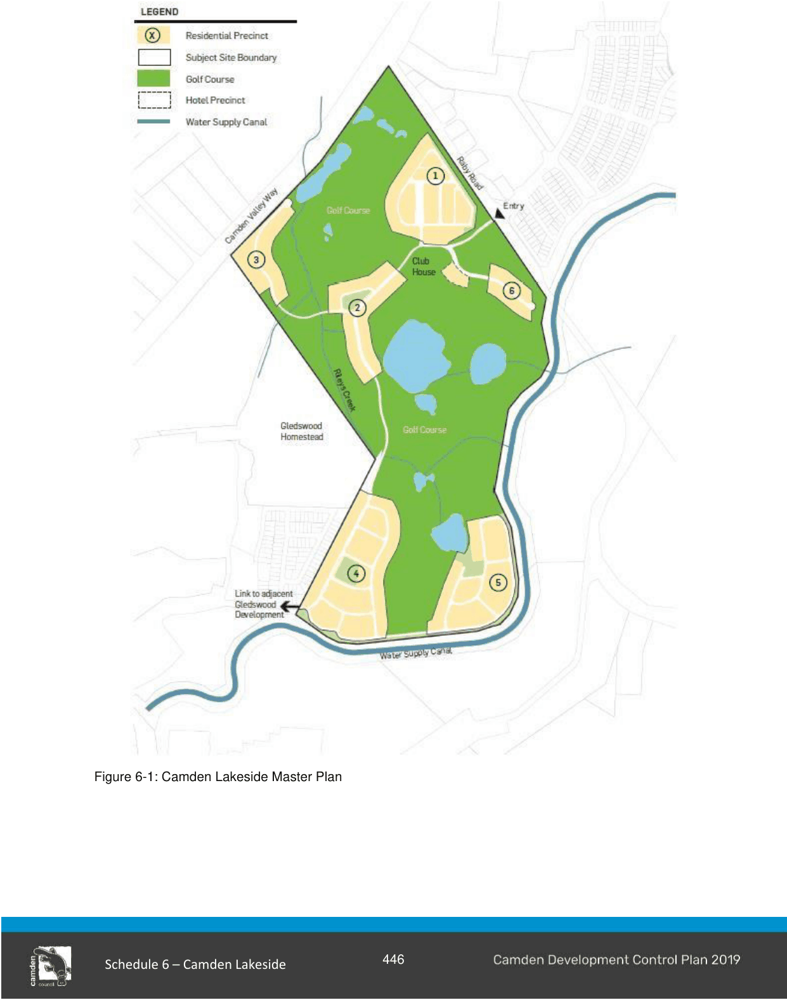

#### S6.2.2 Subdivision design

#### Objectives

a. Establish a framework for the provision of a diversity of dwelling types within Camden Lakeside, including options for seniors living, multi dwelling housing and residential flat buildings in Precinct 1.

b. Maximise amenity of residential lots by providing maximum frontage and access to open space, including golf play areas, parks and creeks.

c. Facilitate streetscapes which maximise opportunities for pedestrian activity and visual surveillance of public spaces.

d. Establish an urban structure which will facilitate the protection and enhancement of the visual amenity of the landscape.

e. Maximise amenity of residential lots by ensuring suitable noise attenuation measures adjacent to Camden Valley Way and Raby Road subject to maintaining visual access to the Camden Lakeside area from Camden Valley Way.

f. Establish an urban structure which will allow for the protection and management of important vegetation.

g. Maximise the use of public transport, walking and cycling trips to, from and within the site.

#### Controls

1\. The subdivision pattern for Camden Lakeside must provide for a diversity of dwelling types (attached and detached) with lot sizes ranging from small lot residential (250m2 to 450m2) to standard lot residential (450m2 to 850m2) and large lot residential (≥850m2).

2\. Precinct 1 dwelling types may also include provision for seniors living, multi dwelling housing and residential flat buildings. The development of the latter will be on super lots which are not required to provide building envelopes as any future subdivision will be assessed to include the relevant design criteria. With the exception of residential flat buildings, the permissible dwelling density is 1 dwelling per 250m2 of site area with a maximum permissible site coverage consistent with Table 6- 1.

> [Picture on page 7: a picture, saved as a picture (images/schedule-06-camden-lakeside-page-7-1.gif, 150 dpi).]

Figure 6-1: Camden Lakeside Master Plan

