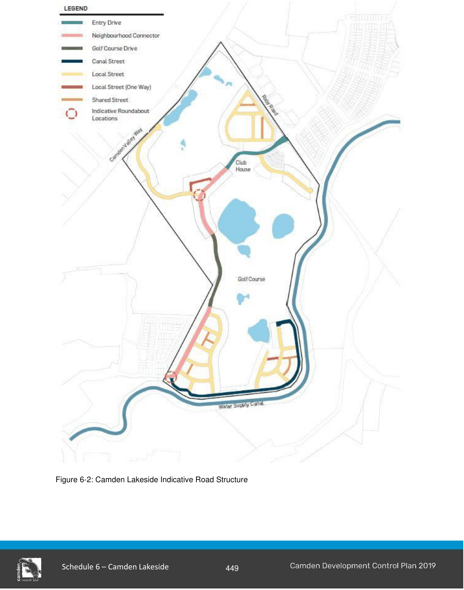
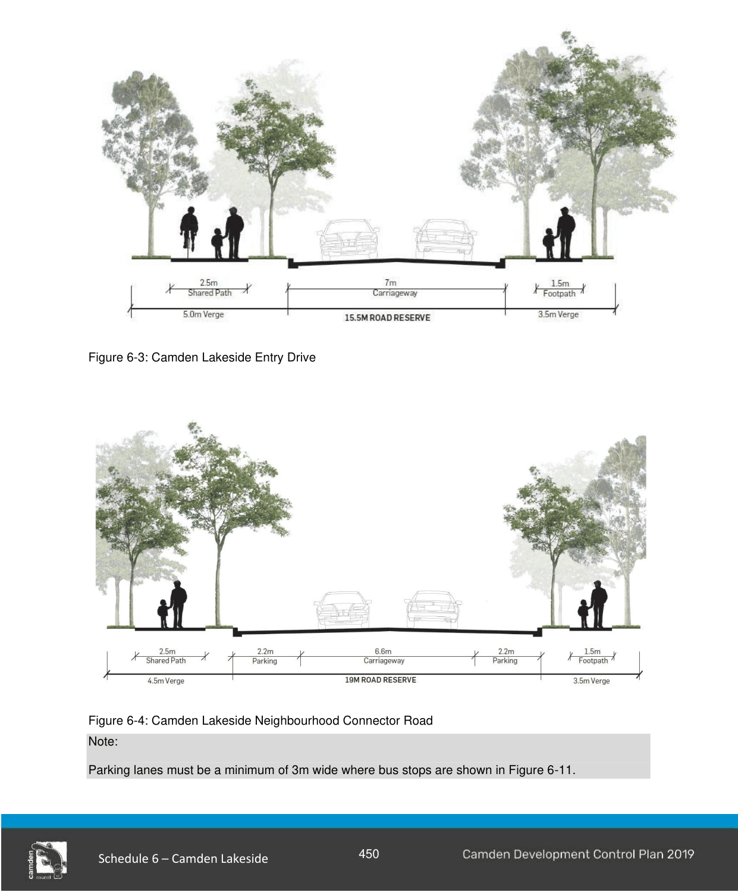
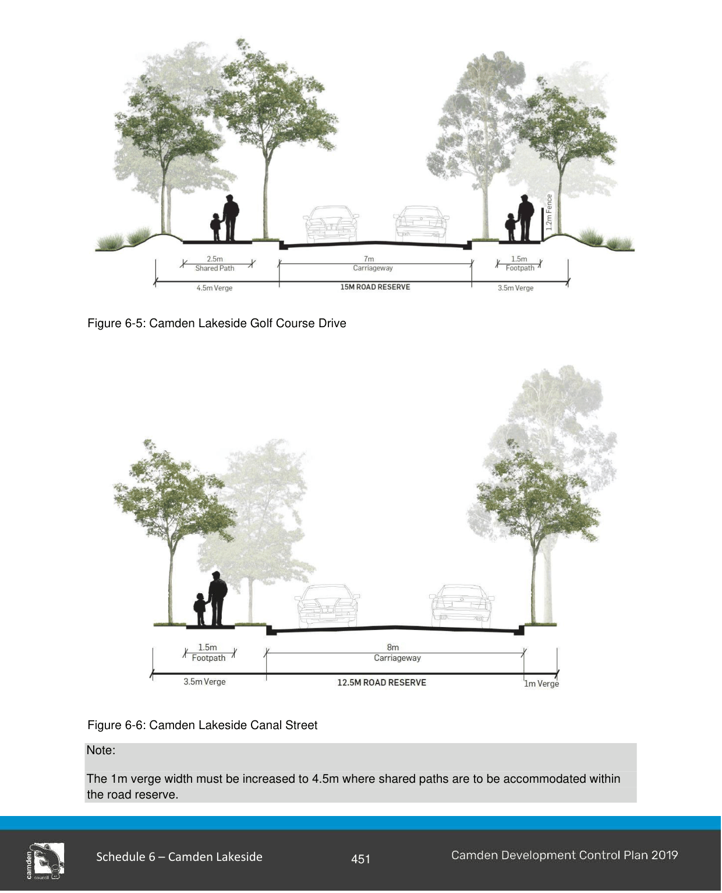
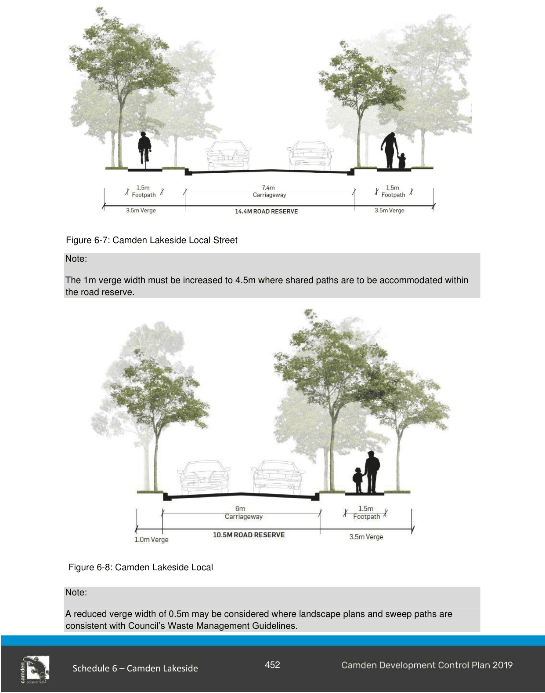
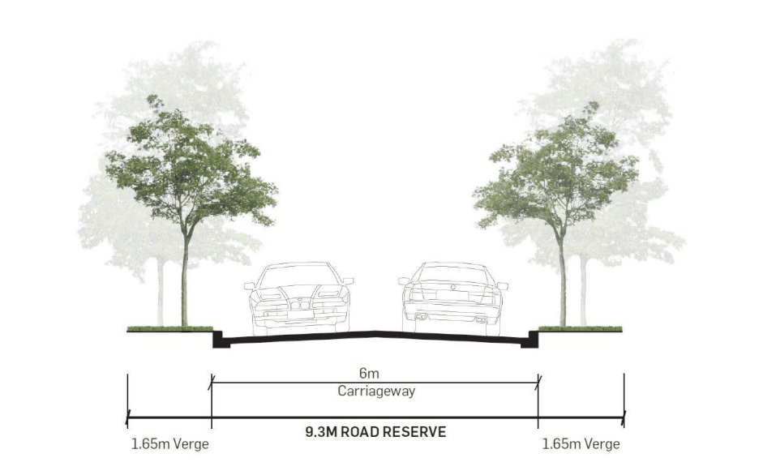
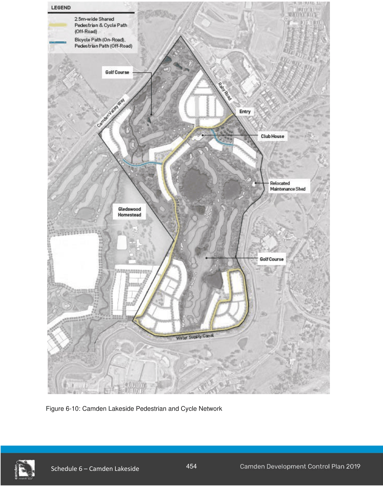
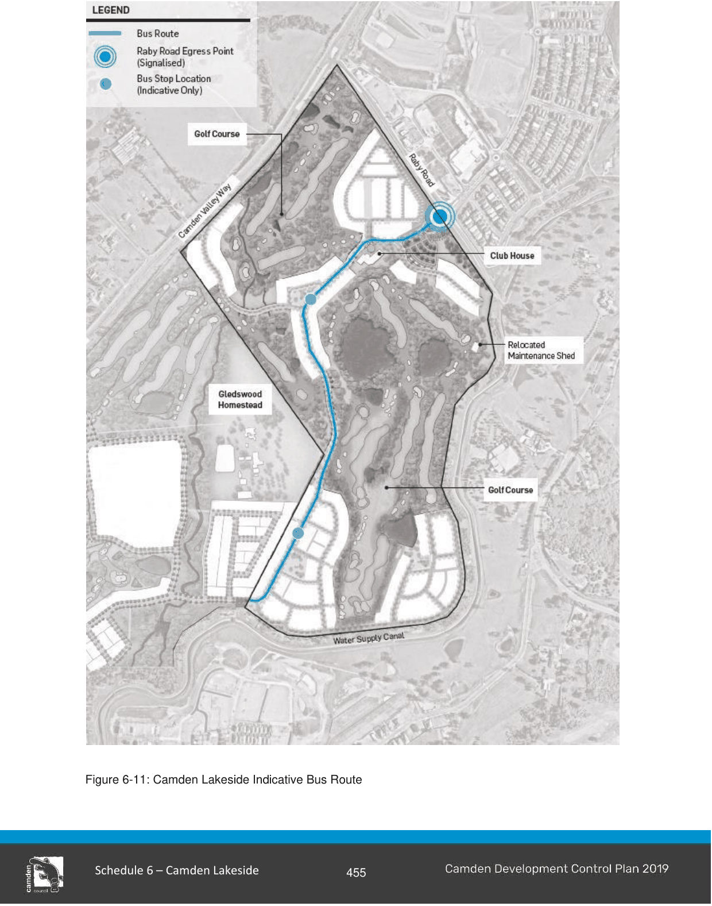

#### S6.2.3 Street, Pedestrian and Cycle Network

#### Objectives

a. Establish a legible, safe and well-connected street network that promotes pedestrian and bicycle movement as well as convenient vehicular access while recognising constraints to connectivity imposed by the water canal and the external arterial roads.

b. Provide a vehicular and pedestrian connection with the Gledswood Precinct.

c. Facilitate a future bus link, with bus stops, connecting to the adjacent Gledswood Precinct.

d. Create well-vegetated, attractive streetscapes which are not dominated by driveways and garages.

e. Ensure the parking arrangements contribute positively to the character of the streets.

f. Incorporate existing significant trees into street verges where feasible.

g. Establish verges which are sustainably landscaped with trees, shrubs and groundcovers that have low water and nutrient demands.

h. Provide a variety of street tree planting with formal and informal spacings that will help create a special character within the streets.

i. Utilise street verges for Water Sensitive Urban Design and stormwater treatment.

j. Plant species selection and layout will minimise ongoing water and maintenance requirements.

k. Where streets cannot be located immediately adjacent to open space, lots may back onto that open space providing they minimise potential personal and property security, vandalism and poor visual amenity.

#### Controls

1\. The street, pedestrian and cycle and public transport networks are to be designed and constructed in accordance with Figures 6-2 - 6-11 and landscaped accordingly.

2\. Kerb returns of 8.5m radius are to be provided for intersections between streets.

3\. Except where otherwise provided for in this DCP, all streets and roundabouts are to be designed and constructed in accordance with the minimum requirements set out in Council’s Engineering Design Specification and Engineering Construction Specification.  In particular:

a. shared streets must be approved by Transport for NSW;

b. all turning heads, local streets (one way) and shared streets must comply with Council’s Waste Management Guidelines;

c. all proposed sign and line marking plans must be approved by the Local Traffic Committee prior to the issue of Construction Certificate;

d. traffic management devices, such as roundabouts shown in figure 6-2, and pedestrian refuge islands along Providence Drive (locations are to be confirmed in consultation with Council Traffic Engineers), are to be identified at the subdivision certificate works stage; and

e. bus stop bays a minimum size of 3m by 30m must be provided for all indicative bus stops in both directions as shown in Figure 6-11.

4\. Where roads are adjacent to public open space, the verge widths may be reduced to a minimum of 1m. This is subject to footpaths, public utilities, bollards and fencing being adequately provided for.

Note:

Refer to Council’s Engineering Construction Standards for road construction.

Figures 6-2 to 6-11 must consider and provide for the 2.5m shared path as shown in Figure 6-10 where relevant.

> [Picture on page 10: a picture, saved as a picture (images/schedule-06-camden-lakeside-page-10-1.gif, 150 dpi).]

Figure 6-2: Camden Lakeside Indicative Road Structure

> [Picture on page 11: a picture, saved as a picture (images/schedule-06-camden-lakeside-page-11-1.gif, 150 dpi).]

Figure 6-3: Camden Lakeside Entry Drive

Figure 6-4: Camden Lakeside Neighbourhood Connector Road Note:

Parking lanes must be a minimum of 3m wide where bus stops are shown in Figure 6-11.

> [Picture on page 12: a picture, saved as a picture (images/schedule-06-camden-lakeside-page-12-1.gif, 150 dpi).]

Figure 6

-

5

:

Camden Lakeside Golf Course Drive

Figure 6-6: Camden Lakeside Canal Street

Note:

The 1m verge width must be increased to 4.5m where shared paths are to be accommodated within the road reserve.

> [Picture on page 13: a picture, saved as a picture (images/schedule-06-camden-lakeside-page-13-1.gif, 150 dpi).]

Figure 6-7: Camden Lakeside Local Street

Note:

The 1m verge width must be increased to 4.5m where shared paths are to be accommodated within the road reserve.

Figure 6-8: Camden Lakeside Local Street (one way) Note:

A reduced verge width of 0.5m may be considered where landscape plans and sweep paths are consistent with Council’s Waste Management Guidelines.

> [Picture on page 14: a picture, saved as a picture (images/schedule-06-camden-lakeside-page-14-1.gif, 150 dpi).]

Figure 6-9: Camden Lakeside Shared Street Note:

A reduced verge width of 0.5m may be considered where landscape plans and sweep paths are consistent with Council’s Waste Management Guidelines.

> [Picture on page 15: a picture, saved as a picture (images/schedule-06-camden-lakeside-page-15-1.gif, 150 dpi).]

Figure 6-10: Camden Lakeside Pedestrian and Cycle Network

> [Picture on page 16: a picture, saved as a picture (images/schedule-06-camden-lakeside-page-16-1.gif, 150 dpi).]

Figure 6-11: Camden Lakeside Indicative Bus Route

