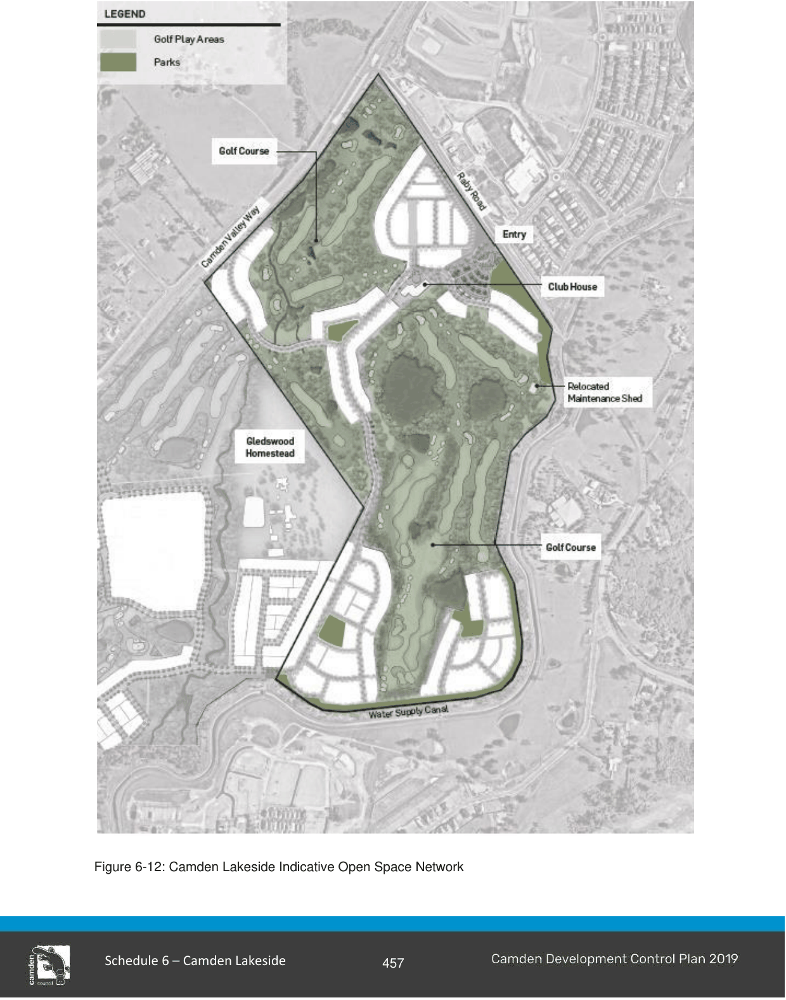

#### S6.2.4 Parks and Open Space

#### Objectives

a. Ensure that open space is of appropriate quality and quantity to meet the recreational and social needs of the community.

b. Provide the framework for the protection and enhancement of remnant vegetation and riparian corridors within the public realm.

c. Provide for the establishment of local parks and other open spaces which contribute to the sense of place.

d. Utilise open space for Water Sensitive Urban Design and stormwater management.

e. Promote plant species selection and design which will minimise ongoing water and maintenance requirements.

#### Controls

1\. Local open space will generally be located in accordance with Figure 6-12.

2\. Ensure connectivity of shared paths through public open space where appropriate.

> [Picture on page 18: a picture, saved as a picture (images/schedule-06-camden-lakeside-page-18-1.gif, 150 dpi).]

Figure 6-12: Camden Lakeside Indicative Open Space Network

