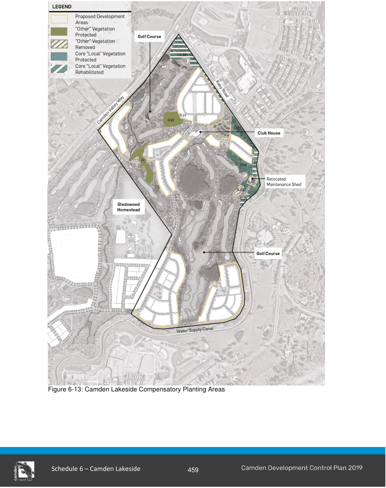

#### S6.2.5 Vegetation Conservation

#### Objectives

a. Ensure the protection and enhancement of existing significant trees and significant remnant vegetation where practical.

b. Facilitate the implementation of the agreed conservation offset package for Camden Lakeside.

c. Prevent the spread of weeds during and after construction.

#### Controls

1\. All ‘Core Local Vegetation Protected’ and ‘Other Vegetation Protected’ areas identified in Figure 6-13 are to be retained within open space and protected to ensure long term viability.

2\. Land identified as ‘Core Local Vegetation Rehabilitated’ in Figure 6-13 is to be restored in accordance with a Conservation Management Plan (CMP).  The CMP must be prepared in line with the recommendations of the Cumberland Ecology - Ecological Assessment (January 2007) and be endorsed by Camden Council.

3\. All applicants for subdivision and bulk earthworks are required to consider the need to minimise weed dispersion.

> [Picture on page 20: a picture, saved as a picture (images/schedule-06-camden-lakeside-page-20-1.gif, 150 dpi).]

Figure 6-13: Camden Lakeside Compensatory Planting Areas

