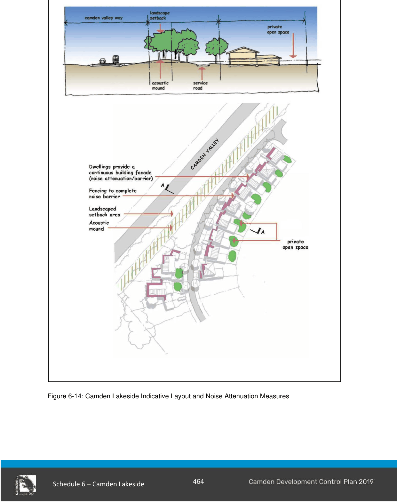

#### S6.2.9 Acoustic Amenity

#### Objectives

a. Establish an urban structure which protects and enhances short and long views within the landscape, whilst allowing for the development of individual lots.

b. Mitigate noise effects from Camden Valley Way and Raby Road to ensure private open space areas are not adversely affected by noise.

c. Allow for the physical separation of incompatible activities to facilitate adequate privacy.

d. Achieve high quality living environments which maximise visual privacy of the occupants and neighbouring properties through siting, building planning, location of openings and building materials.

#### Controls

1\. Lots contained within Precinct 3 immediately adjacent to Camden Valley Way are to have a continuous building facade (noise attenuation / barrier). This must include, where the facade faces toward the road, a private open space area located on the eastern (protected) side of the facade and sleeping / quiet areas located within the part of the dwelling furthest away from the noise source.  Figure 6-14 below shows indicative layout and noise attenuation measures which will help achieve the external noise criteria.

> [Picture on page 25: a picture, saved as a picture (images/schedule-06-camden-lakeside-page-25-1.gif, 150 dpi).]

Figure 6-14: Camden Lakeside Indicative Layout and Noise Attenuation Measures

