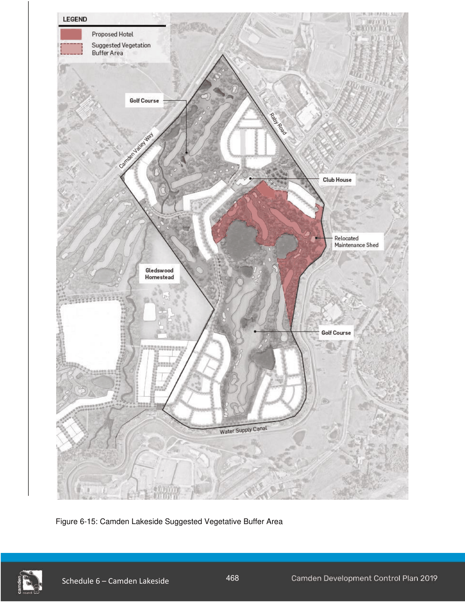

### S6.3 Hotel Development Controls

#### Objectives

a. To ensure any hotel development does not pose an adverse impact on the landscape and visual character of the area, surrounding heritage items or other places of heritage significance.

b. Minimise opportunity for light spill from the hotel development to the public domain and surrounding development.

c. To mitigate potential conflicts between utility service providers and any proposed hotel.

#### Controls

1\. A buffer screen of vegetation, incorporating upper, middle and lower canopy plantings from the Cumberland Plain Woodland community, must be planted to achieve a natural visual buffer as recommended in the Landscape and Visual Analysis Reports (RPS Australia East Pty Ltd, November 2017) and the Heritage Impact Assessment (RPS Australia East Pty Ltd November 2017).

a. Vegetative buffer screen plantings must be no less than 10m in depth.

b. The proposed buffer area must be located within the suggested vegetative buffer area marked on Figure 6-15. The buffer area is to ensure any hotel development is to adequately screen vistas from the heritage listed Upper Canal System and the Gledswood Homestead; and is to preserve the existing vistas of the Gledswood Homestead towards the lakes.

Note - Core protected local vegetation, and local vegetation rehabilitation areas can also be considered if the presence of upper, middle and lower canopy can be demonstrated to a minimum depth of 10m.

c. All plantings must be in place prior to the release of the Occupation Certificate for any hotel.

2\. A Vegetation Management Plan (VMP) is to be submitted with any hotel Development Application.

a. The VMP is to specify plantings required for the vegetation buffer, ensuring they are consistent with the Cumberland Plain Woodland community, and requires a management plan in perpetuity.

b. Any pre-existing vegetative buffer screening is to be protected when civil works are being carried out.

c. A covenant MUST be registered on the title of the lot requiring compliance with the VMP prior to the release of the Occupation Certificate for any hotel.

d. Planting works as per the VMP must be completed prior to the release of the Occupation Certificate for any hotel.

3\. A schedule of materials and colours must be submitted with any hotel development application.

a. Materials and colours for buildings (including ancillary structures) must adopt neutral/ earthen colours such as tones of greys, grey-greens, blue-greys, browns, or fawns. Bright colours, stark whites, and blacks must be avoided.

b. Non-reflective materials for external use must be utilised.

4\. A lighting impact study is to be submitted with any hotel Development Application.

a. The lighting impact study is to include potential impacts and a mitigation strategy to address any potential internal and external light spill from any proposed hotel; and is to address the Australian Standards AS4282 control of the obtrusive effects of outdoor Lighting.

5\. Any development application must seek comment from relevant utility providers and ensure concerns are adequately addressed prior to the issue of development consent.

> [Picture on page 29: a picture, saved as a picture (images/schedule-06-camden-lakeside-page-29-1.gif, 150 dpi).]

Figure 6-15: Camden Lakeside Suggested Vegetative Buffer Area

