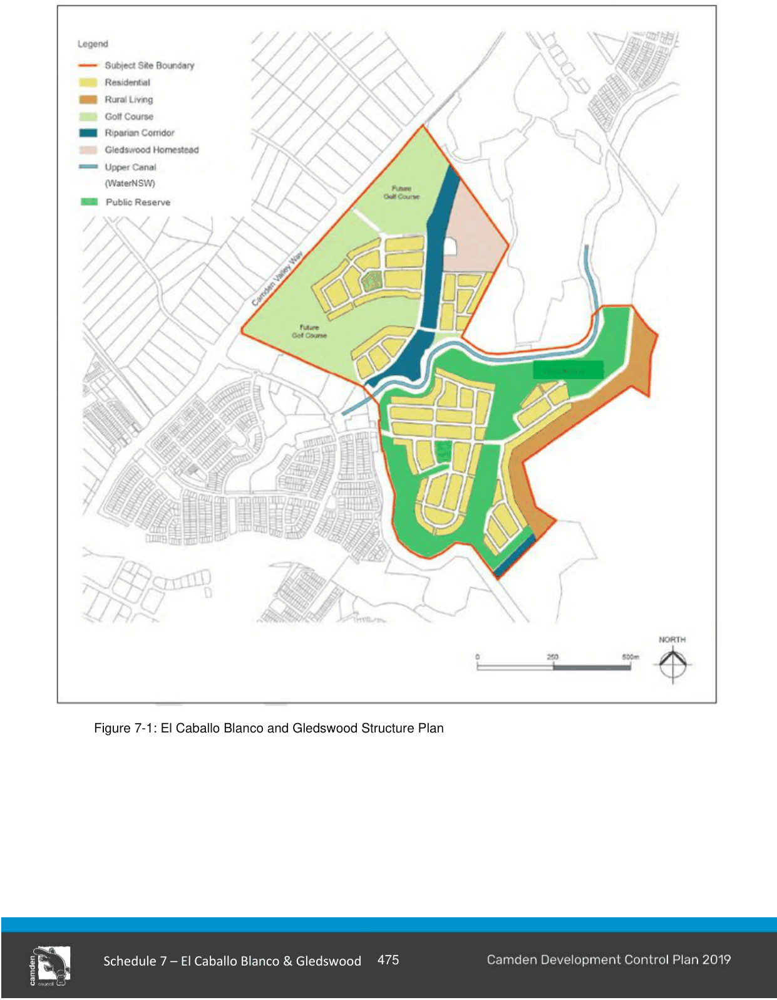

#### S7.1.2 Structure Plan

The site is part of a larger area undergoing change from rural to urban uses. Lands immediately to the north, known as Camden Lakeside, were the subject of a separate rezoning proposal and have been zoned for residential and recreational uses. Lands to the south are within the Turner Road precinct, a first release precinct of the South West Growth Centre.

The Structure Plan provides guidance for the connectivity of development on the subject lands with surrounding development.  The Structure Plan seeks to ensure that:

a. development is coordinated and infrastructure and facilities are delivered to support future residents and users; and

b. conservation and environmental sustainability initiatives are implemented.

Lands to the west of Camden Valley Way are also part of the South West Growth Centre and will be the subject of future urban development. Connectivity and integration of the subject site to adjoining lands to the north and south is illustrated in Figure 7-4.

> [Picture on page 5: a picture, saved as a picture (images/schedule-07-el-caballo-blanco-gledswood-page-5-1.gif, 150 dpi).]

Figure 7-1: El Caballo Blanco and Gledswood Structure Plan

