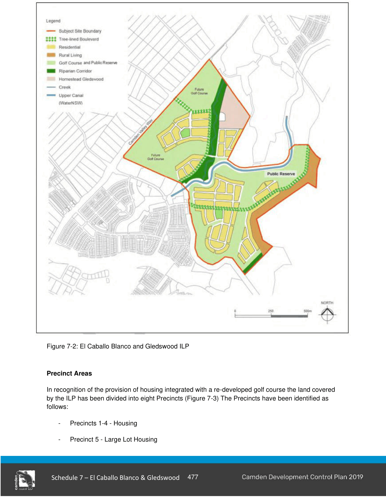
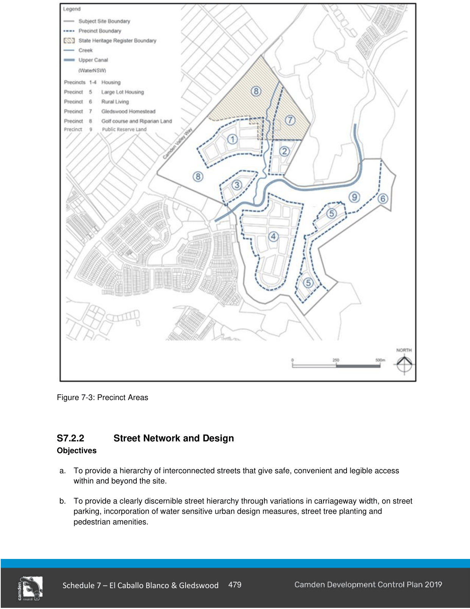

### S7.2 Subdivision Planning and Design

#### S7.2.1 Indicative Layout Plan

The controls and ILP have been prepared to respond to the conservation outcomes identified for Gledswood, including the protection of significant visual connections, interpretation of historic access roads and the provision of landscape buffer areas.

#### Objectives

a. To ensure development of the El Caballo Blanco and Gledswood lands (site) is undertaken in a co-ordinated manner.

b. To ensure the golf course facilities provide a unifying landscape setting across the subject site and integration with the Turner Road Precinct to the south while at the same time respecting the historic landscape of the Gledswood Estate.

#### Controls

1\. Development is to be undertaken generally consistent with the Indicative Layout Plan (ILP) at Figure 7-2 subject to compliance with the objectives and development controls set out in this chapter.

2\. Connectivity points as shown in Figures 7-1 and 7-2 are to be provided or suitable alternative points that maintain the same level of desired connectivity.

3\. Where variation to the ILP is proposed, the applicant is to demonstrate that the proposed development is consistent with the vision, the Gledswood Estate CMP and the Development Objectives for development covered by this chapter.

4\. Golf course facilities must be designed to provide a unifying landscape element. The portion within the Gledswood Estate must comply with the polices for landscape treatments contained within the CMP.

> [Picture on page 7: a picture, saved as a picture (images/schedule-07-el-caballo-blanco-gledswood-page-7-1.gif, 150 dpi).]

Figure 7-2: El Caballo Blanco and Gledswood ILP

#### Precinct Areas

In recognition of the provision of housing integrated with a re-developed golf course the land covered by the ILP has been divided into eight Precincts (Figure 7-3) The Precincts have been identified as follows:

- Precincts 1-4 - Housing

- Precinct 5 - Large Lot Housing

- Precinct 6 - Rural Living

- Precinct 7 - Gledswood Homestead

- Precinct 8 - Golf Course and Riparian Lands

- Precinct 9 – Public Reserve and Riparian Land

The housing provided within the precincts will generally comprise three broad categories.  The categories of housing will be:

- “Golf Course Housing” and “Public Reserve Housing” which will be dwellings which share a frontage to the golf course lands and public reserve land;

- “Traditional Housing” which will be dwellings within the precinct on lots greater than 400m2; and

- Attached Dwellings which are best located opposite either: golf course lands, RE2 zoned lands, riparian corridor lands or open space areas and accessible from a rear lane or second frontage.

> [Picture on page 9: a picture, saved as a picture (images/schedule-07-el-caballo-blanco-gledswood-page-9-1.gif, 150 dpi).]

Figure 7-3: Precinct Areas
