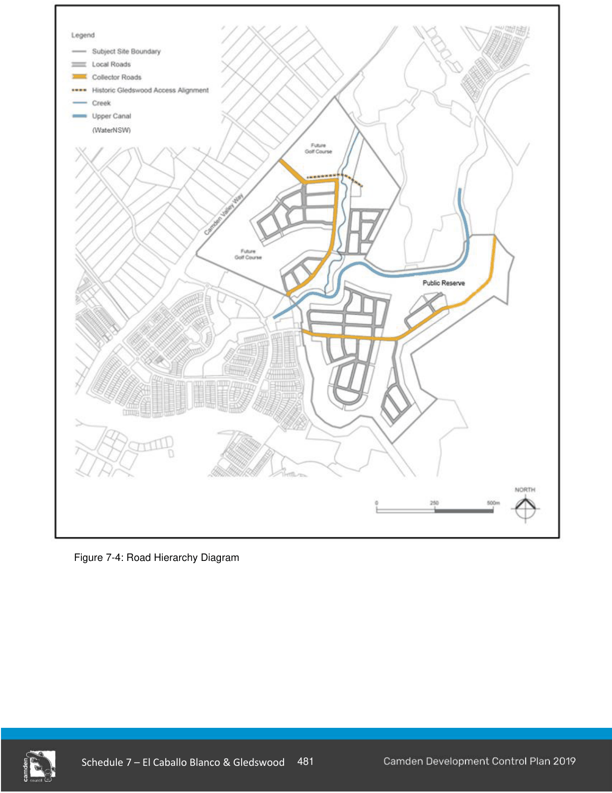

#### S7.2.2 Street Network and Design

#### Objectives

a. To provide a hierarchy of interconnected streets that give safe, convenient and legible access within and beyond the site.

b. To provide a clearly discernible street hierarchy through variations in carriageway width, on street parking, incorporation of water sensitive urban design measures, street tree planting and pedestrian amenities.

c. To provide a safe and convenient public transport, pedestrian and cycleway network and connections to the Turner Road precinct to the south.

d. To ensure a high quality, functional, safe, legible and visually attractive public domain.

e. To protect the historic alignment and rural character of selected access roads to Gledswood Homestead.

f. To acknowledge the historical context of the site.

#### Controls

1\. The street network is to be provided consistent with Figure 7-2 (ILP) and the road hierarchy diagram at Figure 7-4

2\. Where variations to the street network shown in Figure 7-4 are proposed, the alternate street network is to achieve the following principles:

a. establish a permeable network that is based on a modified grid system,

b. encourage walking and cycling and reduce travel distances,

3\. The historic access road alignment to the Gledswood Homestead and adjacent verges and post and rail fence are to be retained in any new street pattern. The entry point into the estate and its connection to the historical access road to the Gledswood Homestead is to reflect a rural character.

4\. The proposed street network is to provide connections to the Turner Road Precinct to the South.

5\. The design and configuration of proposed roads and footpaths are to be consistent with Council’s Engineering Design Specification (other than historic access roads). The road designation is shown on the road hierarchy diagram at Figure 7- 4.

> [Picture on page 11: a picture, saved as a picture (images/schedule-07-el-caballo-blanco-gledswood-page-11-1.gif, 150 dpi).]

Figure 7-4: Road Hierarchy Diagram

