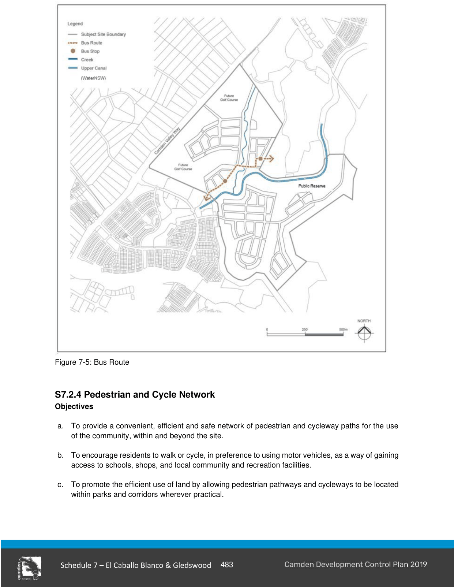

#### S7.2.3 Public Transport

#### Objectives

a. To encourage the provision and use of public transport.

b. To ensure clear, safe pedestrian links to public transport stops.

c. To allow for the majority of residential lots to be within reasonable walking distance from an existing or proposed bus stop.

#### Controls

1\. Bus routes are to be provided generally in accordance with Figure 7-5. Where the bus route is known, the route must be indicated on the subdivision DA drawings. The final location of bus stops will be determined by Council’s Local Traffic Committee.

2\. A minimum travel-way width of 3.5m is to be provided along all bus routes. Roundabouts on bus routes are to be designed to accommodate bus manoeuvrability.

3\. Bus stops are to be provided on-street and not within indented bays. Bus shelters are to be provided at key stops and installed at the subdivision construction stage.

> [Picture on page 13: a picture, saved as a picture (images/schedule-07-el-caballo-blanco-gledswood-page-13-1.gif, 150 dpi).]

Figure 7-5: Bus Route
