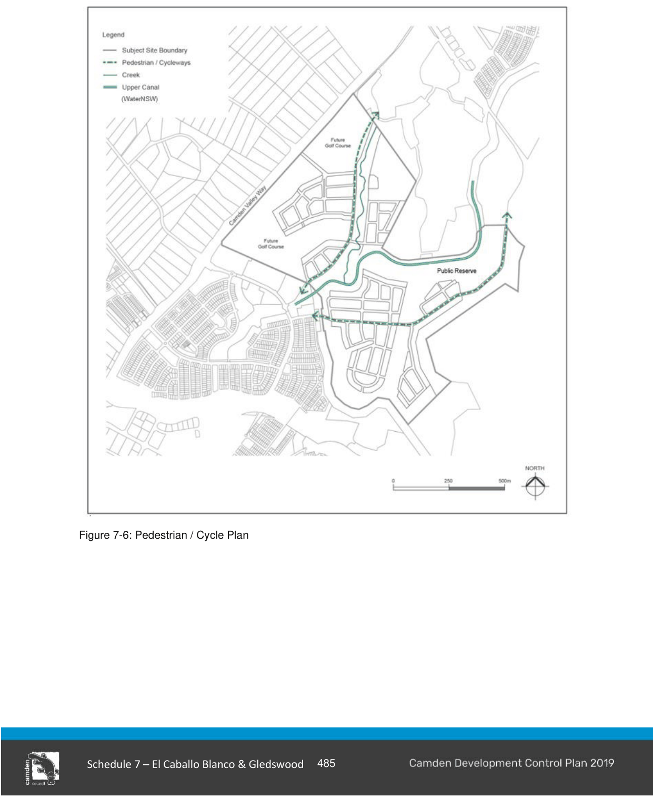

#### S7.2.4 Pedestrian and Cycle Network

#### Objectives

a. To provide a convenient, efficient and safe network of pedestrian and cycleway paths for the use of the community, within and beyond the site.

b. To encourage residents to walk or cycle, in preference to using motor vehicles, as a way of gaining access to schools, shops, and local community and recreation facilities.

c. To promote the efficient use of land by allowing pedestrian pathways and cycleways to be located within parks and corridors wherever practical.

#### Controls

1\. Key pedestrian and cycleway routes are to be provided generally in accordance with Figure 7-6 the design of cycleways located within the road reserve is to be in accordance with the requirements of this DCP. The minimum width of any off-street shared cycle and pedestrian pathways is to be 2.5m.

2\. All pedestrian and cycleway routes and facilities are to be consistent with the Planning Guidelines for Walking and Cycling (DoP & RTA 2004), Council’s Pedestrian Access and Mobility Plan 2003 and Cycling Aspects of Austroads Guide 2017.

3\. Pedestrian and cycle routes and facilities in public spaces are to be safe, well lit, clearly defined, functional and accessible to all.

4\. Pedestrian and cycle pathways, and pedestrian refuge islands are to be designed to be fully accessible by all in terms of access points and gradients, generally in accordance with Australian Standard 1428:1-4.

5\. Pedestrian and cycle pathways are to be constructed as part of the infrastructure works for each residential stage with detailed designs to be submitted with each DA.

> [Picture on page 15: a picture, saved as a picture (images/schedule-07-el-caballo-blanco-gledswood-page-15-3.gif, 150 dpi).]

Figure 7-6: Pedestrian / Cycle Plan

