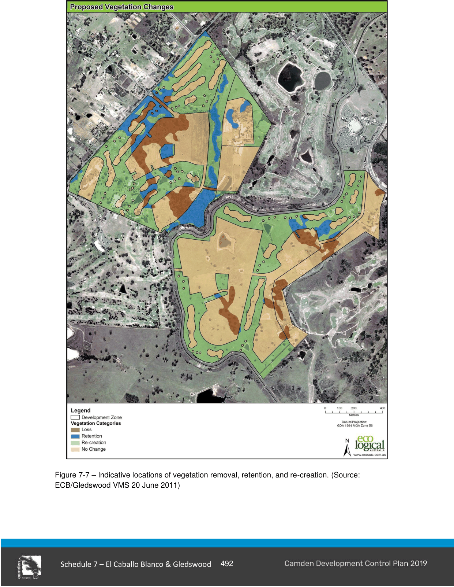

#### S7.2.7 Retention of Existing Vegetation

#### Objectives

a. The configuration of the proposed development precincts within the ILP for this DCP has been prepared to achieve the following objectives:

i. A consolidated, comprehensive vegetation outcome across the site in accordance with the El Caballo Blanco / Gledswood Vegetation Management Strategy (VMS) dated 29 June 2011;

ii. Retention of key vegetation nodes and habitat values (hollow bearing trees and 70% of all large trees);

iii. A central category 1 riparian corridor (as defined by the NSW Office of Water)) along Riley’s Creek connecting Camden Lakeside Golf Course through to Turner Road and South Creek;

iv. Security of ongoing revegetation, management and restricted access by way of a comprehensive Vegetation Management Plan (VMP);

v. Conservation of the historic landscape and setting of the Gledswood Estate through appropriate landscape design and selection within the State Heritage Register (SHR) curtilage area consistent with the policies of the CMP.

vi. Areas of golf course rough, outside the Gledswood SHR curtilage, are to be created and managed as fully vegetated woodland corridors throughout the golf course; and

vii. Designing Precinct pods of development to allow site wide connectivity.

#### Controls

1\. A comprehensive Vegetation Management Plan (VMP) is to be developed at the development approvals stage for the creation of Precinct super lots. The VMP is to contain detailed monitoring requirements and reporting periods to ensure that agreed outcomes are being met throughout the staged development and must be consistent with the El Caballo Blanco/Gledswood Vegetation Management Strategy dated 29 June 2011 specifically.

2\. The Vegetation Management Plan must demonstrate consistency within the vegetation, retention, re-creation and removal outcomes detailed at Table 7-1 and the Gledswood Estate CMP.

3\. A Development Staging Plan must be prepared in conjunction with the Vegetation Management Plan, prior to or at the development approvals stage. The plan must illustrate, for each stage, the area, the amount and type of vegetation to be removed, and the corresponding area and location of land to be revegetated.

4\. Retain all good condition vegetation along the riparian corridor and adjacent areas. If good condition vegetation cannot be retained, staging of works is recommended across the site.

5\. Any removal of good quality Shale Hills Woodland should occur at the final stage only after it can be demonstrated that the loss has been compensated for by sufficient habitat elsewhere within the site.

6\. Strict controls on all construction and earthmoving activities to ensure no impact on vegetation to be retained.

7\. Restoration and revegetation of all areas of rough within the golf course (other than within the Gledswood Estate SHR curtilage) to full Cumberland Plain Woodland communities. The treatment of any areas of rough within the SHR Curtilage must be consistent with the policies of the CMP.

8\. Fence off areas of existing vegetation from stock as soon as possible to facilitate and allow natural regeneration to occur. This will allow for native understorey species existing in the soil profile to regenerate naturally (for example Themeda australis), creating a likely reduction in the cost of regeneration across the site.

9\. Incorporate eco-sensitive development controls into the rural residential zoning along the western boundary of the site e.g. retention of existing vegetation, or excluding stock from sensitive areas to allow for natural regeneration.

10\. Ensure that areas where development abuts riparian corridors and existing good quality vegetation that there are adequate controls in place to protect these areas from contaminated runoff, rubbish and public access.

11\. Each development applications for the development of Precincts 1-8 must demonstrate that a minimum protection offset of 97.0ha of core regional vegetation has been achieved as set out in Table 7-1 below.

12\. If a landholder enters into an agreement that provides for the protection and management of native vegetation located on land that has been identified in the LEP for development, revegetation requirements for that landholder can be reduced on the ratio of 4.3 to 1 (i.e. a reduction of 4.3m² of revegetation for every 1m² that is protected).

13\. Council must consider the condition, viability and connectivity of the vegetation that is proposed to be retained and must consider the importance of the land that will no longer be revegetated in the context of the contribution to the connectivity and viability that this area would have made to the adjacent vegetation.

14\. Clearing of vegetation required to be protected under the LEP may be considered by Council, subject to a 1 for 1 offset with vegetation that is otherwise approved in the LEP for development. The offset must be protected and managed.

15\. Council must consider the condition, viability and connectivity of the vegetation that is proposed to be cleared or retained.

16\. Council may only consent to the clearing of vegetation that is otherwise proposed to be protected if an equal or higher class of vegetation (as identified in the Camden Natural Assets Policy) is proposed to be protected.

#### Table 7-1 Class of vegetation being retained, removed or re-created

| Class of Vegetation | Core Habitat – Regional retained 13.2ha | Core Habitat – Local retained 2.8ha | Support for Core habitat retained 0.7ha | Re-created vegetation habitat 74.8ha | Heritage native grassland re-created 5.5ha | Total area of vegetation to be achieved 97.0ha |
|---|---|---|---|---|---|---|

17\. Achievement of this level of vegetation retention and re-creation must be demonstrated across each of the ownerships and be generally consistent with Figure 7-7 which illustrates where vegetation loss, retention and re-creation may occur.

18\. For further controls on Environmentally Sensitive Land refer to Part 2 of this DCP.

> [Picture on page 22: a picture, saved as a picture (images/schedule-07-el-caballo-blanco-gledswood-page-22-1.gif, 150 dpi).]

Figure 7-7 – Indicative locations of vegetation removal, retention, and re-creation. (Source: ECB/Gledswood VMS 20 June 2011)

