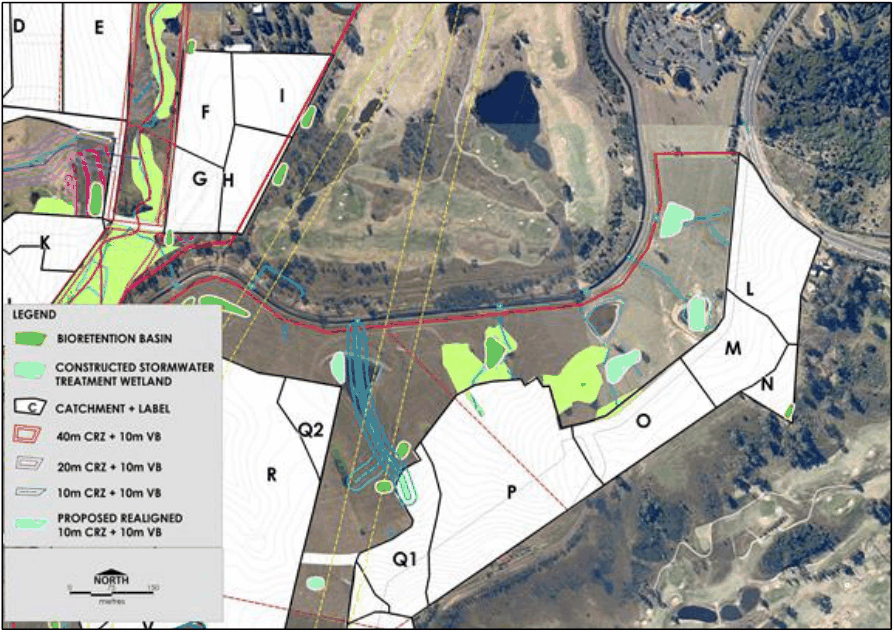
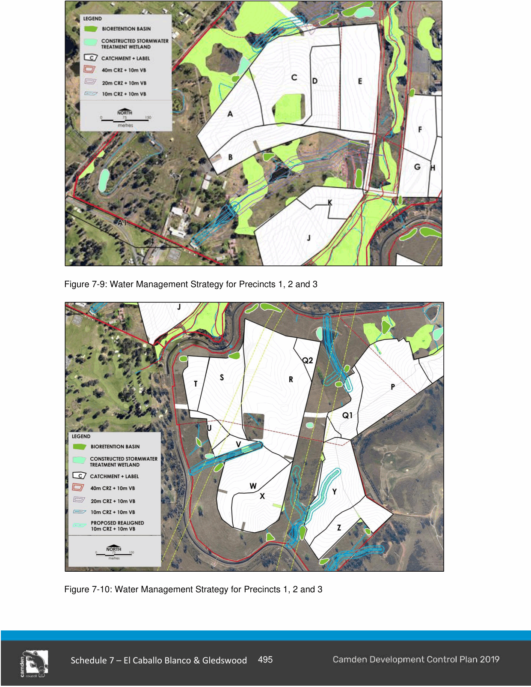

#### S7.2.9 Infrastructure Provision

#### Water Management Plan

#### Controls

1\. A detailed Water Management Plan must be prepared and accompany any development application and demonstrate consistency with the El Caballo Blanco and Gledswood Lands Water Management Strategy: Stormwater Quality and Stream Health prepared by Equatica and dated 8 July 2011 (Figure 7-8, 7-9 and 7-10).

2\. This Plan should demonstrate how stormwater quality targets will be achieved and include a separate monitoring plan that sets out procedures for water sampling, maintenance of water quality treatment facilities and risk management.

3\. The Water Management Plan will specifically address the design standards, access to and maintenance of any water quality treatment or detention devices proposed to be located within the proposed golf course lands and public reserve lands. Council must be satisfied that any such devices located on land zoned RE 2 (i.e. golf course) intended to service the wider urban area will be appropriately managed and maintained. This may require the negotiation of licences, covenants or other such instruments to satisfy Council.

> [Picture on page 24: a picture, saved as a picture (images/schedule-07-el-caballo-blanco-gledswood-page-24-17.gif, 150 dpi).]

Figure 7-8: Water Management Strategy for Precincts 2, 4, 5 and 6

> [Picture on page 25: a picture, saved as a picture (images/schedule-07-el-caballo-blanco-gledswood-page-25-1.gif, 150 dpi).]

Figure 7-9: Water Management Strategy for Precincts 1, 2 and 3

Figure 7-10: Water Management Strategy for Precincts 1, 2 and 3

#### Stormwater Concept

#### Controls

1\. Development must demonstrate general consistency with the El Caballo Blanco and Gledswood Preliminary Stormwater Quantity Management and Flooding Assessment prepared by Brown Consulting and dated July 2011.

2\. Detention basins must generally include a water quality component to assist in meeting the water quality objectives of the El Caballo Blanco and Gledswood Lands Water Management Strategy.

3\. The location and design of detention basins are to be consistent with the policies of the Gledswood Estate CMP.

#### Flood Planning Levels

#### Controls

1\. In addition to the requirements of this DCP, all proposed residential lots and habitable floor levels are to be 500mm above the 100 year ARI flood levels for the site. The ARI flood levels have been identified in the El Caballo Blanco and Gledswood Preliminary Stormwater Quantity Management and Flooding Assessment prepared by Brown Consulting and dated December 2010.

#### Local Infrastructure

#### Controls

1\. Local infrastructure must be provided in accordance with the timeframes identified in the VPA.

2\. Local infrastructure will be provided to support the relevant precinct stages.
