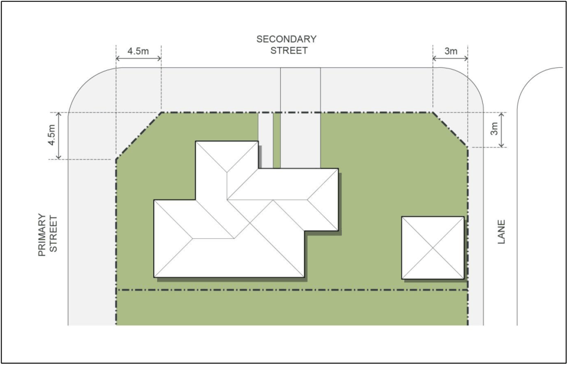

#### S7.2.11 Residential Subdivisions

#### Objectives

a. To establish a clear urban structure that maximises the ‘sense of neighbourhood’ and encourages walking and cycling over private car use.

b. To establish a subdivision layout that utilises the residential development areas efficiently, maximises the natural attributes of the site and clearly defines and reinforces the public domain.

c. To ensure that all residential lots are afforded a high level of amenity in terms of solar access, views/outlook and/or proximity to public and community facilities and parks.

d. To ensure corner sites are developed as visually significant elements in order to promote a strong and legible character.

e. To maintain sight lines for the safety of pedestrians and vehicles.

f. To provide a range of densities, lot sizes and house types to foster a diverse community and interesting streetscapes.

#### Controls

1\. Minimum Lot Widths

a. Precincts 1, 2, 3 and 4:

i. Attached Dwelling:  Minimum width at the building line of 7.5m

ii. Dwelling Houses:  Minimum width at the building line of 12.5m

iii. Dual Occupancy:  No minimum width but must be a corner lot of a minimum area of 750m2

iv. Multi dwelling housing:  Minimum width at the building line of 20.0m

v. Residential Flat Buildings:  Minimum width at the building line of 60m

b. Precinct 5:

i. Dwelling Houses:  Minimum width at the building line of 20m

c. Precinct 6:

i. Dwelling Houses:  Minimum width at the building line of 35m

2\. Lot Depths

a. For development within precincts 1, 2 3 4 and 5 the preferred lot depths are between 30m and 35m.

b. Variations can be considered where it is demonstrated that housing opportunities can be provided on proposed lot depths that meet the desired housing character and form required by this part of the DCP.  The provision of multi-unit housing on lots with an area greater than 1000m2 or Residential Flat Buildings on lots with an area greater than 2000m2 can be considered on lots that may be irregular in shape or which do not have a depth in the preferred range of 30m to 35m.

3\. Lot Alignments

a. Proposed lots on the opposite sides of a road are encouraged to be offset to permit views and outlooks to the open space and golf course areas between the building setbacks created by the controls in this DCP.

4\. Corner Lot Splays

a. Splays on corner lots must be designed in accordance with Figure 7-11 other than where roundabouts are proposed.

> [Picture on page 32: a picture, saved as a picture (images/schedule-07-el-caballo-blanco-gledswood-page-32-1.gif, 150 dpi).]

Figure 7-11: Corner Splay Diagram

