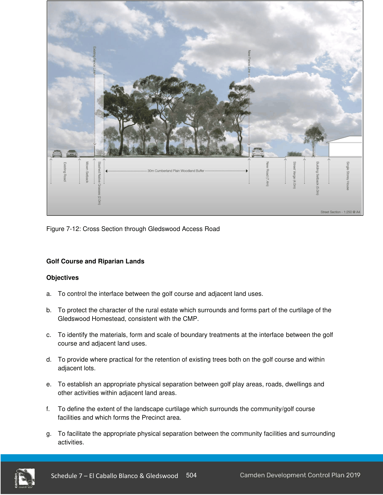
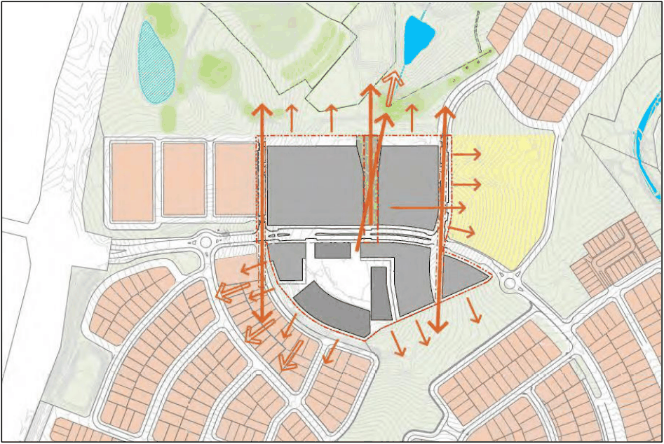

#### S7.2.12 Gledswood and Approaches

#### Introduction

Gledswood and its curtilage is listed on the State Heritage Register (SHR) and is also identified as a heritage item in the CLEP 2010. Consistent with the significance of the site a Conservation Management Plan (CMP) has been prepared to guide the conservation, management, and possible adaptive re-use of the site and buildings.

The CMP has identified principles for the interpretation of visual connections and historic access roads. These principles have been incorporated within the ILP prepared for the development of the lands covered by this chapter of the DCP.

The CMP identifies a range of suitable uses for the existing buildings and where additional infill development can be considered.

#### Objectives

a. To protect the heritage significance of Gledswood and its curtilage.

b. To facilitate redevelopment and adaptive re-use of Gledswood in a manner that provides for its conservation and future maintenance that respects the heritage significance of the site.

#### Controls

1\. Development is to demonstrate consistency with the adopted Conservation Management Plan (CMP) for Gledswood and the principles contained within Figure 7.1 of the CMP.

2\. To maintain and enhance the rural character of the entry into the estate and to visually screen new development within Precinct 1 from view from the historic access drive, the Gledswood Road access is to incorporate a vegetated landscape buffer treatment consistent with Figure 7-12. The landscape buffer:

a. is measured from the existing fence line to any new fence line adjacent to the new internal road of Precinct 1 and is to be 32 metres in depth comprising 2m of slashed native grasses and 30 m of Cumberland Plain Woodland Buffer;

b. the landscape buffer is generally located within land within zone RE2 Private Recreation.

3\. The entry road from Camden Valley Way into the estate must retain its historic alignment and rural character. Kerb and gutter should not be used on this section of the road. The historic post and rail fence is to be conserved.

4\. Golf Course development in the north western section of Precinct 8 must be a links style course comprising open grasslands and plantings consistent with the policies of the CMP.

Any proposed subdivision of the Gledswood curtilage will require the approval of the Heritage Council and must ensure that the heritage significance and historic rural character of the estate is retained.

> [Picture on page 34: a picture, saved as a picture (images/schedule-07-el-caballo-blanco-gledswood-page-34-1.gif, 150 dpi).]

Figure 7-12: Cross Section through Gledswood Access Road

#### Golf Course and Riparian Lands

#### Objectives

a. To control the interface between the golf course and adjacent land uses.

b. To protect the character of the rural estate which surrounds and forms part of the curtilage of the Gledswood Homestead, consistent with the CMP.

c. To identify the materials, form and scale of boundary treatments at the interface between the golf course and adjacent land uses.

d. To provide where practical for the retention of existing trees both on the golf course and within adjacent lots.

e. To establish an appropriate physical separation between golf play areas, roads, dwellings and other activities within adjacent land areas.

f. To define the extent of the landscape curtilage which surrounds the community/golf course facilities and which forms the Precinct area.

g. To facilitate the appropriate physical separation between the community facilities and surrounding activities.

h. To establish site circulation, visual amenity and environmental management principles which apply to the Golf Course Facilities Precinct.

i. To facilitate pedestrian and bicycle access to the Golf Course/Community Facilities Precinct.

j. To utilise golf course areas to improve the ecological and environmental qualities of the area by implementing the Vegetation Management Plan and Water Management Plan.

#### Controls

1\. The north-west portion of the site within the SHR curtilage is to be landscaped in a manner that protects its heritage significance as part of the Gledswood Estate and enhances views of the Homestead from Camden Valley Way.

2\. The requirements for safety setbacks are to be determined by a specialist golf designer or similarly qualified person.

3\. A Golf Course Safety Report is to be submitted with all subdivision applications for the subdivision of land immediately adjacent to the proposed golf course and/or any golf course development applications.

4\. Any proposed removal of existing vegetation is to have regard to the vegetation retention requirements for the RE2 zoned lands, the CMP and the VMP.

5\. Where practical, new planting within the golf course is to be located to maximise existing views of the golf course from residential lots.

6\. The design and management of the Golf Course is to be consistent with the requirements of any adopted VMP and the CMP.

7\. A landscape plan prepared by suitably qualified landscape architect is to be provided with any application for the development of the Golf Course holes. The landscape treatment of land within the SHR boundary should be consistent with the policies of the CMP.

8\. The golf course layout is to be designed to minimise the need for golfers and golf carts to cross public roads, where this is unavoidable, safe crossing points are to be provided to the satisfaction of council.

9\. Where an existing significant tree cannot o be retained, a replacement tree of the same species is to be planted within close proximity of the existing tree.

10\. Greenkeepers and maintenance equipment storage sheds provided for the golf course are to be screened and treated to minimise their visual dominance in the landscape setting.

11\. Any crossings of the  WaterNSW Canal are to comply with the requirements of the WaterNSW and the NSW Heritage Office.

12\. The category 3 riparian areas located south of the entry point to the estate must be revegetated to screen the residential portion of the estate from the entry road.

13\. A 32 metre landscape buffer as shown in Figure 7-13 must be provided adjacent to and along the length of the existing access road to Gledswood to the point that is meets the category 3 riparian creek.

14\. Riparian revegetation along Rileys Creek within Precinct 8 must be of an open grassland form.

15\. Riparian revegetation along with the balance of Rileys Creek must ensure that it is capable of screening views of Precinct 1 from the Gledswood Homestead Precinct 7.

16\. Development is to demonstrate consistency with the adopted Conservation Management Plan (CMP) for Gledswood and the principles contained within Figure 7.1 of the CMP.

17\. Any proposed subdivision of the Gledswood curtilage will require the approval of the Heritage Council and must ensure that the heritage significance and historic rural character of the estate is retained.

18\. The original access road to the Gledswood Homestead as referred in the CMP is to be managed and appropriately interpreted in accordance with the CMP.

#### Club House Location Requirements

Should a new Club House for the golf course be required it could be provided to the south of the site adjoining the Turner Road Entertainment precinct.  The Turner Road Entertainment precinct includes specific controls to protect view axes over the subject site and towards Gledswood Homestead.

The development of any Golf Clubhouse or similar development in the interface area between the land covered by this DCP and the Turner Road Entertainment precinct is to conform to the design and layout principles that seek to protect and reinforce the view axes.  Where a building is proposed that is bisected by the secondary site axis from the Entertainment precinct building transparency zones and building breaks are to be provided consistent with the guidelines that apply to the Entertainment Precinct.

The principles are outlined in the following Figure 7-13.

> [Picture on page 37: a picture, saved as a picture (images/schedule-07-el-caballo-blanco-gledswood-page-37-1.gif, 150 dpi).]

Figure 7-13: Principle north south axis along the valley and secondary axes along the ridgelines providing view corridors and view cone

#### Contamination

#### Objectives

a. To ensure that previously identified Areas of Environmental Contamination (AEC) are appropriately managed to minimise risks to human health and the environment.

#### Controls

1\. Remediation Action Plans must be provided in accordance with Council’s Policy – Management of Contaminated Lands where development applications are submitted for land affected by AEC identified in any of the following reports:

a. report on Phase 2 Contamination Assessment, Gledswood Effluent Treatment Ponds, Catherine Field, Prepared for Paynter Dixon, Project 40470C, February 2008; and

b. report on Sampling, Analysis and Quality Plan and Trial Treatment Methodology Gledswood Ponds, Catherine Field (Douglas Partners, 2 December 2009); and

c. report on Supplementary Contamination Assessment and Preliminary Waste Classification, Gledswood Ponds, Catherine Fields, Prepared for SH Camden Valley Pty Ltd, Project 40470.14 August 2010.

2\. Council may require a Site Audit Statement (SAS) issued by an appropriately accredited Site Auditor where remediation works have been undertaken. The SAS is to confirm that areas identified as being contaminated are suitable for the proposed use. The SAS, if requested by Council, must be submitted for review and written approval prior to the issue of a Subdivision Certificate.

3\. All investigations, reporting and identified remediation works must be in accordance with the protocols of Council’s Policy – Management of Contaminated Lands, and the Guidelines for Consultants Reporting on Contaminated Sites published by the NSW Office of Environment and Heritage; and should have regard to the reports listed in Control 1 above.

Further reference must be made to the provisions within Part 2 of this DCP regarding Salinity Management and Contaminated and Potentially Contaminated Land Management.

