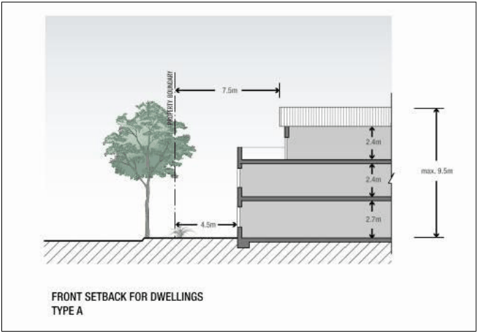

### S7.4 Site Specific Residential Controls

Note: The controls listed below are specific to El Caballo Blanco and Gledswood. They must be read in conjunction with the controls in Part 4 of this DCP. In the event of any inconsistency, the controls below prevail.

#### Residential Controls

Matters such as car parking (other than for secondary dwellings), cut and fill, road geometry and construction, services, stormwater management, crime prevention through environmental design, noise attenuation and waste collection are all addressed within other Parts of the DCP.

#### Front Setbacks – 3rd Level

#### Objectives

a. To provide a variety of streetscapes that reflect the character of different precincts, the diversity of edge conditions, house types and road hierarchies.

b. To create an attractive and cohesive streetscape.

c. To encourage the use of simple and articulated building forms.

#### Controls

#### Attached Dwellings

1\. 7.5m for any third level from the front street boundary as illustrated in Figure 7-14.

> [Picture on page 40: a picture, saved as a picture (images/schedule-07-el-caballo-blanco-gledswood-page-40-18.gif, 150 dpi).]

Figure 7-14: Third Level Setback Principles for Residential Development

