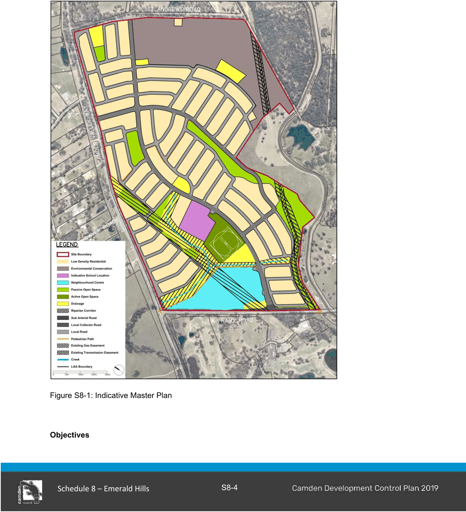
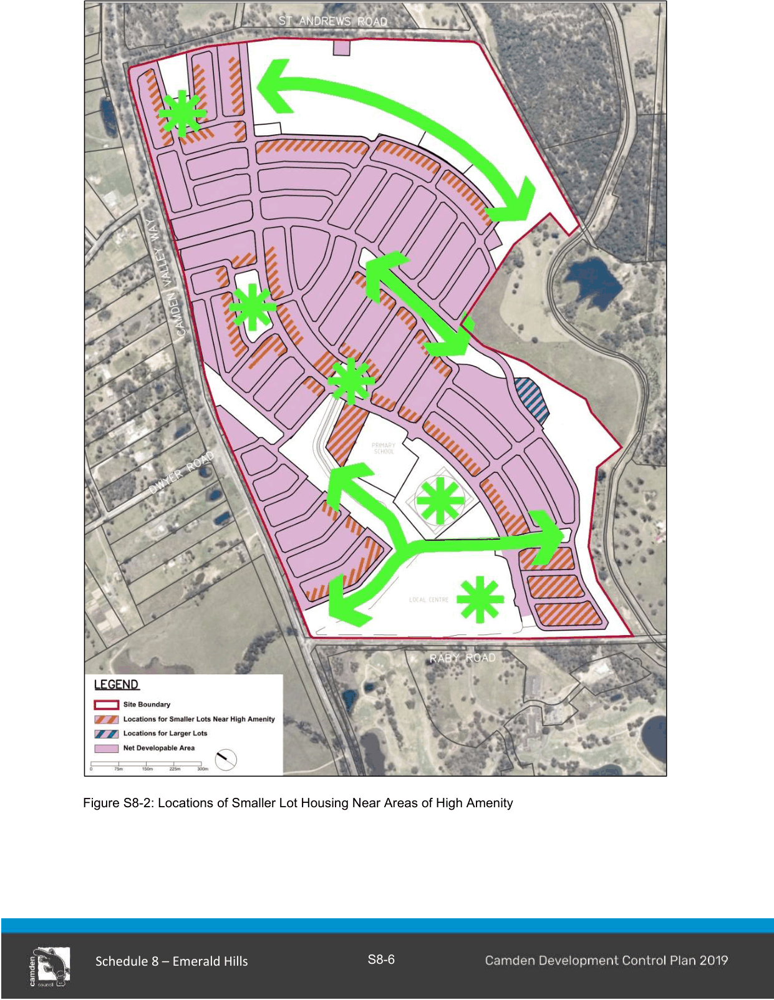

### S8.2 Subdivision Planning and Design

#### S8.2.1 Neighbourhood and Subdivision Design

An indicative master plan for Emerald Hills is shown in Figure S8-1. The proposed entry points to the development are off Raby Road, Camden Valley Way and St Andrews Road. The entries will provide direct access to the residential precincts, community and recreation facilities, major and minor public open spaces and the local centre.

A north-south oriented collector road will provide an important vehicular, pedestrian and bicycle link between the northern and southern parts of the development.

A circular dual use cycle/pedestrian path that extends to connections outside the site is also proposed within linear parklands and roads to not only link spaces and places within Emerald Hills, but also establish opportunities for fitness and recreation.

The riparian corridors and open spaces will incorporate water bodies, watercourses and tree planting as well as water quality and stormwater management measures.

A key feature of Emerald Hills is the approach to environmental and scenic protection. The large area of vegetation in the north east corner will generally be preserved and the prominent ridge and hilltops will be celebrated within the public open space network.

#### Relationship to other Plans

The Emerald Hills indicative master plan is based on the following technical and environmental studies:

AHMS, February 2013, Historical Heritage Assessment;

AHMS, February 2013, Aboriginal Heritage Preliminary Assessment;

Cardno, May 2013, Infrastructure Servicing and Delivery Plan;

Cardno, May 2013, Traffic Assessment;

Cardno, May 2013, Water Cycle Management Report and addendums August & September;

Deep End Services, 24 October 2012, Emerald Hills Retail and Economic Impact;

Douglas and Partners, March 2013, Preliminary Contamination Assessment;

Douglas and Partners, June 2013, Salinity Report;

Douglas and Partners, August 2013, Geotechnical Assessment;

Eco Logical Australia, September 2013, Biodiversity Certification Assessment Report;

Eco Logical Australia, June 2013, Bushfire Assessment;

Eco Logical Australia, April 2013, Preliminary Constraints Analysis Ecology and Riparian Issues Assessment;

Elton Consulting, May 2013, Social Planning Report;

Hill PDA, March 2013, Emerald Hills Retail Need and Economic Impact Assessment – Peer Review;

SLR, April 2013, Odour Impact Assessment;

SLR, September 2013, Residential Precinct Acoustic Assessment.

> [Picture on page 6: a picture, saved as a picture (images/schedule-08-emerald-hills-page-6-6.gif, 150 dpi).]

Figure S8-1: Indicative Master Plan

#### Objectives

a. Establish a framework for the provision of a diversity of predominantly low density dwelling types.

b. Maximise amenity of residential lots by providing maximum frontage and access to open space, including play areas, parks, ridge tops and creeks.

c. Facilitate attractive streetscapes which maximise opportunities to establish a sense of place, promote pedestrian activity and encourage safety and casual surveillance of public spaces.

d. Establish an urban structure which will facilitate the protection and enhancement of the scenic quality of the landscape.

e. Maximise amenity of residential lots by ensuring suitable noise attenuation measures adjacent to Camden Valley Way and Raby Road subject to maintaining visual connectivity between Emerald Hills and adjoining major roads.

f. Establish an urban structure which will allow for the protection and management of important vegetation.

g. Maximise the use of public transport, walking and cycling trips to, from and within the site.

#### Controls

1\. The subdivision pattern for Emerald Hills must generally follow the indicative master plan shown in Figure S8-1.

2\. Subdivision must provide for a diversity of lot sizes and types in appropriate locations which either reinforce the scenic values of the site, or contribute to the accessibility, vitality and character of the local centre, the amenity offered by open spaces and the viability of public transport. This may include larger groupings of smaller lots in the locations shown hatched red in Figure S8-2.

3\. The maximum dwelling density at Emerald Hills must be 15 dwellings per hectare measured across the whole of the shaded area shown as ‘net developable area’ in Figure S8-2.

4\. The maximum dwelling density must be achieved via residential subdivision which includes the following lot sizes and dwelling types:

a. Smaller lot housing (single or two storey detached, semi-detached or zero lot line dwellings) on 220-300m2 lots in areas of high amenity as shown hatched red in Figure S8- 2;

b. Conventional low density housing lots of between 300-600m2 must allow for single or two storey detached dwellings, and

c. Large lots of between 1,000 and 4,000+ m2 must be located where attention to landscape visual character, environmental protection, and management of bushfire hazard and noise impact is required.

> [Picture on page 8: a picture, saved as a picture (images/schedule-08-emerald-hills-page-8-1.gif, 150 dpi).]

Figure S8-2: Locations of Smaller Lot Housing Near Areas of High Amenity

