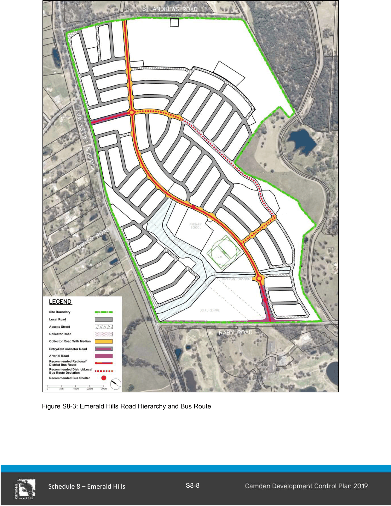
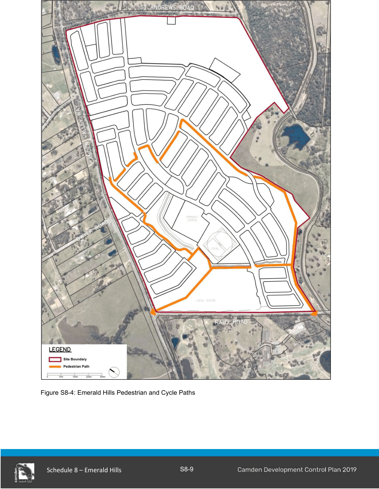
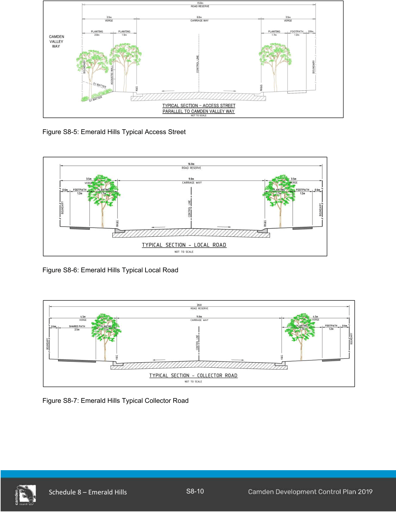
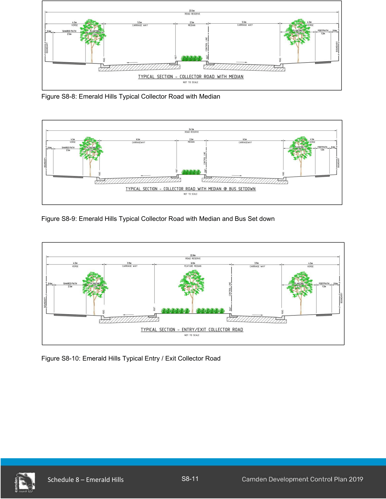

#### S8.2.2 Street, Pedestrian and Cycle Network

#### Objectives

a. A legible interconnected ‘grid pattern’ of walkable streets which seeks to address site topography and encourage walking and cycling as well as provide a choice of alternate routes for vehicles.

b. The provision of a major local collector road that is located parallel to Camden Valley Way and incorporates distinctive entries into the site from Camden Valley Way. St Andrews Road and Raby Road facilitating vehicle access. Road character and route must be designed to minimise ‘rat-running’ and through traffic seeking to avoid the Camden Valley Way / Raby Road intersection.

c. Local roads addressing frontages to public open space to avoid the provision of rear fences and contributing to protecting and enhancing the character of the site.

d. A road network distinguished by well-vegetated, attractive streetscapes which are not dominated by driveways and garages.

e. A bus route and bus stops located along a major local collector road that links the local centre with any potential routes beyond the site to the Leppington Town Centre and railway station.

f. A permeable local road network within the majority of the urban part of the site, which would ensure dwellings are located within a 400 metres/5 minutes walking catchment of the bus route and public open space.

g. A simple hierarchy of road design and character comprising a collector road and local roads.

h. Provision of a variety of street tree planting with formal and informal spacing that will help create a special character within the streets incorporating verges which are sustainably landscaped with trees, shrubs and groundcovers that have low water and nutrient demands. Plant species selection and layout should minimise ongoing water and maintenance requirements.

i. A flexible and connected pedestrian and cycle pathway network that utilises open space corridors.

#### Controls

1\. The street, pedestrian and cycle and public transport networks are to be designed and constructed generally in accordance with Figures 8-3, 8-4 and 8-5 to 8-10 and landscaped accordingly.

2\. The design and construction of the collector road in accordance with Figures 8-7, 8-8, 8-9 and 8-10 must provide north-south pedestrian and cycle connectivity through the Emerald Hills development to East Leppington at the north and Camden Lakeside to the south.

3\. Root guards must be used around all street trees to minimise damage to road pavements and footpaths.

4\. The design and construction of Raby Road and St Andrews Road are subject to further detailed design at the Development Application stage in accordance with Council requirements and in conjunction with the RMS and TfNSW.

Note: Refer to Council’s Engineering Construction Specifications for road construction.

> [Picture on page 10: a picture, saved as a picture (images/schedule-08-emerald-hills-page-10-1.gif, 150 dpi).]

Figure S8-3: Emerald Hills Road Hierarchy and Bus Route

> [Picture on page 11: a picture, saved as a picture (images/schedule-08-emerald-hills-page-11-1.gif, 150 dpi).]

Figure S8-4: Emerald Hills Pedestrian and Cycle Paths

> [Picture on page 12: a picture, saved as a picture (images/schedule-08-emerald-hills-page-12-1.gif, 150 dpi).]

Figure S8-5: Emerald Hills Typical Access Street

Figure S8-6: Emerald Hills Typical Local Road

Figure S8-7: Emerald Hills Typical Collector Road

> [Picture on page 13: a picture, saved as a picture (images/schedule-08-emerald-hills-page-13-1.gif, 150 dpi).]

Figure S8-8: Emerald Hills Typical Collector Road with Median

Figure S8-9: Emerald Hills Typical Collector Road with Median and Bus Set down

Figure S8-10: Emerald Hills Typical Entry / Exit Collector Road

