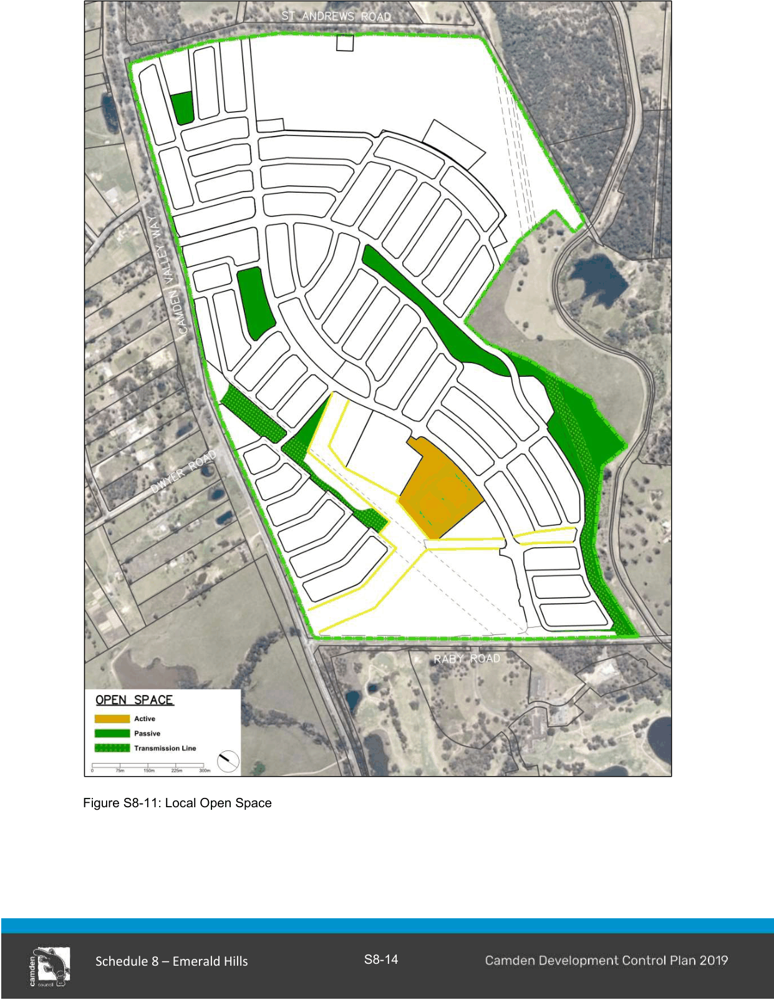

#### S8.2.4 Open Space, Public Domain and Fencing

#### Objectives

a. Ensure that open space is of appropriate quality and quantity to meet the recreational and social needs of the community.

b. Ensure an attractive public domain and streetscapes are established that contribute to the visual quality of the site.

c. Provide the framework for the protection and enhancement of remnant vegetation and riparian corridors within the public domain.

d. Provide for the establishment of local parks and other open spaces which contribute to the sense of place.

e. Utilise open space for Water Sensitive Urban Design and stormwater management.

f. Promote plant species selection and design which will minimise ongoing water and maintenance requirements.

g. Provide appropriate fencing between the Emerald Hills site and adjacent Sydney Water Upper Canal land.

#### Controls

1\. Local open space must generally be located in accordance with Figure S8-11.

2\. Estate fencing must be erected in locations to separate public domain areas from residential development.

3\. Estate fencing is to be constructed of consistent high quality materials and finishes and is to form part of the subdivisional works for the site.

4\. The location of estate fencing is identified in a Development Application and is to be constructed in accordance with a Landscaping Plan.

5\. Estate fencing is limited to a maximum height of 1.8m above ground level.

6\. Estate fencing is not to be removed or altered in finish, shape or form of the fence.

7\. Appropriate fencing to prevent public access to the Sydney Water Upper Canal land must be provided.

> [Picture on page 16: a picture, saved as a picture (images/schedule-08-emerald-hills-page-16-1.gif, 150 dpi).]

Figure S8-11: Local Open Space

