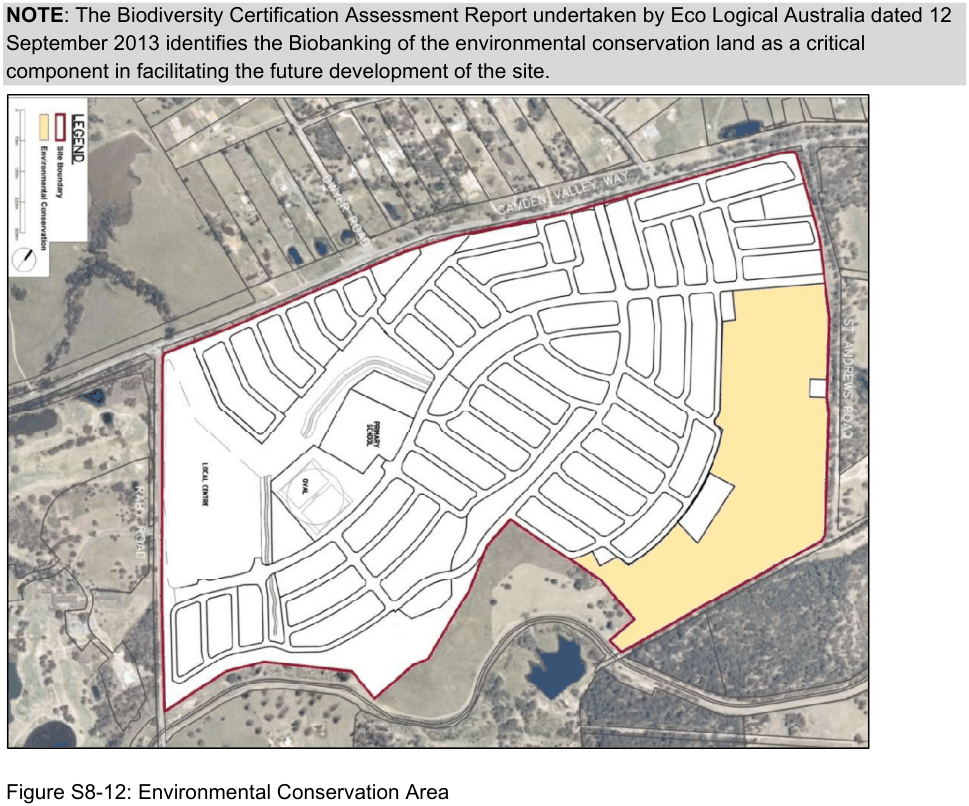

#### S8.2.5 Vegetation Conservation

#### Objectives

a. Ensure the protection and enhancement of existing significant trees and significant remnant vegetation.

b. Facilitate the implementation of an agreed conservation management plan for Emerald Hills.

#### Controls

1\. The proponent of the Emerald Hills development is to enter into a Biobanking Agreement with the Office of Environment and Heritage for the land identified as ‘Environmental Conservation’ in Figure S8-12. This will ensure that the environmental conservation land is appropriately protected, enhanced and managed to ensure its long term viability, and to help achieve the necessary biodiversity offset credits to facilitate development of the site.

NOTE: The Biodiversity Certification Assessment Report undertaken by Eco Logical Australia dated 12 September 2013 identifies the Biobanking of the environmental conservation land as a critical component in facilitating the future development of the site.

> [Picture on page 17: a picture, saved as a picture (images/schedule-08-emerald-hills-page-17-15.gif, 150 dpi).]

Figure S8-12: Environmental Conservation Area

