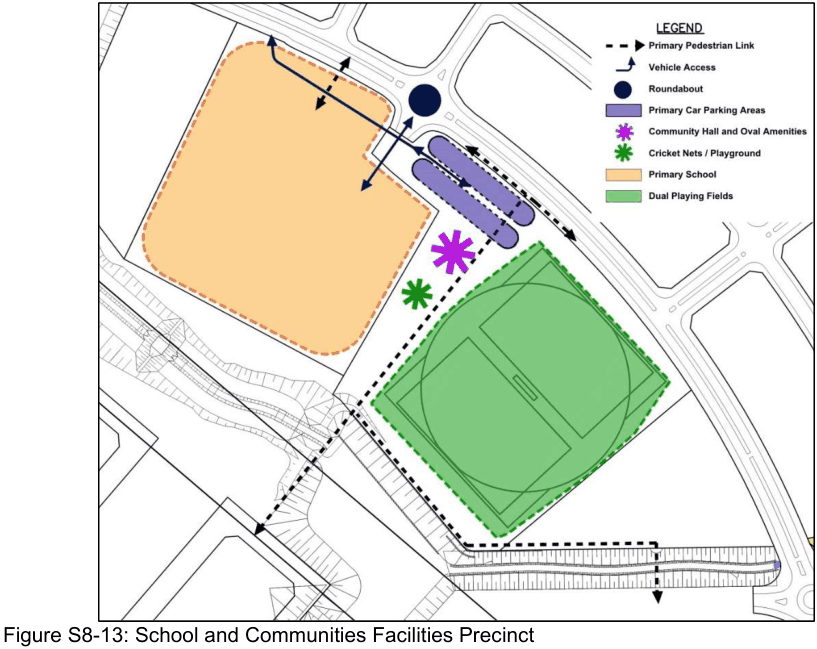

#### S8.2.6 School and Communities Facilities Precinct

#### Objectives

a. Control the interface between the school, sports oval and adjacent land uses.

b. Establish an appropriate physical separation between facilities, roads, dwellings and other activities within adjacent land areas.

c. Define the extent of the landscape curtilage which surrounds the school.

d. Facilitate the appropriate physical separation between the recreational facilities and surrounding activities.

e. Establish site circulation, visual amenity and environmental management principles which apply to the School and Community Facilities Precinct.

f. Facilitate pedestrian and bicycle access to the Precinct.

#### Controls

1\. Development will generally be located in accordance with the principles in Figure S8-13.

2\. A multi-purpose community room of approximately 170m2 floor space is to be provided within the amenities building of approximately 360m2 which is attached to the recreation oval.

> [Picture on page 18: a picture, saved as a picture (images/schedule-08-emerald-hills-page-18-16.gif, 150 dpi).]

Figure S8-13: School and Communities Facilities Precinct

