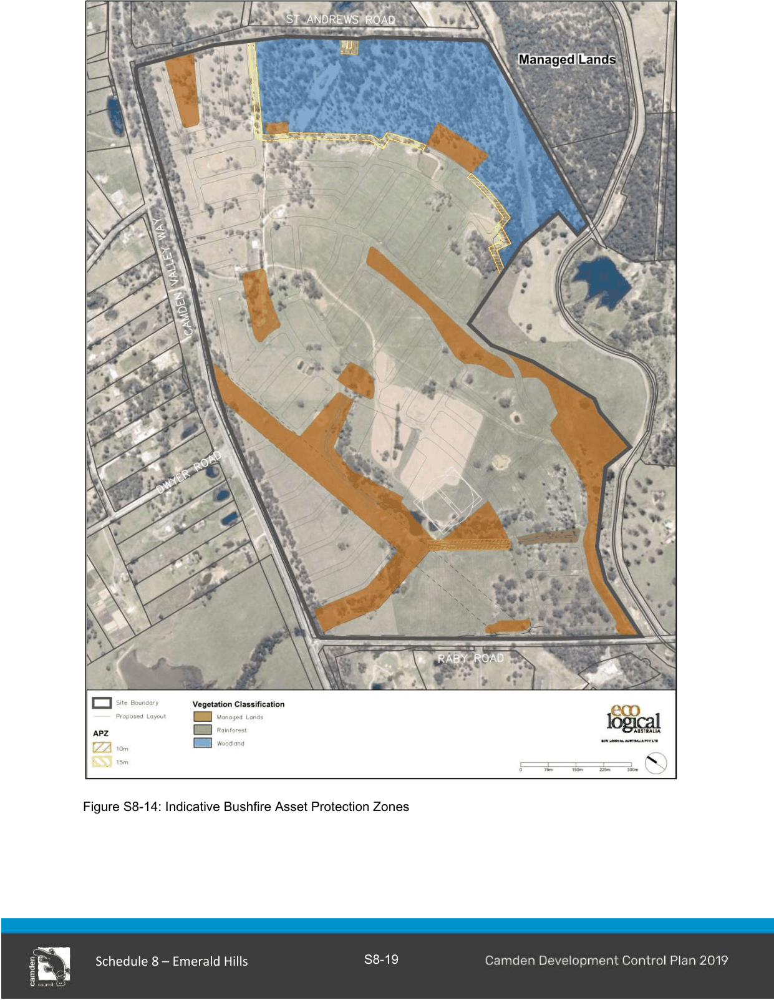
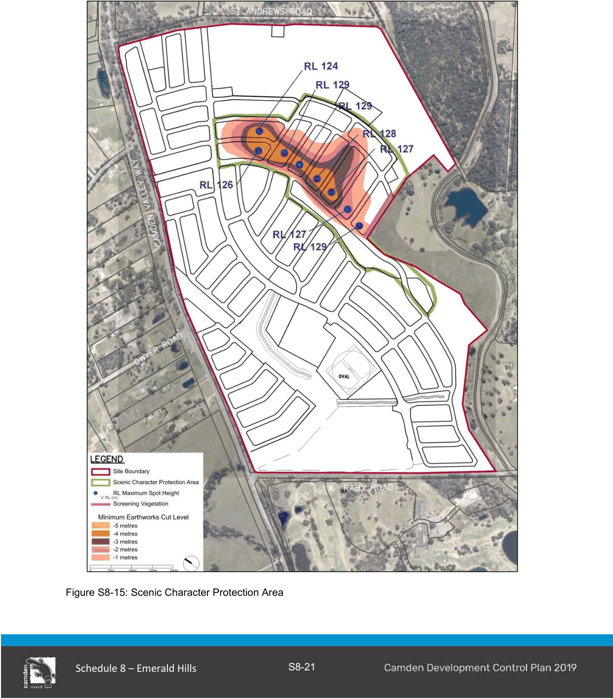

#### S8.2.9 Bushfire Risk Management

#### Objectives

a. Provide the framework for the protection of property and vegetation from bushfire hazard within the Site.

#### Controls

1\. Subject to detailed design at development application stage, the indicative location and widths of Asset Protection Zones are to be provided in accordance with Figure S8-14 and;

a. are to be located wholly within the Precinct.

b. may incorporate roads and flood prone land.

c. may be used for open space and recreation within private lots subject to appropriate fuel management.

d. are to be maintained in accordance with the Planning for Bushfire Protection (NSW RFS).

e. may incorporate private residential land, but only within the building setback (no dwellings are to be located within the APZ).

f. are not to burden public land.

g. are to be generally bounded by a perimeter fire trail/road that is linked to the public road system at regular intervals in accordance with Bushfire Protection.

h. may be allowed within the outer 50% of the VRZ but any encroachment into the riparian corridor requires offsets to be provided.

2\. Buildings adjacent to APZs are to be constructed in accordance with the requirements of Appendix 3 of Bushfire Protection and Australian Standard 3959 - Construction of Building in Bushfire-prone Areas.

3\. Where an allotment fronts and partially incorporates an APZ it must have an appropriate depth to accommodate a dwelling with private open space and the minimum required APZ. The APZ will be identified through a Section 88b instrument.

4\. Temporary APZs, identified through a Section 88b instrument, may be required where development is proposed on allotments next to undeveloped land. Once the adjacent stage of development is undertaken, the temporary APZ will no longer be required and must cease.

> [Picture on page 21: a picture, saved as a picture (images/schedule-08-emerald-hills-page-21-1.gif, 150 dpi).]

Figure S8-14: Indicative Bushfire Asset Protection Zones

#### S8.2.10

#### Large Lots within Environmental Conservation

#### Objectives

a. To preserve significant vegetation, whilst facilitating the provision of appropriate development as a mechanism to own and manage the vegetation.

#### Controls

1\. Identify building envelopes through a Section 88b instrument, located to respect and be sympathetic to the natural environment and significance of the vegetation.

2\. Provide adequate bush fire management measures.

3\. Manage vegetation in accordance with a Conservation Management Plan

#### S8.2.11

#### Scenic Character Protection Area

#### Objectives

a. To protect the scenic character of the Scenic Hills Area to the east of the site.

#### Controls

1\. This clause applies to lots and dwellings generally in the area indicated in Figure S8-15.

2\. Dwelling materials and colours must adopt darker, recessive toned colours such as dark browns, dark greens, dark greys and charcoal, and utilise non-reflective surfaces for both wall and roof cladding.

3\. Utility and ancillary structures must adopt darker, recessive toned colours such as dark browns, dark greens, dark greys and charcoal, along with non-reflective surfaces.

4\. Bulk earthworks must be undertaken along the northern ridgeline and surroundings as per the ‘Minimum Earthworks Cut Level’ as shown in Figure S8-15. The finished ground levels must be in accordance with the spot RLs shown on Figure S8-15. Certification of the finished ground levels in accordance with this control will be required to be submitted to Council prior to the issuing of subdivision certificates in relation to this land.

5\. Road verge/street tree planting must adopt hardy dark-leaved evergreen trees with good canopy cover.

6\. The ridgeline reserve must be planted out with tall locally indigenous woodland species (to blend with woodland canopies in the Scenic Hills) using a minimum pot size of 100 litres, planted across the entire width of the reserve.

7\. The southern verge of the perimeter road between the scenic character protection area and the WaterNSW land (delineated by a purple line in Figure S8-15) must be planted with tall locally indigenous woodland species using a minimum pot size of 100 litres.

8\. Street lights must have hoods or other appropriate design treatment to minimise light spill and reducing ambient light haze as much as possible.

> [Picture on page 23: a picture, saved as a picture (images/schedule-08-emerald-hills-page-23-6.gif, 150 dpi).]

Figure S8-15: Scenic Character Protection Area

#### S8.2.12

#### Aboriginal and European Heritage

#### Background

The Emerald Hills site, like surrounding areas, has a history of Aboriginal occupation, European settlement and agricultural purposes. The St Andrews Home for Boys was established in 1934 on site and was used in various capacities until 1987. These buildings were not heritage listed and have been lawfully demolished. However, it became apparent during the rezoning process that they are considered by architectural groups to be an important example of the Sydney School of Architecture, designed by Phillip Cox. It is appropriate that the architecture and various previous uses of the site are interpreted within the new Emerald Hills residential development.

The following documents were prepared to inform the rezoning of the Emerald Hills site, and should be referred to as part of the preparation of the Heritage Interpretation Strategy as outlined below:

Historical Heritage Assessment: St Andrew’s Home for Boys, 1100-1150 Camden Valley Way, Leppington, prepared by AHMS (Final Report), dated February 2013.

Aboriginal Heritage Preliminary Assessment: Emerald Hills Estate, Leppington, prepared by AHMS (Final Report), dated February 2013.

Photographic Archival Record: St Andrews boys Home (Burnside) Leppington, prepared by Inspire Urban Design and Planning, dated 4 February 2013.

#### Objectives

a. To ensure that the Aboriginal and European land uses and the Sydney School of Architecture style of the former St Andrews’ Boys Home (now demolished) are interpreted and incorporated where possible into the public domain of Emerald Hills.

#### Controls

1\. A Heritage Interpretation Strategy must be prepared by a suitably qualified and experienced heritage consultant which identifies the key stories associated with the site, its varying owners, associations and evolving users over time. Some examples of key people would include Thurawal, Dharug and Gundungurra Aboriginal peoples, the Cubbitch Barta clan, early colonial settlers and farming families such as those of Cordeaux, Edwards, Ward, Gaudry, Kable, Chisholm, Moore, William and Florence Price, the Presbyterian/Uniting Church/Burnside Homes (St Andrews School for Boys) and architects Philip Cox and Ian McKay.

2\. The Heritage Interpretation Strategy must be submitted for Council approval as part of the Development Application for the park shown in C68 in the site of the former St Andrews School site. It should include an implementation plan with prioritised actions that identify specific locations and recommended means of interpretation that will be integrated into the park. These might include structures, artworks, plaques, sculptures, installations, street tree selection and treatment, landscaping which is themed on past uses,), open space designs and treatments, and place names.

The following publications may assist in preparing the Interpretation Strategy: Historical Heritage Assessment: St Andrew’s Home for Boys, 1100-1150 Camden Valley Way, Leppington, prepared by AHMS (Final Report), dated February 2013. Aboriginal Heritage Preliminary Assessment: Emerald Hills Estate, Leppington, prepared by AHMS (Final Report), dated February 2013.

Interpreting Heritage Places and Items

http://www.environment.nsw.gov.au/resources/heritagebranch/heritage/NSWHeritageOfficeGuidelin esinfointerpreting.pdf

Heritage Interpretation Policy

http://www.environment.nsw.gov.au/resources/heritagebranch/heritage/interpretationpolicy.pdf

