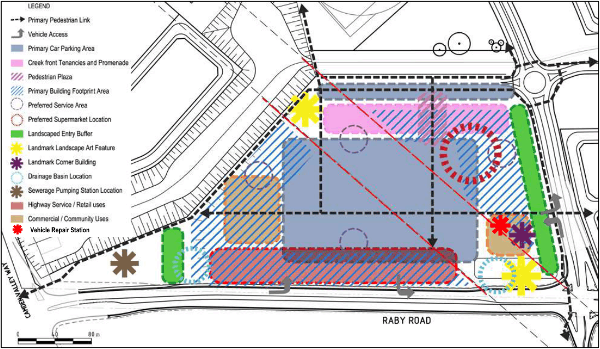

### S8.3 Centre Development Controls

#### Background

The Emerald Hills Centre will form part of the Emerald Hills Urban Release Area.

#### Controls

#### Maximum Floor Area

1\. The centre will have a maximum lettable floor area of 10,000m2 for ‘retail premises’ excluding ‘food and drink premises’.

#### Layout and Design

1\. Development must be in accordance with the site planning principles contained in the master plan for the Centre in Figure S8-16. Development applications for the purposes of remediation, earthworks, drainage, environmental landscape works and other minor works that, in the opinion of Council, do not predetermine an outcome on the land covered by the B2 Local Centre zone boundaries in LEP 2010 may be accepted.

> [Picture on page 27: a picture, saved as a picture (images/schedule-08-emerald-hills-page-27-1.gif, 150 dpi).]
> Words printed on the picture (copied from the PDF):
> Vehicle Repair Station

Figure S8-16: Site Planning Principles for Emerald Hills Centre

2\. The development must be designed to provide access and exposure to Raby Road and Riley’s Creek adjoining the centre site whilst incorporating a vibrant and active focal point in the form of a civic square, plaza or main street.

3\. In addition to any relevant controls for the centre, residential buildings within the centre are subject to the controls contained in Chapter D2 of this DCP as relevant.

4\. Vehicle access and/or car parking facilities will not be approved if within 30 metres of a Transmission Line structure without adequate precautions provided to protect the structure from any accidental damage.

5\. The site containing the Key Landmark Building and Vehicle Repair Station must not contain any more than two vehicular crossovers.

6\. The landscaped entry buffer must be generally consistent with the width of existing or planned buffers on other sites within the Centre and be designed to ensure adequate softening and screening to future development and achievement of a high-quality public domain outcome.

7\. The Key Landmark Building must be designed to address both Emerald Hills Boulevard and Raby Road.
