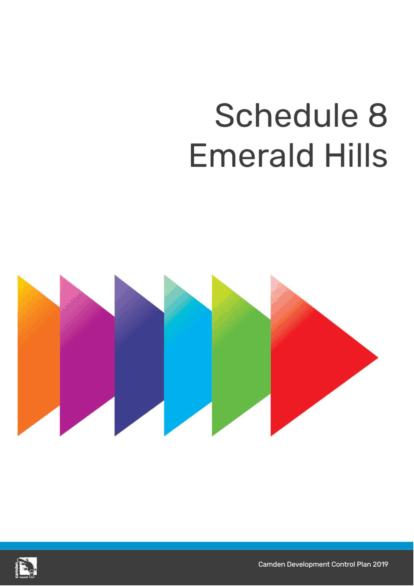

# Camden Development Control Plan 2019 - Schedule 8 Emerald Hills

> This chapter is split into 14 section file(s), one per numbered heading, in the order they appear in the PDF.

Source PDF: [DCP-2019-Final-Schedule-8-Emerald-Hills-Version-4-September-2024.pdf](DCP-2019-Final-Schedule-8-Emerald-Hills-Version-4-September-2024.pdf)

> [Picture on page 1: a picture, saved as a picture (images/schedule-08-emerald-hills-page-1-1.gif, 150 dpi).]

### Contents

EMERALD HILLS .............................................................................................................................................. S8-1

S8.1 Introduction ......................................................................................................................................... S8-1 S8.1.1 Emerald Hills Planning Principles ............................................................................................. S8-1

S8.2 Subdivision Planning and Design ........................................................................................................ S8-3 S8.2.1 Neighbourhood and Subdivision Design .................................................................................. S8-3 S8.2.2 Street, Pedestrian and Cycle Network ...................................................................................... S8-7 S8.2.3 Bulk Earthworks and Retaining Walls ...................................................................................... S8-12 S8.2.4 Open Space, Public Domain and Fencing .............................................................................. S8-12 S8.2.5 Vegetation Conservation ........................................................................................................ S8-15 S8.2.6 School and Communities Facilities Precinct ........................................................................... S8-16 S8.2.7 Acoustic Amenity .................................................................................................................... S8-17 S8.2.8 Stormwater Management ....................................................................................................... S8-17 S8.2.9 Bushfire Risk Management .................................................................................................... S8-17 S8.2.10 Large Lots within Environmental Conservation .................................................................. S8-20 S8.2.11 Scenic Character Protection Area ...................................................................................... S8-20 S8.2.12 Aboriginal and European Heritage ..................................................................................... S8-22

S8.3 Centre Development Controls ........................................................................................................... S8-24 S8.3.1 Built Form and Appearance .................................................................................................... S8-25

S8.4 Site Specific Residential Controls ..................................................................................................... S8-26 S8.4.1 Double Garages on Narrow Lots equal to or greater than 10m and less than 12.5m .............. S8-28

### Table of Figures

| Figure S8-1: Indicative Master Plan | S8-4 |
|---|---|
| Figure S8-2: Locations of Smaller Lot Housing Near Areas of High Amenity | S8-6 |
| Figure S8-3: Emerald Hills Road Hierarchy and Bus Route | S8-8 |
| Figure S8-4: Emerald Hills Pedestrian and Cycle Paths | S8-9 |
| Figure S8-5: Emerald Hills Typical Access Street | S8-10 |
| Figure S8-6: Emerald Hills Typical Local Road | S8-10 |
| Figure S8-7: Emerald Hills Typical Collector Road | S8-10 |
| Figure S8-9: Emerald Hills Typical Collector Road with Median and Bus Set down | S8-11 |
| Figure S8-10: Emerald Hills Typical Entry / Exit Collector Road | S8-11 |
| Figure S8-11: Local Open Space | S8-14 |
| Figure S8-12: Environmental Conservation Area | S8-15 |
| Figure S8-13: School and Communities Facilities Precinct | S8-16 |
| Figure S8-14: Indicative Bushfire Asset Protection Zones | S8-19 |
| Figure S8-15: Scenic Character Protection Area | S8-21 |
| Figure S8-16: Site Planning Principles for Emerald Hills Centre | S8-25 |

### List of Tables

Table S8-1 Summary of residential accommodation controls – Emerald Hills .................................................... S26

### EMERALD HILLS

<!-- sections -->
## Sections

1. [S8.1 Introduction](01-s8-1-introduction.md)
2. [S8.1.1 Emerald Hills Planning Principles](02-s8-1-1-emerald-hills-planning-principles.md)
3. [S8.2.1 Neighbourhood and Subdivision Design](03-s8-2-1-neighbourhood-and-subdivision-design.md)
4. [S8.2.2 Street, Pedestrian and Cycle Network](04-s8-2-2-street-pedestrian-and-cycle-network.md)
5. [S8.2.3 Bulk Earthworks and Retaining Walls](05-s8-2-3-bulk-earthworks-and-retaining-walls.md)
6. [S8.2.4 Open Space, Public Domain and Fencing](06-s8-2-4-open-space-public-domain-and-fencing.md)
7. [S8.2.5 Vegetation Conservation](07-s8-2-5-vegetation-conservation.md)
8. [S8.2.6 School and Communities Facilities Precinct](08-s8-2-6-school-and-communities-facilities.md)
9. [S8.2.7 Acoustic Amenity](09-s8-2-7-acoustic-amenity.md)
10. [S8.2.8 Stormwater Management](10-s8-2-8-stormwater-management.md)
11. [S8.2.9 Bushfire Risk Management](11-s8-2-9-bushfire-risk-management.md)
12. [S8.3 Centre Development Controls](12-s8-3-centre-development-controls.md)
13. [S8.3.1 Built Form and Appearance](13-s8-3-1-built-form-and-appearance.md)
14. [S8.4 Site Specific Residential Controls](14-s8-4-site-specific-residential-controls.md)
