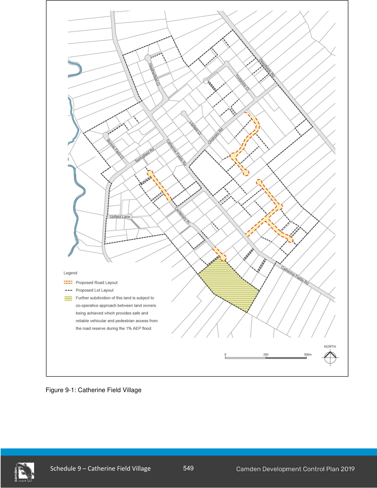

### S9.2 Subdivision Planning and Design

#### Controls

#### Road Layout

1\.  Development must conform with the road and subdivision layout shown at Figure 9-1 in the first instance.

Any variations proposed will only be considered if they satisfy all relevant environmental criteria.

Variations which do not affect other landowners will be dealt with by Council on merit.

Variations which affect adjoining landowners will be dealt with by Council on merit if the agreement of the adjoining landowners is obtained.

#### Building Envelopes

1\. All development applications for subdivision of land must nominate a building envelope on each lot with a minimum area of 300m2 and a minimum one way dimension of 15m, suitable for the erection of a dwelling.  The nominated building envelope, and access road form this, must be free of any site constraints such as flood affectation, required sewage and stormwater disposal areas, setbacks, watercourses and significant trees.

#### Temporary Access

1\. Temporary right of ways will be considered by Council; however they must be extinguished when permanent access is provided.

#### Street Tree Planting

1\. Street planting must be of indigenous species, preferably using plants grown from locally collected seeds.  A street tree-planting scheme is required prior to subdivision and must include elements of mass planting as part of the overall salinity strategy.

The following trees (refer to Table 9-1) are suitable as street trees in the Catherine Field area:

| Preferred | Eucalyptus tereticornis Eucalyptus moluccana Eucalyptus botryoides Angophora bakeri |
|---|---|
| Acceptable | Eucalyptus crebra Eucalyptus baueriana Eucalyptus fibrosa Eucalyptus amplifolia Eucalyptus maculata Angophora subvelutina Brachychiton acerifolis Brachychiton discolor Brachychiton populneum Angophora floribunda |
| Smaller Trees |  |
| Preferred | Melaleuca stypheloides Melaleuca decora |
| Acceptable | Melaleuca linariifolia Melaleuca ericfolia |

#### Table 9-1 Street Trees in Catherine Field

#### Services

New electricity services within the Catherine Field village must be provided underground.

#### Battleaxe lots

1\. Handle widths to battleaxe lots are to be a minimum of 6 metres with a maximum length of 100 metres.  A handle may serve two lots provided that there are reciprocal rights of way.  An all weather pavement surface constructed to Council’s standards is to be provided within each handle.

> [Picture on page 6: a picture, saved as a picture (images/schedule-09-catherine-field-village-page-6-1.gif, 150 dpi).]

Figure 9-1: Catherine Field Village

