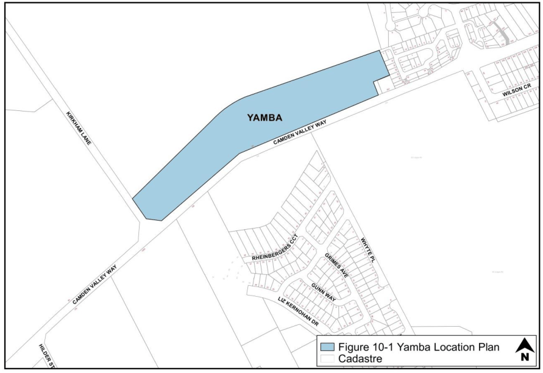

### S10.1 Introduction

#### Background

Yamba is a property containing a heritage listed cottage and associated buildings. It is located on Camden Valley Way between Narellan and Camden. It abuts rural/primary production land to the north, the Links Estate to the west, and Kirkham Lane to the south. Located opposite across Camden Valley Way is the Elderslie Release area, Rheinberger’s Hill, and the Camden Golf Club. See Figure 10-1.

> [Picture on page 3: a picture, saved as a picture (images/schedule-10-yamba-page-3-9.gif, 150 dpi).]

Figure 10-1: Yamba Location Plan

