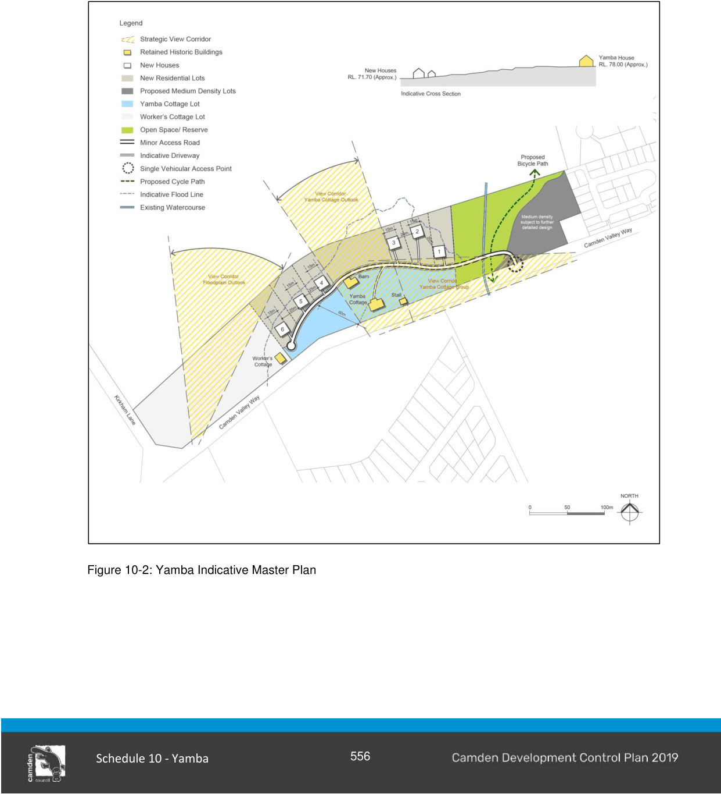

### S10.2 Subdivision Planning and Design

#### Objectives

a. Promote the conservation of Yamba cottage and its curtilage which includes the barn and roadside stall.

b. Promote the conservation of the worker’s cottage.

c. Achieve development that occurs in an environmentally sensitive and energy efficient manner, is sustainable in terms of efficient use of land, resources and community facilities, maintenance of adequate services and facilities and development that reflects land capability and other constraints.

d. Ensure that development is consistent with the semi-rural character of the site.

e. Prescribe development guidelines relating to the shape and form of buildings and their relationship to Camden Valley Way and Yamba cottage.

f. Ensure that new buildings, ancillary structures and additions to the existing cottages are complementary in design to the existing heritage buildings.

g. Maintain strategic view lines and corridors both to and from the site as identified in the Yamba Cottage Conservation Management Plan.

#### Yamba Planning Principles

1\. Yamba cottage and the buildings within its curtilage will be restored in accordance with the Yamba CMP and be actively used. The historical grouping of these buildings will be reinforced by the pattern of subdivision, which incorporates these buildings on the same lot of land, forming the centrepiece of the development.

2\. The workers cottage will be restored and enhanced to enable its ongoing use as a dwelling house. It will be located on the large lot which includes all of the land between the cottage and Kirkham Lane.

3\. The rural character of the site will be maintained by limiting development to six large rural/residential allotments on the lower slopes surrounding Yamba Cottage. The new dwelling houses on these lots will be sympathetic to the heritage significance of Yamba Cottage by using appropriate building materials and adopting a bulk and scale which is subservient to Yamba cottage.

4\. Future medium density townhouses at the eastern corner of the site will improve the rural/urban interface by providing a transition between the existing medium density development adjoining the site and the rural/open space land to the west. The townhouses will present an active frontage to Camden Valley Way and will appear as single storey dwellings when viewed from the street.

5\. Existing view lines and corridors will be maintained and enhanced via the strategic location of new residential allotments and the removal of noxious weed species Camden Valley Way. Future landscaping will be appropriately planned so as not to impact on view lines and corridors.

6\. Vehicular access to the site will be rationalised with the construction of an internal access road having a single connection point to Camden Valley Way.

7\. The Yamba Voluntary Planning Agreement (VPA) ensures the conservation of Yamba cottage and associated buildings is linked to stages of development of the site to guarantee the heritage outcomes for Yamba.

8\. Reference must be made to the heritage provisions of this DCP.

> [Picture on page 5: a picture, saved as a picture (images/schedule-10-yamba-page-5-7.gif, 150 dpi).]

Figure 10-2: Yamba Indicative Master Plan

#### Controls

#### Subdivision

1\. The subdivision of the site must be generally consistent with the lot layout depicted on the indicative master plan shown at Figure 10-2.

2\. The lot layout must include:

a. a ‘Yamba’ lot which includes the land between Camden Valley Way and the internal access road, Yamba cottage, and the packing shed/roadside stall and barn buildings.

b. six new dwelling lots on the lower slopes surrounding Yamba Cottage.

c. a ‘workers cottage’ lot which includes the workers cottage and the remainder of the land at the southern corner of the site.

d. a ‘medium density’ lot at the eastern corner of the site which will be developed and further subdivided in the future.

e. an ‘open space’ lot which includes the remaining land surrounding the watercourse which will be revegetated and for dedication to Council in accordance with the VPA.

#### Contamination

1\. A detailed Phase 2 contamination investigation must be carried out on the site and the results submitted with the initial development application on the site in accordance with Council’s policy titled ‘Management of Contaminated Lands’.

#### Flooding

1\. The location of the 1% AEP and PMF flood lines must be verified by ground survey. These must be used to determine the appropriate location of dwellings and infrastructure at the detailed design stage prior to lodging a development application for the site.

#### Landscaping and weed management

1\. A landscape master plan must address the following:

a. location of existing vegetation species on the site (both endemic and introduced/invasive).

b. a weed management strategy for the introduced/invasive species, with particular regard for the vegetation fronting Camden Valley Way.

c. location of all existing and proposed structures and associated services on the site.

d. location of existing and proposed fencing. Solid boundary fencing is not permitted and post, rail/post and wire fencing is an appropriate form of fencing.

e. a planting schedule indicating proposed plant species, quantities and growth characteristics/mature heights. This must include street tree planting along Camden Valley Way and the revegetation of the open space land around the watercourse.

f. access road, kerbing, driveway and footpath surfacing and treatments.

2\. Street tree planting fronting Camden Valley Way must be appropriately spaced to minimise the impact upon existing view lines and corridors to Yamba cottage from Camden Valley Way. The proposed species of street tree must be discussed with Council prior to finalising the landscape plan.

3\. Landscaping must respect the rural character of the site by maintaining the prominent open grassed areas and limiting new vegetation to appropriate locations.

4\. Landscaping within the view corridors identified on the indicative master plan shown at Figure 10- 2 must be minimised to maintain view lines and corridors.

#### Vehicular access

1\. Vehicular access to the site must be achieved by a single point near the eastern corner of the site, generally in the same location as shown on the indicative master plan shown at Figure 10-2. Direct access to Camden Valley Way will not be permitted at any other point.

2\. The access road within the site must be constructed as a ‘minor access road’ as per Council’s Engineering Specifications.

3\. The access road must be designed and constructed to allow access by waste collection and other service vehicles and, where necessary, must incorporate turning heads to facilitate vehicle manoeuvring and access within the site.

4\. The access road must be constructed using appropriate materials and finishes in the context of the site. To soften the appearance of the road it is preferred that rolled edge kerbing be used and that raw white concrete kerbing be avoided.

5\. The individual access driveways to each dwelling must be constructed using gravel, bitumen or coloured concrete. The use of raw white concrete or stenciled concrete is not permitted.

#### Further Information

• Yamba Cottage Conservation Management Plan.

• Yamba Voluntary Planning Agreement.

