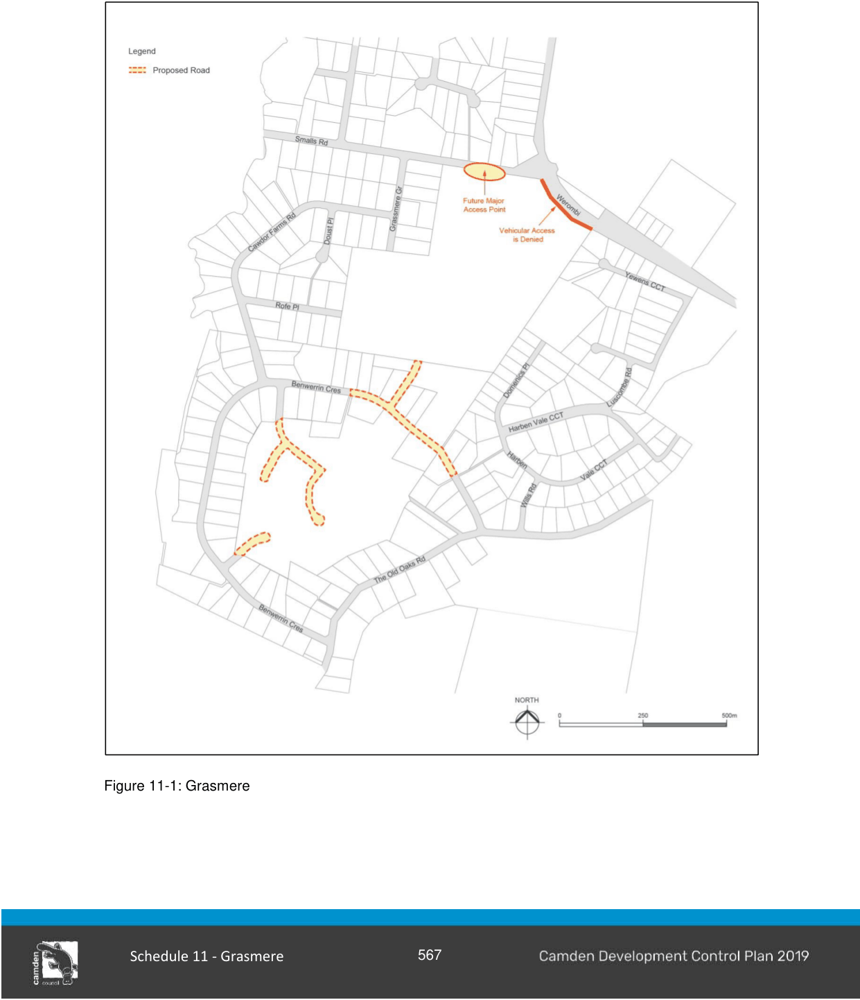
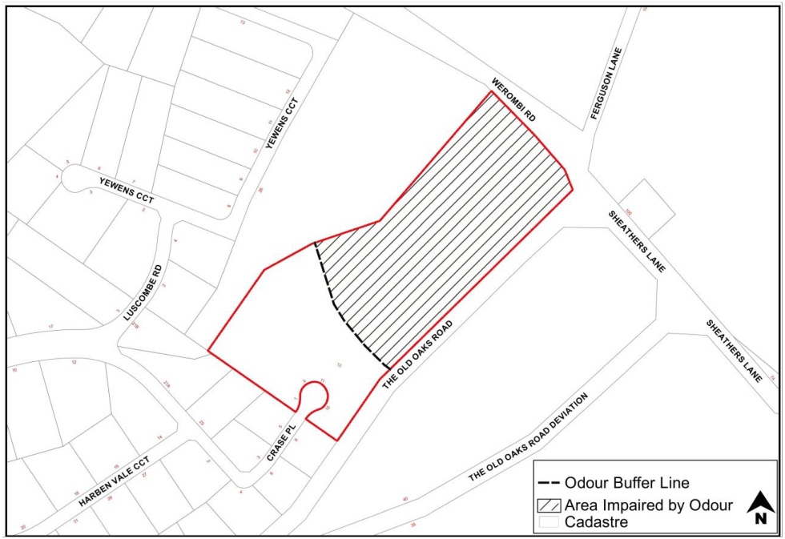

### S11.2 Subdivision Planning and Design

#### Objectives

a. Ensure that the subdivision and local road layout provides for safe vehicular and pedestrian management, whilst providing a clear hierarchy, with design and construction standards applicable to a rural residential development as indicated in Figure 11-1.

b. Ensure the supply of town water by the developer to all lots up to a ground level of approximately RL110m AHD (subject to investigation and determination by Sydney Water).

c. Be responsive to the variable terrain and ensure reasonable privacy and/or view sharing.

#### Controls

1\. With the exception of land within the Harben Vale Estate, all structures must have a minimum 20m building setback from the front boundary, excepting those fronting two roads whereby the setbacks to the secondary road must be a minimum 5m.

2\. All structures must have a side boundary setback of a minimum 5m.

3\. No outbuilding/structure must be erected with a ridge height in excess of 4.5m above natural ground level.

4\. All structures must have a minimum 8m building setback from the front boundary of any lot having frontage to The Old Oaks Road, Smalls Road or Werombi Road.

5\. Each new allotment created must provide a satisfactory building envelope for the erection of a dwelling and outbuildings, having regard to the requirements of service provision, boundary setbacks, flood line, on-site effluent disposal and the height limitation.

6\. The paved carriageway must be designed to create an edged road muster with grass up to the bitumen edge and prevent edge breakdown as well as ensure water is satisfactorily drained away from the road.

7\. Pathways must be provided with a minimum paved width of 2.5m and a minimum 10m reservation, as generally shown on the plan adjacent to Sickles Creek.  Other pathways must have a minimum reservation width of 4m.

8\. Town water supply will be provided by the developer to all lots up to a level of approximately RL110m AHD.  The exact ground level will be determined by Sydney Water and must be ascertained and documented with the development application by the applicant.

9\. As the provision of a town water supply to lots above RL110 AHD is likely to require the major amplification of existing water mains and/or the installation of booster pumps, each dwelling erected on such lots is to be provided with a domestic water supply by a water storage tank of 23,000 litres minimum capacity.

Note:  A restriction as to user is to be placed on the title of each lot (section 88B Instrument) above RL110m AHD that is not serviced by a town water supply. This must indicate that the owner of the lot will be responsible for the provision of a domestic water supply as detailed in control

(8) above. Also, that the owner will be responsible for all costs associated with the provision of a mains water supply if/when the mains water supply becomes available

> [Picture on page 5: a picture, saved as a picture (images/schedule-11-grasmere-page-5-6.gif, 150 dpi).]

Figure 11-1: Grasmere

#### S11.2.1

#### Crase Place, Grasmere

This subsection applies to the land marked in red on Figure 11-2 below:

> [Picture on page 6: a picture, saved as a picture (images/schedule-11-grasmere-page-6-4.gif, 150 dpi).]

Figure 11-2: Odour Buffer Line

Notes:

1\. A restriction as to user is to be placed on the lot containing the hatched area as shown on Figure 11-2 to indicate that no dwellings are to be constructed due to odour impact from the West Camden Water Recycling Plant.

2\. A restriction as to user is to be placed on all lots highlighted in red in Figure 11-2 to indicate that these lots are in close proximity to the West Camden Water Recycling Plant.

