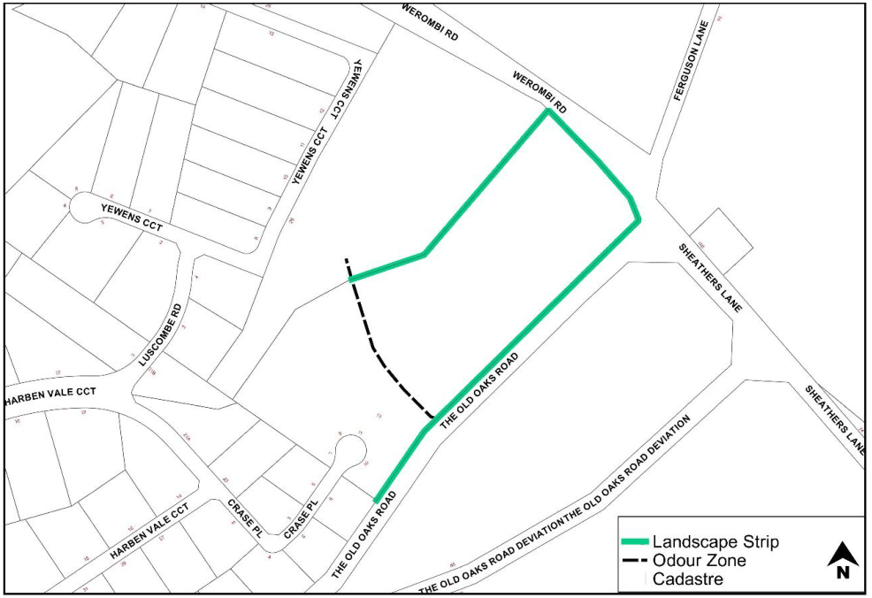

### S11.4 Site Specific Residential Controls

Note: The controls listed below are specific parts of Grasmere. They must be read in conjunction with the controls in Part 4 of this DCP. In the event of any inconsistency, the controls below prevail.

#### Objective

a. To ensure residential and associated development is designed and located to blend in with the rural residential backdrop, when viewed from the important view corridors including the vehicle entrance to Carrington hospital on the corner of Werombi and Smalls Road.

b. Maintain consistency with existing adjoining development.

#### Controls

1\. Native screen landscaping, incorporating trees and shrubs, must be planted along the area marked green in Figure 11-3 to screen development.

2\. Building materials and colours (of dwellings, outbuildings and hard landscaping) are to be restricted to recessive, mid-dark earth tones to blend in with the rural setting. White, cream, red, terracotta, or contrasting and reflective colours are not acceptable. Uncoloured or light concrete driveways are not acceptable.

3\. All structures must have a front boundary setback of 12m

> [Picture on page 9: a picture, saved as a picture (images/schedule-11-grasmere-page-9-1.gif, 150 dpi).]

Figure 11-3: Crase Place, Grasmere

#### - End of Schedule –

