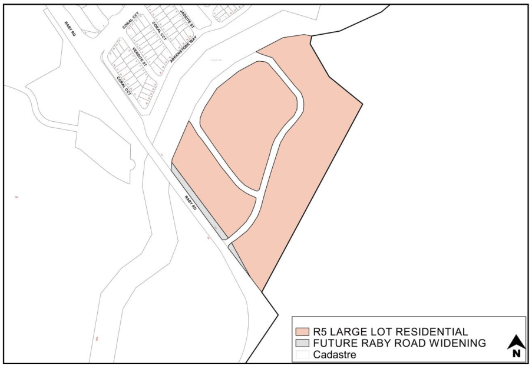
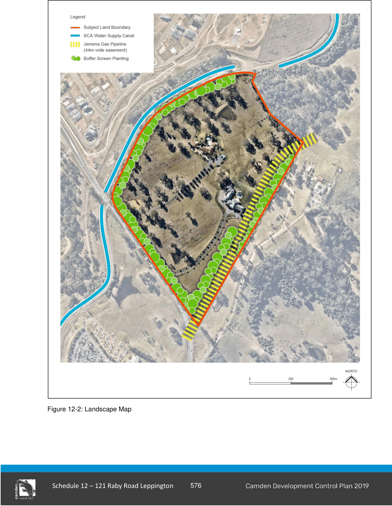

### S12.1 Introduction

#### Raby Road, Leppington

This section applies to the land marked in red in Figure 12-1.

> [Picture on page 3: a picture, saved as a picture (images/schedule-12-121-raby-road-leppington-page-3-5.gif, 150 dpi).]

Figure 12-1: Land to which this Schedule applies

#### Objectives

a. To ensure the development does not pose an adverse impact on sensitive landscape areas such as the Scenic Hills, the settings of heritage items or heritage conservation areas or other places of heritage significance.

b. Minimise opportunity for light spill from infrastructure in the public domain.

c. To prohibit development on land subject to future road widening of Raby Road.

#### Controls

1\. A 10m wide (minimum) vegetated buffer screen incorporating upper, middle and lower canopy plantings from the Cumberland Plain Woodland vegetation community must be planted in the locations shown in Figure 12-2 to achieve a natural visual buffer as recommended in the Landscape and Visual Analysis Reports (Distinctive Living Design, JMD Design, Musescape) and Flora and Fauna Assessment (Lesryk Environmental Consultants).  A Vegetation Management Plan (VMP) is to be submitted with the first DA.

a. The VMP is to specify the necessary buffer screen plantings and ongoing maintenance.

b. Areas of native landscaping buffer screen are to be fenced off and protected when earthworks and civil works are being carried out in proximity.

c. A covenant MUST be registered on the title of the lots requiring compliance with the VMP.

d. Planting works as per the VMP must be completed prior to the release of the Subdivision Certificate for the relevant lots.

2\. Street lights must have hoods or other appropriate design treatment (e.g. use of low glare street light luminaires) to minimise light spill in order to reduce ambient light haze as much as possible.

3\. A Section 88B instrument must be placed on the lots containing the hatched area in Figure 12-2 to indicate that development for the purposes of any permanent structure must not be undertaken to accommodate for future road purposes.

> [Picture on page 5: a picture, saved as a picture (images/schedule-12-121-raby-road-leppington-page-5-1.gif, 150 dpi).]
> Words printed on the picture (copied from the PDF):
> SUBJECT SITE

Figure 12-2: Landscape Map

